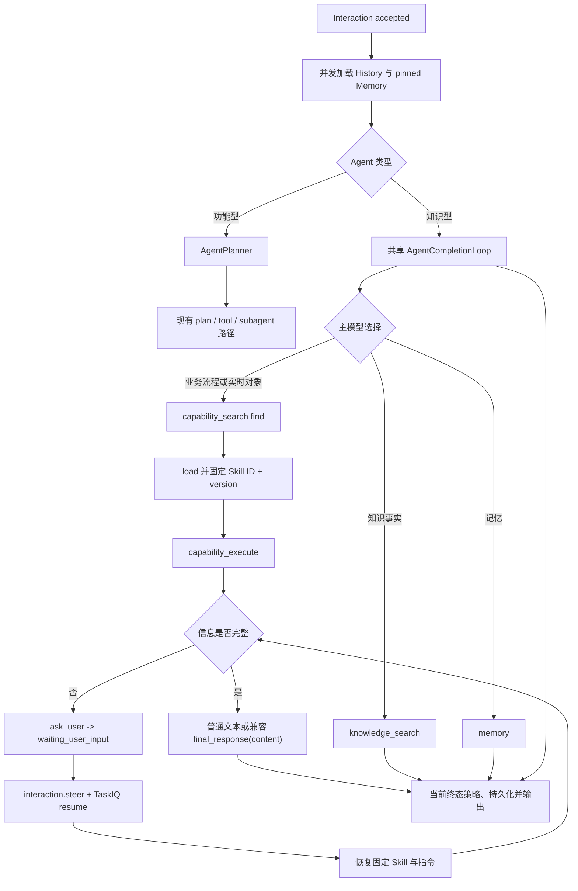

# Agent Runtime 统一 Loop 实施方案

> 状态：知识型统一 Loop 已实施；功能型 Planner 保持不变
> 日期：2026-07-20

> 范围说明：本文记录统一 Loop 的既有基线。`SkillContextV1` 已按
> [多能力编排方案](multi-capability-orchestration-design.md) 的 Slice B 实施；Subagent continuation 等后续工作只按
> [配套 Checklist](multi-capability-orchestration-checklist.md) 推进，本文不再作为这些 Slice 的设计依据。

## 1. 决策

知识型 Agent 不再使用额外的 `KnowledgeIntentAnalyzer`，也不再把最多 6 个绑定 Skill/MCP 候选预塞给一个前置模型。
History、受限 pinned Memory 和当前输入直接进入共享 `AgentCompletionLoop`，由同一次主模型推理按需选择：

- `knowledge_search`：查询当前 Agent 已授权的知识空间；
- `memory`：在当前 tenant、Agent、Actor、conversation 可见范围内按需召回；
- `capability_search` / `capability_execute`：发现并使用管理员显式绑定的 Skill 或 MCP Tool；
- `ask_user`：Root WebSocket 回合缺少信息、选择或确认时进入可恢复等待态；
- `final_response(content)`：活动 Skill 的兼容结构化终态；普通无 Tool Call 文本同样可以完成；
- `time`、`math`、`todo`：继续使用现有受限内建工具。

这减少一次路由模型调用，但不把安全策略交给模型。Runtime 继续拥有租户隔离、Agent binding、工具 allowlist、
Tool 专属参数校验、Tool Policy、审批、预算、重复调用防护、租约和 TaskIQ 恢复。当前功能型
`capability_lookup` 仍有“至少一次 Observation”的旧终止门；这是已实施事实，不是下一阶段目标语义。

## 2. 当前执行闭环



简单且无需工具的知识型回答只进行一次模型调用。需要工具时，后续模型调用是同一 Loop 的标准 Tool continuation，
不再额外存在“先判断 route、再执行主模型”的调用。

### 2.1 与 OpenClaw 的边界

OpenClaw 将同一飞书会话稳定映射到 `sessionKey`，每个模型回合的 user/assistant/tool 消息都写入同一份持久
transcript，并按 session 串行执行。因此普通 assistant 文本即使只是追问，也可以结束当前回合；用户下一条消息仍会在
同一 session transcript 上继续。参见 OpenClaw 的 [Agent loop](https://docs.openclaw.ai/agent-loop) 与
[Session management](https://docs.openclaw.ai/session)。

Parrot 的业务流程检查点是 interaction 级，不能把活动 Skill 隐式延长到任意后续 interaction，否则会误续接已经完成或
无关的流程。`ask_user` 与 `final_response(content)` 是结构化等待/完成快速路径，但不是 Provider 必须满足的输出格式：
模型正常返回文本时直接完成当前 interaction，用户后续消息通过同会话原生 History 保持连贯。Runtime 不为改变输出形态
追加一次模型调用，也不使用 `tool_choice=required` 强迫终止工具。

## 3. 知识与能力选择规则

- 规则、流程、政策、原因、说明等需要内部依据时使用 `knowledge_search`。
- 查询明确工单、订单、酒店预订、外部系统、实时状态或执行实际业务动作时，使用完整用户请求执行
  `capability_search(action=find)`。
- `find` 返回的候选已经通过服务端授权、启用状态、scope 和最低相关度过滤，但仍是建议集合，不是必执行合同。模型可根据
  当前请求判断是否 `load`；Runtime 不能把“召回非空”解释成“任意候选必须执行”。真正必须执行的业务动作应由服务端
  应用服务或高层业务 Tool 拥有，不能只写在 Skill 自然语言中。
- 当前功能型 Planner 产生 `capability_lookup` 后，旧终止策略仍要求至少一次 Tool Observation；该行为由新原则清单 L-01
  移除，不能继续扩展成通用 Requirement 或业务成功证明。
- Skill 必须遵循 `find_and_load`（或 `find` → `load`）再 `capability_execute`；模型不能直接使用未绑定 ID。
- instruction-only Skill 的 `capability_execute` 只把已发布说明返回模型，不启动沙盒，也不能被描述为外部动作已完成。
- Knowledge Agent 仍拒绝可执行 Skill、stdio MCP 和没有启用服务端 Tool Policy 的 MCP Tool。`read + automatic` 可
  自动执行；`approval=required` 只向 Root WebSocket 暴露并进入持久化审批，非交互入口只发现自动只读 Tool。
- `no_results` 表示当前授权范围内没有结果；`unavailable` 只表示检索暂时不可用，两者不得混写。

管理台召回验证只证明 ranker 返回候选。它不调用 LLM、不加载 Skill、不执行 Skill/MCP，也不能证明完整流程成功。

## 4. 当前活动 Skill 检查点基线（待按 scoped 方案替换）

首次成功 `load` instruction-only Skill 时，Runtime 使用 interaction 行锁在 tenant-private `input_payload.active_skill`
写入：

```json
{
  "skill_id": "skill_hotel",
  "skill_version": 3
}
```

规则：

1. 同一 interaction 只能固定一个 Skill 版本；重复固定相同值幂等。
2. 固定后，`find` 只返回当前 Skill，加载或执行其他 Skill 返回 `ACTIVE_SKILL_CONFLICT`。
3. 活动 Skill 后续请求沿用 OpenAI-compatible 默认工具选择，不发送 `tool_choice=required`。模型调用 `ask_user` 时保持
   当前 interaction 并等待恢复；调用 `final_response(content)` 或返回普通文本时直接交付。普通文本是兼容终态，不再触发
   一次只为改变输出格式的纠正请求。
4. `interaction.steer` 提交后，worker 从 PostgreSQL profile snapshot 与活动检查点恢复 Skill 指令和已加载状态；不重新召回。
5. 检查点版本不存在或与 snapshot 不一致时以 `partial` 失败闭合，不静默升级或切换 Skill。
6. interaction 到达完成、部分完成、失败或取消终态后，该检查点随 interaction 生命周期保留用于审计，不跨 interaction 复用。

本地 Durable Runtime 在 accepted 阶段只持久化 execution ID，不写入零秒占位租约。首次 TaskIQ Worker claim 才创建
执行租约；否则“提交后立即消费”会在数据库时间精度窗口内被误判为租约未过期，消息已确认但 interaction 永久停留在
accepted。需要真实远端恢复租约的 Runtime 仍可显式返回正数 `recovery_lease_seconds`。

检查点只保存 ID 和版本，不保存凭证、外部参数或完整模型输出；tenant predicate 与 PostgreSQL RLS 继续同时生效。

## 5. `ask_user` 与恢复

`ask_user(question)` 只向 `runtime_depth=0` 且 `entry_type=websocket` 的 Root Loop 暴露。它写入
`ai.output.completed(runtime_status=waiting_user_input)`。所有者发送 `interaction.steer` 后，服务端持久化真实用户消息，
将 interaction 恢复为 `accepted`，事务提交后直接投递 TaskIQ。schedule、subagent 和其他非交互入口不暴露该工具。

活动 Skill 恢复会在最新用户补充之前重建一组私有、标准的 `assistant tool_call + tool result` 消息，并额外声明固定
Skill 的 ID 与版本。该内容只进入 Provider 请求和受限诊断，不进入公开 WebSocket 工具事件。

恢复上下文以 `control_after_sequence` 为边界，从 `conversation_messages` 读取当前 interaction 已持久化的全部
user/assistant 轮次，再追加本次 `interaction.steer` 消息。这样第二次及后续追问不会退化成“原始请求 + 最后一问 +
最新回答”，也不会重复已经写入历史 interaction 的消息。查询必须同时携带 tenant、Agent、Actor、conversation 和
interaction 条件。

新 interaction 会从同一 tenant、Agent、Actor、conversation 的近期已持久化消息中恢复跨 interaction 上下文。
Prompt Compiler 保留每条消息的原生 `user/assistant` role，并在历史正文前添加由服务端生成的
`historical_message` header；`occurred_at` 来自 `conversation_messages.created_at`。历史条数和 Token 预算继续使用
Runtime 配置，当前请求保持为独立、未标记的 user message。该路径不增加前置 LLM 调用。

兼容的 `final_response`：空参数进入无工具 Final Renderer（唯一作答轮，可真流式）；带 `content` 或普通
文本在完成门通过后按候选一次交付。Runtime 不为流式重写已有正文，也不回放已缓存的 Loop delta。

## 6. 实施检查表

- [x] 知识型简单问题跳过前置 Planner，保留一轮模型快速路径。
- [x] `ask_user` 提供结构化等待；活动 Skill 的 `final_response` 与普通文本都可结束当前回合。
- [x] 通用 Agent Loop 不发送 `tool_choice=required`，思考模型与普通模型统一使用 Provider 默认工具选择。
- [x] 兼容的 `final_response(content)` 不增加总结模型调用，普通文本也不增加格式修复轮。
- [x] 能力候选保持 advisory；当前 `capability_lookup` Observation 门仅作为待移除的旧实现事实记录。
- [x] 流式 Provider 错误先读取响应体再分类，不以 `ResponseNotRead` 覆盖真实错误。
- [x] 本地 Durable accepted 状态不再创建零秒占位租约，TaskIQ Worker 是首个 lease owner。
- [x] `ask_user` 进入 `waiting_user_input`，用户回复恢复同一 interaction。
- [x] 多次询问恢复当前 interaction 的完整 user/assistant transcript。
- [x] 新 interaction 按原生 user/assistant role 恢复同会话近期历史，并保留绝对发生时间。
- [x] 固定 Skill ID 与版本，不跨 interaction 隐式继承。
- [x] 功能型 Agent Planner 和普通直接文本终止路径保持不变。

## 7. 验收

必须覆盖：

- 知识型简单回答只有一个主 Loop 模型调用，且不存在默认候选目录；
- `knowledge_search` 在共享 Loop 中返回授权证据；
- `ask_user` 产生 `waiting_user_input`，非交互入口不暴露该工具；
- 活动 Skill 的普通文本直接完成；只有需要在同一 interaction 恢复时才调用 `ask_user`；
- 普通模型和 thinking 模型的通用 Loop 都使用 Provider 默认 Tool Choice，不产生 `required/fallback` 修复轮；
- `load` 持久化 `skill_id + version`，相同值幂等，不同 Skill 冲突；
- `steer` 恢复后包含同一 Skill 指令和当前 interaction 的全部已确认问答，不再召回；
- profile 中缺失固定版本时失败闭合；
- Knowledge Agent 的 executable Skill、MCP Tool Policy、tenant 和 binding 安全回归继续通过；
- direct、Tool Loop、TaskBoard、审批和 finalization 的既有测试不回退。

定向命令：

```bash
cd backend
./.venv/bin/pytest -q \
  tests/test_knowledge_unified_loop.py \
  tests/test_knowledge_agent_runtime.py \
  tests/test_knowledge_agent_capabilities.py \
  tests/test_active_skill_checkpoint.py \
  tests/test_durable_agent_runtime.py
```
