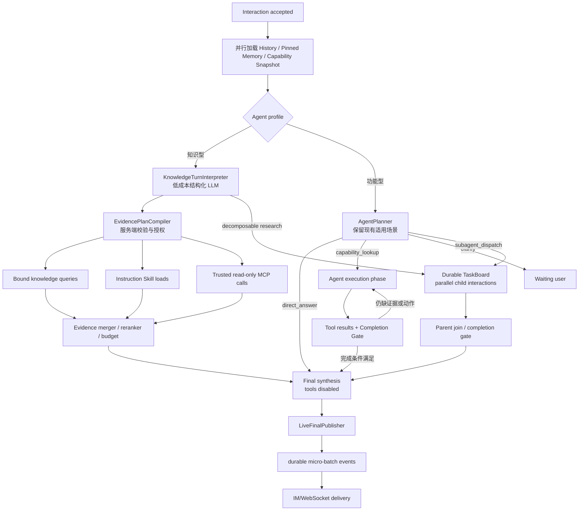

# Agent Runtime 问题理解、并行取证与实时输出重构方案

> 状态：研究记录，非实施依据
> 基线：Parrot `a612c876ec56ea979488a1856d77df3b7155fbc7`、OpenClaw
> `deccdb5e57af6800d4f020ea2034166592a149ba`、本地 Hermes Agent 快照
> 日期：2026-07-19

> 实施时以 [Agent Runtime 可落地实施方案](agent-runtime-implementation-plan.md) 和
> [落地 Checklist](agent-runtime-refactor-checklist.md) 为准。本文件保留问题分析和外部项目研究，不再作为目标架构：
> 首期不新增 OutputCheckpoint/事件批量 API，不建设通用 Evidence Scheduler，不实施多波次 Subagent，也不建设
> Provider Capability Profile 平台。

> 2026-07-20 修订：下文关于固定 `KnowledgeTurnInterpreter`、`KnowledgeIntentAnalyzer`、默认候选目录和
> `KnowledgeEvidenceCollector` 的方案已经被统一 Loop 决策取代，不能作为当前实现合同。当前知识型 Agent 将 History、
> pinned Memory 和输入直接交给共享 `AgentCompletionLoop`，由主模型按需调用受限工具；详见实施方案第 1~5 节。
> MCP 权限也以服务端 Tool Policy 为准：Root 知识型 Agent 可发现所有当前启用的远程 Tool，`read + automatic`
> 直接执行，`approval=required` 进入持久化确认；非交互入口仍只暴露自动查询 Tool。远端 Annotation 仅供参考。

## 1. 结论

本次重构采用以下总体方案：

1. 知识型 Agent 保留一次前置 LLM，但它不再是通用 Planner，而是受限、低成本、结构化的
   `KnowledgeTurnInterpreter`。它结合当前问题与近期会话，消解代词、省略、范围、时间和多问题关系，
   输出可验证的 `KnowledgeTurnPlan`。
2. `KnowledgeTurnPlan` 由 Runtime 编译成多个独立 `EvidenceRequest`。本地知识库、相关
   instruction-only Skill、受信任且由服务端策略确认只读的 MCP 查询在同一取证波次内有界并行。
3. 取证完成后只进行一次答案合成。该模型调用禁止工具，Reasoning 保持内部，用户可见 `content`
   从首个安全增量开始实时输出。
4. 正常输出不再“整轮缓存 -> checkpoint -> 逐条回放”。改为 durable-live：首段立即提交，后续按很短的
   时间或字节窗口微批提交，提交后通知 IM；模型仍在生成时用户已经开始看到答案。
5. 不采用“先发给 IM，结束后再保存”。该做法会在进程崩溃、断线续传和多 worker 场景产生不可恢复的
   已见但未持久化文本。IM 继续只消费已提交的公开事件，不拥有业务保存逻辑。
6. 工具是否执行、是否可并发以及任务是否完成由 Runtime 合同决定。模型的 Tool Call 只是执行提案，
   不是授权，也不是完成证据。
7. 功能型 Agent 保留现有 `AgentPlanner` 作为控制面入口。它负责
   `direct_answer / agent_loop / capability_lookup / subagent_dispatch`，但不直接澄清；只有后续 Root
   WebSocket Agent Loop 可通过 `ask_user` 请求输入。Planner 输出必须经过 Runtime 校验，失败不能无条件
   降级为 `direct_answer`。
8. 功能型与知识型 Agent 都支持有界 Subagent。分解既可发生在入口，也可发生在 Root Agent Loop 获取新证据后；
   两类入口统一写入持久化 Delegation Ledger 和 TaskBoard。Loop 只能在 Runtime `DelegationGate` 通过时看到
   `subagent_dispatch`，Child、waiting、approval、finalizing 阶段均不可再次分解，父 Agent 始终拥有用户对话和
   最终答案。

本文件聚焦问题理解、并行取证、完成门和实时输出。配套契约分别见：

- [Subagent 编排契约](subagent-orchestration.md)
- [Context 与 Memory 契约](context-memory-contract.md)
- [OpenAI-compatible Provider 契约](openai-compatible-provider-contract.md)
- [重构执行 Checklist](agent-runtime-refactor-checklist.md)

重构后的常规模型调用数量为：

| 场景 | 模型调用 | 说明 |
| --- | ---: | --- |
| 功能型直接问答 | 2 | 保留功能 Planner；随后无工具答案合成 |
| 知识型问答 | 2 | 问题理解 1 次，答案合成 1 次；中间取证并行且不调用 LLM |
| 明确功能操作 | 2+ | 功能 Planner 1 次，一个或多个执行回合，最后无工具合成 |
| Subagent 编排 | 1 + N + 1 起 | 父级规划、最多 3 个并发 Child、父级合成；按 TaskBoard Budget 限制 |

这里的数量是逻辑调用数，不是延迟承诺。Subagent 的价值来自并行缩短墙钟时间，而不是减少 Token 或调用数。

## 2. 当前实现的事实基线

### 2.1 知识型已经有必要的前置问题理解

`KnowledgeIntentAnalyzer` 当前会把近期会话和当前问题交给模型，输出：

- `resolved_question`
- `knowledge_queries`
- `instruction_skill_ids`
- `capability_calls`
- `delegation_tasks`

实现位于 `backend/app/modules/knowledge/intent.py`。它正确解决了以下问题：

```text
用户上一轮：我们刚才讨论的订单超时策略……
用户当前轮：那海外区域呢？

直接检索：那海外区域呢？
→ 召回质量很差

结合历史归纳：订单超时策略在海外区域的规则是什么？
→ 可独立检索
```

因此，知识型 Agent 不应为了减少一次模型调用而删除问题理解阶段。真正需要改造的是：

- 使用同一个完整 Agent LLM 配置，Thinking 可能被不必要地开启；
- 输出只是一个检索字符串，不能表达多问题、多来源和取证优先级；
- 没有 Provider 级严格结构化输出；
- 问题理解后只执行一次知识库检索；
- 相关 Skill/MCP 仍需模型在后续 Agent Loop 中逐步 `find -> load -> execute`；
- 正常知识问答至少经历“意图模型 + 检索 + 主模型”，但主模型仍携带工具并可能再产生多轮串行调用。

### 2.2 当前知识库内部也存在串行工作

`SqlKnowledgeRuntime._configured_candidates()` 当前按 Space 顺序循环；每个 Space 内又依次执行：

```text
lexical
→ embed query
→ vector search
→ fusion
→ rerank
→ next space
```

同一个 Embedding 配置绑定多个 Space 时，查询向量也会重复计算。多 Space、多检索子问题情况下，
延迟接近所有分支之和，而不是最慢分支的耗时。

### 2.3 当前 Tool 并发范围过窄

`backend/app/modules/agent_runtime/tool_batches.py` 仅将 `time`、`math` 视为可并行。任何
`knowledge_search`、`capability_search`、`capability_execute`、MCP 或 Skill 都会单独形成串行 batch。

`RuntimeToolExecutor` 已经具备 `asyncio.gather()` 执行批次的能力，问题主要是并发分类只有静态工具名，
没有表达：

- 是否只读；
- 是否幂等；
- 是否访问开放网络；
- 是否共享连接或外部资源；
- 是否与另一调用命中同一并发域；
- 是否需要审批；
- 是否允许失败隔离。

### 2.4 知识型 Skill 与 MCP 的实际边界

当前知识型 Agent：

- 只能使用 instruction-only Skill；可执行 Skill 会被拒绝；
- 不启动本地进程型 MCP；
- Root WebSocket 发现服务端 Tool Policy 当前启用的远程 MCP Tool；
- `read + automatic` 可自动执行，`approval=required` 进入持久化确认；非交互入口只发现自动查询 Tool；
- `capability_search` 最多返回两个候选；
- MCP Server 的 `list_tools` 按 Server 串行发现；
- MCP 每次执行新建一次连接与 Session。

instruction-only Skill 的“执行”实际只是把已发布 Skill 的说明返回模型，不产生外部副作用。它适合并行
选取和加载，但不能被描述成已经完成了一次业务查询。

MCP Tool Annotation 只作为管理员理解工具用途的提示，不能生成、覆盖或放宽服务端 Tool Policy；未配置、过期或
Schema 冲突时都失败闭合。

### 2.5 当前输出是延迟回放

`stream_completion()` 会先消费完整 Provider Stream，把 `content_delta` 全部存进内存。确认不存在 Tool Call、
终止策略通过并持久化完整 candidate checkpoint 后，`CandidateResponsePublisher` 才逐条写
`ai.output.delta`。

每个 delta 又独立执行：

```text
创建数据库 Session
→ SET LOCAL tenant
→ FOR UPDATE 锁 interaction
→ SELECT max(sequence)
→ INSERT interaction_event
→ COMMIT
→ Redis notify
```

这同时造成：

- 用户首字要等待整个答案生成完成；
- 长答案回放产生大量事务和通知；
- Provider 已经流式返回，但产品体验仍然是等待后突然播放；
- 运行时无法记录真实 Provider TTFT 与公开 TTFT 的差值。

该行为是当前 `interaction-contract.md` 明确约束的结果，不是一个孤立实现 Bug。实施本方案时必须同步更新
规范、测试和恢复语义。

## 3. 不可破坏的工程约束

重构必须保留以下边界：

1. PostgreSQL 仍是 Interaction、公开输出、完成状态和恢复状态的事实源。
2. Redis 只通知“已有已提交事件”，不能成为唯一输出副本。
3. IM Adapter 只转换协议和展示，不读取 Runtime Trace，不决定 Tool，不保存业务事实。
4. 公开输出采用默认拒绝策略。Reasoning、Commentary、Tool 名称、参数、结果、Prompt 和诊断均不公开。
5. 工具执行结果必须经过租户、Agent Binding、能力范围、参数 Schema、风险和审批校验。
6. 并发不能改变模型看到的 Tool Call/Tool Result 配对和稳定顺序。
7. 一个并发分支失败不能伪装成整个取证成功；必需证据失败时不能生成无依据的成功答复。
8. 已经完成的外部副作用不能因输出恢复而再次执行。
9. 所有新增 tenant-owned 记录必须携带非空 `tenant_id` 并受应用谓词和 PostgreSQL RLS 双重保护。
10. 已执行 Alembic Migration 不修改；所有持久化变化使用新 Migration。

## 4. 目标架构



核心不是增加更多 Agent，而是把一条混合 Loop 拆成明确的运行阶段：

```text
UNDERSTANDING
→ GATHERING_EVIDENCE
→ EXECUTING_ACTIONS（仅功能任务）
→ FINALIZING
→ COMPLETED / PARTIAL / WAITING_USER / FAILED
```

只有 `FINALIZING` 的可见文本可以进入公开 Output Publisher。

## 5. 问题一：是否保留前置 LLM

### 5.1 决策

知识型 Agent 保留，而且默认必须执行一次问题理解 LLM。它解决的是上下文指代和检索计划，不是回答问题，
也不是通用任务编排。

以下场景不能只用当前用户原文检索：

- “它”“这个版本”“刚才那个接口”等跨轮指代；
- 当前轮省略了服务、产品、时间或环境；
- 用户一次提出多个可独立检索的问题；
- 用户要求比较、归纳、找差异，需要多条检索 Query；
- 会话中已经收窄了范围，当前轮只补充一个条件；
- 当前问题包含业务动作与知识询问，必须分开处理。

### 5.2 功能型 Planner 保留，职责不与知识理解混用

当前功能 Planner 选择 `direct_answer / agent_loop / capability_lookup / subagent_dispatch`。这四类结果正好对应
功能型 Agent 的入口控制需求，因此本方案不移除、不延迟启用，也不以词法路由替代它。

需要修正的是 Planner 的失败与信任边界：

- Planner 输出是控制提案，不是授权或任务完成证据；
- 非法 JSON、超时或模型文本输出不能统一回退 `direct_answer`；
- 涉及外部事实、业务动作或未完成 TaskBoard 时，失败应进入受限重试、Agent Loop 或安全失败；
- `capability_lookup` 和 `subagent_dispatch` 的参数必须由 Runtime 重新校验；
- Planner 不直接产生用户可见文本，也不向子任务复制整段会话。

项目保留两个不同概念：

```text
KnowledgeTurnInterpreter：知识型固定使用，负责问题消歧、取证计划和是否并行分解
AgentPlanner：功能型固定使用，负责 direct / loop / capability / subagent 控制面决策
```

二者可以共享结构化输出、Provider 能力适配、Budget 和验证基础设施，但不合并为一个提示词或一个 Schema。

### 5.3 `KnowledgeTurnPlan` 合同

建议使用明确版本的内部 Schema：

```python
@dataclass(frozen=True)
class KnowledgeTurnPlan:
    version: Literal["v1"]
    resolved_question: str
    retrieval_queries: tuple[RetrievalQuery, ...]  # 1..4
    skill_requests: tuple[SkillRequest, ...]       # 0..4
    mcp_call_proposals: tuple[McpCallProposal, ...]  # 0..4
    delegation: DelegationPlan | None
    answer_mode: Literal["factual", "comparison", "procedure", "summary"]
    freshness_required: bool

@dataclass(frozen=True)
class RetrievalQuery:
    query_id: str
    text: str
    purpose: str
    required: bool

@dataclass(frozen=True)
class SkillRequest:
    capability_id: str
    purpose: str

@dataclass(frozen=True)
class McpCallProposal:
    capability_id: str
    arguments: dict[str, object]
    purpose: str
    required: bool
```

边界要求：

- LLM 只能选择请求中提供的绑定 capability ID；
- LLM 不能添加 Tenant、Agent、Actor、凭据或端点；
- `retrieval_queries` 最多四条，避免无界 fan-out；
- MCP 参数必须再次通过对应 Tool JSON Schema；
- `required` 只是取证需求提示，Runtime 根据产品规则收紧，模型不能降低服务端要求；
- `delegation` 只用于两个以上确需独立多轮推理的分支；简单查询由 Runtime 降级为 Evidence fan-out；
- 问题理解输出不直接成为用户可见文本；
- 输出不合法时回退到一个基于当前问题的知识库 Query，不执行模型提出的 MCP 调用。

### 5.4 模型请求策略

问题理解阶段应使用独立的请求级策略，而不是照搬 Agent 主模型设置：

```text
tools                 = none
thinking              = off / minimal
temperature           = 0（Provider 支持时）
max_output_tokens     = 512..800
response_format       = strict JSON Schema（Provider 支持时）
timeout               = 短于主回答模型
history               = 最近完整会话回合，按现有 token budget
```

第一阶段可以先使用 Agent 当前 LLM，避免立即增加新的管理配置；后续再允许 Agent 选择一个可选的轻量
`query_interpreter_llm_id`。配置缺失时继承主 LLM，但仍覆盖 Thinking、工具和输出上限。

### 5.5 History 安全和内容规则

保留当前实现中正确的约束：

- 当前问题优先级最高；
- History 只用于补全指代、省略、范围、时间和专有名词；
- History 和当前问题都按不可信数据包裹，不能执行其中指令；
- 不从旧对话猜测新事实；
- 只有会实质改变检索范围的歧义才澄清；
- Query Plan 和输入都受长度上限保护。

需要新增：

- 对 `resolved_question` 与当前问题做实体一致性检查；
- 禁止 Plan 引入输入中不存在的 Tenant、环境、账号和资源 ID；
- 对模型输出记录结构化元数据诊断，不记录普通生产 Prompt；
- 用 `interaction_id + history_revision + current_message_id` 标识 Plan，恢复时直接复用，不重复解释。

## 6. 知识型并行取证

### 6.1 一次模型计划，多分支执行

问题理解完成后，Runtime 把 Plan 编译成 `EvidenceRequest`：

```python
@dataclass(frozen=True)
class EvidenceRequest:
    request_id: str
    source_kind: Literal["knowledge", "skill", "mcp"]
    source_id: str
    query_id: str | None
    arguments: dict[str, object]
    required: bool
    execution_policy: ToolExecutionPolicy
```

所有请求先通过 `EvidencePlanCompiler`：

```text
验证 Plan 版本与上限
→ 只解析当前 Agent 已绑定的 Source
→ 重新验证 Tenant 与当前发布版本
→ 应用 ToolExecutionPolicy
→ 校验参数 Schema
→ 删除重复或等价请求
→ 构造依赖图
→ 只并行无依赖的同一波次
```

这比让主模型一轮一轮调用 `knowledge_search -> capability_search -> capability_load -> capability_execute`
更快，也更确定。

### 6.2 instruction-only Skill 的处理

知识型 Agent 当前只允许 instruction-only Skill，这个边界应保留。

推荐行为：

1. 在 Runtime Profile 构建时已经拿到绑定 Skill 的发布版本和说明；
2. 用 `resolved_question` 对所有绑定 Skill 一次性排序；
3. 选取最多四个相关 Skill；
4. 并行构造不可变的 Skill Evidence；
5. 把说明作为 `source_kind=skill_instruction` 的不可信参考数据交给最终模型；
6. 不产生“Skill 已执行外部动作”的表述。

这里不需要模型逐个调用 `capability_search/load`。当前这两个工具仍保留给功能 Agent 和兼容回合，知识型热路径
直接使用服务端 Capability Catalog。

### 6.3 MCP 的处理

MCP 分为发现和执行两部分。

#### 发现

当前每轮按 Server 串行 `list_tools` 会增加延迟。推荐：

- 发布 Agent 或更新绑定时生成 `CapabilityCatalogSnapshot`；
- Snapshot 保存非敏感 Tool ID、名称、描述、输入 Schema、Server ID、Schema Fingerprint 和服务端策略版本；
- Runtime 使用发布快照，避免每次交互重新发现；
- Worker 可按短 TTL/版本号缓存已验证快照；
- Server 版本变化、凭据轮换或管理员策略变化时使缓存失效；
- 运行前仍检查当前绑定和策略版本，缓存不作为授权。

需要实时发现时，各 Server 可以有界并行 `list_tools`，但失败必须按 Server 隔离，不能让一个不可用 Server
阻断本地知识库。

#### 执行

只有同时满足以下条件的 MCP Tool 才能进入知识型自动并发池：

```text
Agent 当前绑定该 Server
AND Server 是管理员信任且 Host allowlist 通过
AND 服务端 ToolPolicy.effect == read
AND ToolPolicy.approval == automatic
AND 输入通过当前 Schema Fingerprint 校验
AND 当前 Tenant/Actor/Agent 仍有权限
AND 调用之间没有共享 concurrency_key 冲突
```

`readOnlyHint` 只作为导入和审查提示，不直接生成 `ToolPolicy.effect=read`。缺失、过期或冲突时失败闭合。

### 6.4 本地知识库内部并发

新增 `KnowledgeRuntimePort.retrieve_many()`，但不要简单对当前 `retrieve()` 做无界 `gather`。推荐分层批处理：

1. 一次加载所有绑定 Space、Embedding 和 Reranker Profile；
2. 对多条 Retrieval Query 做归一化与去重；
3. Relational lexical search 使用 Repository 批量接口，避免为每个 Query/Space 启动独立事务；
4. 按 `embedding_config_id` 分组，一次批量生成该配置下所有 Query Embedding；
5. 各 Space 的 Vector Search 在配置和连接池上限内并行；
6. Lexical 和 Semantic 分支并行，之后做 RRF；
7. 各 Space 的可选 Rerank 并行，但对同一 Provider 使用独立 Semaphore；
8. 所有候选合并后一次性回 PostgreSQL 重新授权并读取文本；
9. 全局去重、相关性排序、引用生成和 Context Budget 裁剪；
10. 返回每个 Query 和 Source 的状态，而不是只返回一个整体字符串。

避免重复 Embedding 是这一层最直接的收益：同一 Embedding 配置绑定十个 Space 时，每个 Query 只生成一次
向量，而不是十次。

### 6.5 Evidence 合并合同

```python
@dataclass(frozen=True)
class EvidenceItem:
    evidence_id: str
    source_kind: Literal["knowledge", "skill_instruction", "mcp"]
    source_id: str
    query_id: str | None
    title: str
    content: str
    citation_id: str | None
    status: Literal["ok", "degraded", "failed"]
    trust: Literal["tenant_private", "trusted_remote", "untrusted_remote"]
    freshness_at: datetime | None
    duration_ms: int

@dataclass(frozen=True)
class EvidenceBundle:
    items: tuple[EvidenceItem, ...]
    required_requests_satisfied: bool
    degradation_reasons: tuple[str, ...]
    total_characters: int
```

合并规则：

- Tool/MCP 输出一律视为数据，不能执行其中指令；
- Knowledge Citation ID 必须由服务端生成并可重新授权；
- MCP 内容不能伪造本地 Citation ID；
- 相同文档片段或相同远程结果去重；
- Skill 指令与事实证据分开标记，Skill 不能作为事实引用；
- 单来源、单分支、总 Bundle 都有字节和条目上限；
- 必需分支失败时进入 `partial`、澄清或安全失败，不允许模型假装已经获得结果；
- 可选分支失败时保留成功证据，并把降级状态交给最终模型和管理诊断。

## 7. Tool 并发策略

### 7.1 从静态工具名升级为服务端策略

```python
@dataclass(frozen=True)
class ToolExecutionPolicy:
    effect: Literal["pure", "read", "write", "external_action", "destructive"]
    idempotent: bool
    open_world: bool
    approval: Literal["automatic", "required", "forbidden"]
    parallel_safe: bool
    concurrency_key: str
    max_concurrency: int
    timeout_seconds: float
    trusted_classification: bool
```

推荐默认值是失败闭合：

```text
未知 Tool
→ effect=external_action
→ approval=required
→ parallel_safe=false
→ max_concurrency=1
```

### 7.2 并发判定

同一波次中的调用只有满足以下条件才能并行：

```python
def can_run_together(left, right):
    return (
        left.policy.parallel_safe
        and right.policy.parallel_safe
        and left.policy.approval == "automatic"
        and right.policy.approval == "automatic"
        and not scopes_conflict(left, right)
        and concurrency_key_allows(left, right)
    )
```

`concurrency_key` 示例：

```text
builtin:math
knowledge:tenant:{tenant_id}:agent:{agent_id}
mcp:server:{server_id}
mcp:server:{server_id}:tool:{tool_name}
skill:instruction:{skill_version_id}
database:{connection_profile_id}
```

同一远程 Server 如果没有经过验证的并发支持，所有调用共享 Server Key 并串行；不同受信任 Server 的只读调用
可以并行。

### 7.3 参考实现的可取点和不足

Hermes 的实现值得借鉴：

- 维护明确的只读并发 Allowlist；
- 对文件类 Tool 检查路径是否重叠；
- MCP 只有 Server 明确允许时才并行；
- 参数解析失败时退回串行；
- 并行完成后按原 Tool Call 顺序写回结果。

Parrot 不应照搬的部分：

- 不能只靠工具名和第三方 Server 的布尔开关；
- Parrot 有 Tenant、持久化审批、RLS、远程 MCP 和多 Worker，需要服务端策略版本与并发域；
- 不能使用进程级 Thread Pool 作为跨交互全局限流；
- 不能让并行分支直接并发写同一个 `messages`、TaskBoard 或工具历史列表。

推荐每个 Tool Task 返回不可变结果，由协调器在所有 Task 结束后按原 Call Index 一次性更新模型上下文和完成证据。

### 7.4 失败、取消和超时

- 使用 `asyncio.TaskGroup` 或等价结构管理同一波次；
- 用户取消必须传播到尚未开始和可取消的读取任务；
- 每个 Tool 有独立 Timeout，同时受 Interaction 总 Budget 限制；
- 可选分支失败不取消其他读取分支；
- 认证、Tenant 或策略校验失败属于硬失败，不进入降级重试；
- 429/503 可以在总 Budget 内按 Provider/Server 做短重试和熔断；
- 非幂等调用永不自动重试；
- Tool Result 按原模型 Call Index 写回，不能按完成时间改变上下文顺序。

## 8. 问题二：输出应该怎样保存和实时发送

### 8.1 不推荐“先发 IM，最后保存”

该方案首字最快，但不适合 Parrot：

```text
WebSocket 已向用户发送“答案前半段”
→ Worker 崩溃
→ PostgreSQL 没有这段内容
→ 用户重连后内容消失
→ 管理 Run、会话历史和用户屏幕不一致
```

其他风险：

- 多 Worker 无法知道另一个进程已经发送到哪里；
- Redis 通知丢失后没有事实源可恢复；
- 终态保存失败时用户已看到系统无法证明的答案；
- 后续 Conversation History 与用户实际看到的内容不一致；
- 无法稳定处理 Cancel、Steer、Reset 和重复消息。

如果构建纯临时、无恢复要求的 Demo，可以采用先发后存；Parrot 的持久会话和生产操作不适用。

### 8.2 推荐 durable-live，而不是 delayed replay

正确顺序是：

```text
Provider final content delta
→ LiveFinalPublisher 内存聚合
→ 首段立即提交 / 后续微批提交 PostgreSQL
→ Commit 成功
→ 一次 Redis notify
→ WebSocket 从 PostgreSQL 按 sequence 读取
→ 用户看到 delta
```

它与当前实现的区别是：提交发生在模型生成过程中，而不是等待完整模型流结束。

### 8.3 微批策略

建议初始策略：

```text
首个非空公开 delta：立即 flush
后续 flush：满足任一条件
  - 距上次 flush >= 40ms
  - 累积 UTF-8 bytes >= 1024
  - Provider content block 结束
  - 收到 cancel / error / completed
```

这里是对正在到达的真实 Provider 增量做短窗口合并，不是答案完成后按固定长度制造伪流式。

公开 `delta_index` 按提交批次递增。可选保留内部 Provider Sequence 范围用于诊断，但不向访客暴露。

### 8.4 Event Store 批量提交

新增：

```python
class RuntimeEventSink(Protocol):
    async def append_batch(
        self,
        *,
        tenant_id: str,
        interaction_id: str,
        request_id: str,
        events: tuple[PendingRuntimeEvent, ...],
        lease_owner: str | None = None,
    ) -> tuple[InteractionEventView, ...]: ...
```

一次 batch：

1. 创建一个数据库 Session；
2. 设置一次 Tenant；
3. 锁一次 Interaction 并验证 Lease；
4. 分配连续 Sequence；
5. 插入多个 Event；
6. 必要时更新 Interaction/Output 状态；
7. 一次 Commit；
8. 一次 Redis Notify。

Sequence 分配不再对每个 Event 查询 `max(sequence)`。推荐给 Interaction 增加持久化的
`last_event_sequence`，在持有行锁时分配连续范围。唯一约束继续作为最终防线。

### 8.5 Output Checkpoint

现有 `InteractionFinalization` 在完整候选生成后才准备。重构后要在无工具答案合成调用开始前创建：

```text
output_id
generation
delivery_mode = live_final | legacy_candidate
phase = prepared | streaming | completed | reset_required
render_messages 或可重建引用
last_committed_delta_index
terminal_status
expires_at
```

可以先通过新增 Migration 扩展现有表和代码模型，避免立即进行高风险表重命名；代码层将其抽象为
`OutputCheckpointStore`。旧 `candidate_content/candidate_deltas` 仅供兼容和迁移期恢复使用。

### 8.6 正常完成与 Conversation 保存

正常路径：

```text
实时提交 ai.output.delta
→ Provider end_turn
→ Completion Gate 最终确认
→ 同一事务写 ai.output.completed(full content)
→ Interaction 进入 completed/partial
→ 写 ConversationMessage(role=assistant, full content)
→ OutputCheckpoint completed
```

Conversation 仍只保存一条完整 Assistant 消息，不为每个 delta 写 ConversationMessage。当前
`persist_completed_assistant_message()` 的基本边界可以保留，但应从单 Event `append()` 内部提取到批量终态事务服务，
避免 Event Store 同时承担过多业务规则。

### 8.7 断线与崩溃恢复

| 故障点 | 恢复行为 |
| --- | --- |
| 首个公开 delta 前失败 | 不发 reset；按模型重试策略重试或失败 |
| 已提交部分 final delta，Provider 断流 | 标记 `reset_required`；发送同一 `output_id` 的 reset；只重跑无工具答案合成 |
| 工具已经成功、finalize 阶段崩溃 | 不重跑工具；从持久化 Tool Observation 重建无工具合成输入 |
| Redis notify 丢失 | 事件仍在 PostgreSQL；订阅重连按 Sequence 回放；实时层增加短周期兜底检查或下一次通知唤醒 |
| 客户端断线 | 按最后 Sequence 补发已提交公开事件 |
| completed 已提交、客户端未收到 | 重连收到 completed 完整 Content 并收敛 |

不支持 Provider 精确续传时，已显示的部分答案必须 reset 后重新合成，不能把两次非确定性生成直接拼接。

## 9. 用户可见性与 Thinking

### 9.1 标准 Provider 事件

扩展当前模型协议：

```python
@dataclass(frozen=True)
class ModelStreamEvent:
    kind: Literal[
        "reasoning_delta",
        "assistant_delta",
        "tool_call_delta",
        "content_block_end",
        "turn_end",
    ]
    phase: Literal["commentary", "final_answer", "unknown"]
    text: str = ""
    tool_call_delta: ToolCallDelta | None = None
    finish_reason: str | None = None
    provider_state: ProviderTurnState | None = None
```

`ProviderTurnState` 保存 Provider 要求在 Tool Loop 中回传的非公开状态，例如 DeepSeek
`reasoning_content`、Responses Reasoning Item 或签名。它不能进入公开事件和普通日志。

### 9.2 可见性规则

```text
reasoning_delta                 → 私有 trace/session state
phase=commentary                → 私有 assistant state
tool_call_delta                 → 私有 Agent Loop
phase=final_answer + finalizing → durable-live public output
phase=unknown + tools enabled   → 暂存，不能直接公开
phase=unknown + tools disabled  → 可视为 final content，实时公开
```

关键优化是：取证完成后进入明确的无工具合成阶段。即使 Provider 不支持 `final_answer` Phase，只要 Runtime 已经
设置 `tools=()` 或等价 `tool_choice=none`，这一轮的 `content` 就可以从首个增量安全公开。

### 9.3 为什么不完全依赖 OpenClaw Phase

OpenClaw 对 Responses 的 `commentary/final_answer` Phase 做了很好分流，并对 Anthropic 未分阶段的 pre-tool
文本延迟判定。这值得借鉴。

Parrot 仍不能把 Provider Phase 作为唯一安全边界：

- 不是所有 OpenAI-compatible Provider 都提供 Phase；
- 本地模型可能把 Thinking 混在普通文本；
- 第三方兼容层可能丢失签名或 Finish Reason；
- Phase 只能说明文本用途，不能证明业务工具已经成功。

因此，Parrot 以 Runtime Stage 和 Completion Gate 为主，Provider Phase 为增强信号。

## 10. Tool Call 确定性和完成证据

并发与实时输出不能削弱此前的 Tool 确定性要求。

### 10.1 `ToolRequirement`

```python
@dataclass(frozen=True)
class ToolRequirement:
    requirement_id: str
    capability_kind: str
    required_capability_ids: tuple[str, ...]
    minimum_successes: int
    success_predicate: str
    status: Literal["pending", "satisfied", "failed"]
```

### 10.2 `ToolObservation`

```python
@dataclass(frozen=True)
class ToolObservation:
    tool_call_id: str
    capability_id: str
    status: Literal["succeeded", "failed", "rejected", "cancelled"]
    result_code: str | None
    requirement_ids: tuple[str, ...]
    evidence_ids: tuple[str, ...]
```

### 10.3 Completion Gate

```python
def can_finalize(state: TurnState) -> bool:
    return (
        state.no_pending_tool_calls
        and state.all_required_observations_satisfied
        and state.no_pending_approval
        and state.taskboard_required_steps_complete
        and state.provider_finish_reason in {"stop", "end_turn"}
    )
```

不能继续使用“执行过任意一个 Tool 即满足 observation”这种计数逻辑。错误 Tool、被拒绝 Tool、失败 Tool、重复
Tool 都不能满足无关 Requirement。

### 10.4 Provider Tool Choice

Provider 支持时：

- `direct/finalizing` 使用 `none`；
- 明确必需工具使用 `required` 或 Allowed Tools；
- Tool Schema 使用严格模式；
- 模型与执行器分别限制并行 Tool 数。

Provider Thinking 模式不支持强制 Tool Choice 时：

- 不把 `required` 强行发送给 Provider；
- Runtime 拒绝未满足 Requirement 的普通文本终止；
- 有界重试一次纠正指令；
- 参数已由受限 Plan 确定时可以由 Runtime 直接执行；
- 仍无法获得必需观察时进入 `partial/failed/waiting_user`，不能伪造成功。

## 11. 不同 Agent 类型的完整流程

### 11.1 知识型 Agent

```text
1. interaction.accepted
2. 并行加载 recent history、极小 confirmed pinned memory、capability catalog snapshot
3. KnowledgeTurnInterpreter（一次短 LLM）
4. 如必须澄清：waiting_user_input
5. 基于 resolved question 并行召回相关 structured memory
6. 如入口 delegation 通过校验：写入第一波 TaskBoard，Child 并行执行，Parent 等待 join
7. 否则由 EvidencePlanCompiler 校验、授权、去重
8. 并发：
   - knowledge_runtime.retrieve_many
   - relevant instruction-only Skill load
   - trusted read-only MCP execute
9. EvidenceMerger 重新授权、去重、rerank、裁剪
10. Completion Gate 检查 required evidence / required Child
11. 若新证据暴露出多个独立未完成方向，Root Loop 可经 DelegationGate 创建下一波 TaskBoard
12. join 后恢复 Root Loop；达到两波/总 Child Budget 或 Requirement 已满足时进入 finalizing
13. Final synthesis：thinking 可开，tools=()
14. LiveFinalPublisher 实时 durable 输出
15. completed + ConversationMessage
```

正常知识回合不再让主模型逐个发现和调用检索工具。只有首轮证据不足且策略允许 adaptive retrieval 时，增加最多
一次补充取证 Plan；该路径必须受独立 Budget 限制。

### 11.2 直接问答

```text
1. 功能型：AgentPlanner 返回 direct_answer；知识型：KnowledgeTurnInterpreter 判定无需外部证据
2. Runtime 校验不存在必需 Capability、未完成 TaskBoard 或待审批动作
3. tools=()
4. 模型首个 content delta 开始 durable-live
5. completed
```

功能型仍保留 Planner；此路径只是不进入 Tool Loop、Candidate Replay 或额外 Final Renderer。

### 11.3 功能型 Agent

```text
1. AgentPlanner 固定执行并返回 direct / clarify / capability_lookup / subagent_dispatch
2. capability_lookup：暴露经过策略过滤的 Tool
3. Root Loop 进入 researching/executing；只有 DelegationGate 通过时才暴露 subagent_dispatch
4. 模型可一次产生多个独立 Tool Call
5. ToolExecutionScheduler 根据服务端策略并行或串行
6. ToolObservation 更新 Requirement
7. Planner 或 Loop 发起 subagent_dispatch：写入当前波 TaskBoard，Child Interaction 并行执行
8. Child 全部终态后父级 join；结果只消费一次并恢复 Root Loop
9. 若出现新的独立工作且仍有波次、总 Child、Tool、Token 和时间 Budget，可创建下一波
10. 未完成：继续 execution phase；失败按 Requirement 和 TaskBoard 策略处理
11. 完成条件满足：下一轮 tools=() 进入 finalizing
12. 首个 final content delta 开始 durable-live
```

Planner 仍是每个根功能回合的固定控制面调用；Subagent Child 使用由父 TaskBoard 合同生成的 synthetic plan，
不再重复执行根 Planner，也不允许嵌套分解。Root 默认最多两波委派、整个根回合最多五个 Child，而不是每波重新
获得五个名额；跨波任务使用稳定 dedupe key，防止 join 后重复创建同一工作。

## 12. 模块重构边界

建议按职责拆分，避免继续扩大 `InProcessAgentRuntime` 和 `AgentCompletionLoop`。

### 12.1 新增或重构模块

```text
backend/app/modules/agent_runtime/
  turn_policy.py                 # RuntimeTurnPolicy 和 Stage
  turn_orchestrator.py           # 阶段推进，不包含 Provider 解析
  provider_events.py             # 标准 ModelStreamEvent/ProviderTurnState
  model_turn_consumer.py         # Provider Stream 归一化与 Tool Call 聚合
  completion_gate.py             # Requirement/Observation 完成判断
  delegation_gate.py             # Root Loop 是否允许暴露 subagent_dispatch
  delegation_ledger.py           # 跨入口和 Loop 的波次、预算、消费状态
  tool_policy.py                 # 服务端 ToolExecutionPolicy
  tool_scheduler.py              # 并发域、Semaphore、稳定结果顺序
  live_final_publisher.py        # 微批输出和可见性门
  output_checkpoint.py           # 增量恢复状态 Port

backend/app/modules/knowledge/
  turn_interpreter.py            # KnowledgeTurnPlan
  evidence_plan.py               # Plan 编译、Schema 和授权
  evidence_scheduler.py          # 多来源并行取证
  evidence_merge.py              # 去重、信任、引用、Budget
  runtime.py                     # retrieve_many 与内部并行/批处理
```

### 12.2 现有模块迁移

| 当前模块 | 目标处理 |
| --- | --- |
| `agent_runtime/planner.py` | 保留为功能型根回合固定 Planner；补强版本化输出与安全失败策略 |
| `agent_runtime/subagent_dispatcher.py` | 继续作为两类 Agent 共用的持久化分发器；补齐知识型和 Loop 入口、任务合同与幂等键 |
| `agent_runtime/taskboard.py` | 继续拥有当前波 DAG、并发和任务状态；根级波次、总 Child、总 Tool/Token/时间 Budget 由 Delegation Ledger 约束 |
| `agent_runtime/plan_tools.py` | 仅当 DelegationGate 通过时为 Root researching/executing Loop 加入 `subagent_dispatch`；Child/finalizing 永不加入 |
| `agent_runtime/subagent_plan.py` | Child 继续使用 synthetic plan，禁止重复根 Planner 与递归分解 |
| `knowledge/intent.py` | 升级为版本化 `KnowledgeTurnInterpreter` |
| `knowledge_turn.py` | 变成知识型阶段协调器，不直接拼接一个 Evidence 字符串 |
| `streaming_output.py` | 替换为标准事件 Consumer；不再完整缓冲用户可见 final |
| `candidate_output.py` | 仅用于旧 checkpoint 恢复，正常路径下线 |
| `final_renderer.py` | 收敛为无工具合成/恢复能力，不额外重复生成正常答案 |
| `tool_batches.py` | 替换为基于 ToolExecutionPolicy 的 Scheduler |
| `tool_executor.py` | 只执行单 Tool 和归一化结果，不拥有批次策略 |
| `capabilities.py` | 使用发布期 Capability Catalog Snapshot；知识热路径不逐个 find/load |
| `mcp_executor.py` | 并行发现、可信策略、连接复用和 Server 级限流 |
| `interactions/event_store.py` | 增加 append_batch 和连续 Sequence 分配 |

### 12.3 端口边界

- Knowledge Module 不直接调用 WebSocket 或 Redis；
- Agent Runtime 通过 `RuntimeEventSink` 写公开事件；
- Event Store 负责持久化与事务，不决定模型内容可见性；
- IM 只订阅公开事件；
- MCP/Skill Executor 不直接修改 Agent Message 列表；
- Tool Policy 是 Runtime Server-owned Contract，不由前端或模型传入。

## 13. 配置建议

新增配置必须进入显式 TOML，不读取环境变量：

```toml
[ai.turn_interpreter]
max_output_tokens = 700
timeout_seconds = 12
max_retries = 0
max_retrieval_queries = 4
max_skill_requests = 4
max_mcp_calls = 4

[ai.output_stream]
flush_interval_ms = 40
flush_bytes = 1024
max_pending_bytes = 16384

[ai.tool_concurrency]
global_per_interaction = 6
knowledge_queries = 4
mcp_global_per_interaction = 4
mcp_default_per_server = 1
reranker_per_provider = 2
```

所有数值需要上下限校验。每 Tenant 的跨 Interaction 限流不能只放进进程内 Semaphore；若未来需要平台级配额，
应使用已有 Redis 限流基础设施并保留 PostgreSQL 审计事实。

## 14. 安全与租户边界

### 14.1 Prompt Injection

- History、Knowledge Chunk、MCP Result、Skill Instructions 都标记为参考数据；
- MCP 开放网络结果会把当前 Turn 标记为 `untrusted_external_content_seen`；
- 看到不可信外部内容后，不得自动升级到写、外发、凭据或高权限 Tool；
- Tool Result 不能通过文本要求 Runtime 调用其他 Tool；
- 最终模型只获得当前 Agent 授权且经过裁剪的 Evidence。

### 14.2 Capability Classification

- `readOnlyHint`、`destructiveHint`、`idempotentHint` 作为参考；
- 管理员拥有的 Tool Policy 才是执行和并发依据；
- Policy 绑定 Server ID、Tool Name、Schema Fingerprint 和版本；
- Schema 变化导致 Policy 失效并失败闭合；
- 未知或冲突分类默认需要审批并禁止并发。

### 14.3 Tenant

- Capability Snapshot、Output Checkpoint、Evidence Trace 和 Event 都带 `tenant_id`；
- Knowledge 候选最终回 PostgreSQL 重新授权；
- Cache Key 包含 Tenant、Agent Publication、Capability Version 和 Credential Version；
- 缓存值不跨 Tenant 复用；
- 管理诊断不进入公开 WebSocket；
- Prompt、Reasoning、完整 MCP Result 不进入普通日志。

## 15. 观测与性能指标

当前只有 `model.request` 元数据，不足以证明慢在哪里。新增以下时间点：

```text
interaction_accepted_at
context_ready_at
interpreter_dispatched_at
interpreter_first_byte_at
interpreter_completed_at
evidence_started_at
evidence_branch_completed_at
evidence_completed_at
final_model_dispatched_at
provider_first_reasoning_at
provider_first_content_at
first_public_delta_committed_at
first_public_delta_delivered_at
interaction_completed_at
```

关键指标：

```text
accepted_to_context_ms
knowledge_interpretation_ms
evidence_fanout_wall_ms
evidence_branch_sum_ms
provider_ttft_ms
public_commit_overhead_ms
public_delivery_overhead_ms
user_visible_ttft_ms
completion_tail_ms
model_call_count
tool_parallelism_peak
tool_queue_wait_ms
```

初始验收目标：

- 直接问答只调用一次模型；
- 正常知识问答只调用两次模型；
- Final Provider 首个 Content 到首个公开 Delta Commit 的 P95 增量不超过 100ms；
- 同一取证波次的耗时接近最慢成功分支，而不是所有分支之和；
- 正常路径不出现 Candidate Replay；
- 每次 Output Flush 最多一个数据库事务和一次 Redis Notify；
- 公开事件中 Reasoning、Commentary、Tool 参数和 Tool Result 泄漏为零。

绝对端到端目标需要先采集当前模型、网络、知识 Provider 和数据库基线后再设定，不能只凭本地单元测试承诺。

## 16. 错误与降级矩阵

| 场景 | 行为 |
| --- | --- |
| 问题理解模型超时 | 使用当前问题作为单 Query；不执行模型提出的 MCP；记录 `fallback_used` |
| 结构化 Plan 非法 | 同上，不解析自由文本猜测 Tool |
| History 无法加载 | 使用当前问题继续，标记降级 |
| 一个 Knowledge Space 不可用 | 其他 Space 继续；必需来源规则决定 partial |
| Embedding/Vector 不可用 | 使用 lexical fallback，并记录原因 |
| Reranker 不可用 | 使用融合前排序，并记录原因 |
| 一个可选 MCP 失败 | 其他分支继续，最终答案说明证据限制 |
| 必需 MCP 失败 | 有界重试后 partial/waiting/failed，不生成成功结论 |
| MCP Schema 改变 | Policy 失效，拒绝执行并要求管理员复核 |
| Tool Call 参数非法 | 不执行；返回结构化失败 Observation，允许一次修正 |
| 模型提前输出文本 | Requirement 未满足则私有丢弃/修正，不公开 |
| Final Stream 中断 | reset 同一 Output，仅重跑无工具 Finalization |
| Event Commit 失败 | 不向 IM 推送该批；按数据库错误策略重试或失败 |
| Redis Notify 失败 | 数据保留；日志告警；重连/兜底唤醒后按 Sequence 获取 |
| 用户 Cancel | 取消未完成读取；不撤销已提交外部副作用；输出 cancelled |

## 17. 实施阶段

### Phase 0：测量与协议补全

- 增加阶段耗时和 TTFT 诊断；
- 扩展 Provider Event：Reasoning、Finish Reason、Phase、Provider State；
- 修复 DeepSeek Thinking Tool Loop 的 `reasoning_content` 回传；
- 添加 Provider Contract Tests；
- 不改变公开输出语义。

### Phase 1：Context、History 与 Memory 合同

- 引入 Provider 无关 `ContextEnvelope`；
- 让 `ConversationMessage.created_at` 贯穿 History DTO 和 Prompt；
- 最近完整 History 恢复 native roles，动态 TaskBoard 不再使用 system role；
- 修复 Memory double wrapping，区分 pinned 与 query-aware recall；
- 保持兼容 compiler，不改变 Tool 和公开输出行为。

### Phase 2：Tool Policy 与 Completion Gate

- 引入服务端 ToolExecutionPolicy；
- 将 `readOnlyHint` 降级为参考信息；
- 引入 Requirement/Observation Ledger；
- 替换静态 `time/math` Batch；
- Provider 支持时启用严格 Tool Schema 和 Tool Choice；
- 增加风险分级审批持久化。

### Phase 3：问题理解与并行取证

- 引入 `KnowledgeTurnPlan` 严格 Schema；
- 引入 Capability Catalog Snapshot；
- 增加 `retrieve_many()`、批量 Embedding 和 Space 并行；
- 增加 Evidence Scheduler/Merger；
- instruction-only Skill 和受信任只读 MCP 进入并行取证；
- 保持旧 Candidate 输出，先独立验证答案质量和并发安全。

### Phase 4：Subagent 合同与 Loop 内委派

- 保留功能 Planner 固定根入口；
- 修正 `subagent_dispatch` 的 `agent_id` Schema/Runtime 不一致；
- 知识型接入同一 TaskBoard/Subagent 分发器；
- 增加 DelegationGate/Ledger，让功能型和知识型 Root 可在正常 Loop 中受控创建后续波次；
- join 不再一律 `tools=()` 直接总结，而是按 `resume_stage`、Requirement 与剩余 Budget 恢复 Root Loop；
- 完成跨波幂等、Child 最小 Context、全局并发和恢复测试。

### Phase 5：durable-live 输出

- 添加 Output Checkpoint 增量状态；
- 添加 Event Store `append_batch()` 和连续 Sequence 分配；
- 实现 `LiveFinalPublisher`；
- 知识答案合成和 Direct Answer 首段实时公开；
- 实现 Stream 中断 reset + 无工具重合成；
- 更新 WebSocket 合同、恢复测试和前端 Streaming 测试。

### Phase 6：收敛旧输出与发现热路径

- 功能 Planner 保留，替换不安全的 `direct_answer` 通用失败回退；
- 知识型移除逐轮 capability find/load；
- 普通路径停止创建完整 Candidate Deltas；
- `CandidateResponsePublisher` 仅保留兼容恢复；
- 根据稳定期数据删除废弃字段和代码；
- 更新运行手册和数据保留说明。

每个 Phase 都应可以独立上线和回滚，不能一次性替换全部 Runtime。

## 18. 测试计划

### 18.1 问题理解

- 跨轮代词和省略解析；
- 当前问题覆盖旧历史；
- 恶意 History 指令不能进入 Plan；
- 多问题生成有限 Query；
- 实质歧义进入澄清；
- 非法 JSON 和超时安全降级；
- Plan 不得引用未绑定 Capability。

### 18.2 并行取证

- 多 Knowledge Query 确实并发；
- 同 Embedding 配置只批量计算一次；
- 多 Space 最终全部重新授权；
- 不同只读 MCP 并发；
- 同一非并发 Server 串行；
- instruction-only Skill 可并行加载；
- 可执行 Skill 对知识 Agent 继续拒绝；
- 并发结果按 Plan/Tool Call 原顺序交给模型；
- 一个可选分支失败不取消其他分支；
- Cancel 和 Timeout 能终止未完成分支；
- 全部并发受配置上限。

### 18.3 Tool 确定性

- 必需 Tool 未调用时普通文本不能结束；
- 错误、拒绝和无关 Tool 不满足 Requirement；
- 成功 Observation 满足对应 Requirement；
- 写操作没有审批不执行；
- 不支持 Forced Tool 的 Thinking Provider 有界修正；
- DeepSeek Tool Loop 回传 Reasoning State；
- 严格 Schema 失败不进入 Executor。

### 18.4 实时输出

- Direct/Finalizing 首个 Provider Content 在流结束前产生公开 Event；
- Reasoning/Commentary/Pre-tool 文本不公开；
- 首段立即 Flush，后续按时间/字节微批；
- Batch 内 Sequence 连续；
- Commit 失败前客户端看不到该 Batch；
- 一次 Batch 只通知一次 Redis；
- Redis Notify 丢失后重连仍可恢复；
- Final Stream 中断产生 Reset，不拼接两次生成；
- 工具不因 Output Recovery 重跑；
- Completed 完整 Content 能让缺失 Delta 的客户端收敛。

### 18.5 Tenant 与安全

- 跨 Tenant Capability、Evidence、Checkpoint、Event 均不可见；
- MCP Schema Fingerprint 变化使 Policy 失效；
- 未受信任 `readOnlyHint` 不能获得自动并发授权；
- Prompt、Reasoning、凭据和完整远程结果不进入公开事件；
- RLS 在遗漏应用谓词的测试中继续阻止越权。

### 18.6 性能回归

构造可控 Fake Provider 和 Barrier Tool：

- 证明知识并发 Wall Time 小于串行总和；
- 记录模型调用数量；
- 记录 Provider First Content 到 Public Commit 的时间；
- 长答案不产生每 token 一个数据库事务；
- 同一 Tenant 并发 Interaction 不突破全局限额；
- 高并发下 Sequence、Lease 和恢复无重复。

### 18.7 Subagent

- 功能 Planner 入口分解继续可用；
- 知识 Interpreter 和正常 Root Loop 可使用同一 TaskBoard 分发器；
- Loop 只有在 DelegationGate 通过时看到 `subagent_dispatch`；
- Child、finalizing、waiting 和 approval 状态看不到 `subagent_dispatch`；
- join 结果只消费一次，恢复后不会重复创建同一任务；
- 两波使用同一根级总 Child/Tool/Token/时间 Budget；
- 达到波次或预算上限后只能继续当前 Loop、澄清、部分完成或安全失败。

## 19. 明确不采用的方案

### 19.1 删除所有前置 LLM

不采用。知识型跨轮指代和问题拆分会直接降低召回质量。

### 19.2 所有 Agent 类型共用一个 Planner Schema

不采用。功能型 Planner 与知识型问题理解的职责、输出和失败策略不同。功能型保留固定 `AgentPlanner`，
知识型保留固定 `KnowledgeTurnInterpreter`；二者都不能把自身文本当作 Tool 已执行的证明。

### 19.3 先发 IM，最后保存完整答案

不采用。它破坏 PostgreSQL 事实源、重连恢复和多 Worker 一致性。

### 19.4 完整生成后再按块回放

只保留给旧 Candidate Recovery，不用于正常路径。它牺牲真实 TTFT，并制造大量事件事务。

### 19.5 所有只读标记 Tool 无条件并发

不采用。第三方 Annotation 可能错误，同一 Server/数据库也可能有共享限流和连接状态。

### 19.6 每个知识来源都让 LLM 单独决定一次

不采用。应由一次结构化 Plan 生成多个受限请求，Runtime 并发执行并统一合并。

### 19.7 为了流式强制所有模型调用 `final_response`

不采用。部分 Thinking Provider 不支持 Forced Tool Choice；无工具 Finalizing Stage 已经能提供明确的公开边界。

## 20. 外部与参考实现依据

### OpenClaw

- `skyler/tmp/openclaw/src/agents/embedded-agent-subscribe.handlers.messages.ts`：按
  `commentary/final_answer` 分流，并暂存未分阶段的 pre-tool 文本。
- `skyler/tmp/openclaw/src/agents/embedded-agent-subscribe.ts`：Thinking 始终进入内部事件，展示由单独开关控制。
- `skyler/tmp/openclaw/extensions/feishu/src/reply-dispatcher.ts`：只消费允许展示的 Partial/Final，串行更新同一输出。

采用其“内部事件与用户输出分离”和“未知文本先暂存”的思想；不复制其进程内 Session 或渠道实现。

### Hermes Agent

- `skyler/tmp/hermes-agent-main/agent/tool_dispatch_helpers.py`：只读 Allowlist、路径冲突、MCP 并发开关和失败闭合。
- `skyler/tmp/hermes-agent-main/agent/tool_executor.py`：并发执行后按原 Tool Call 顺序写回结果。

采用其并发安全判定和稳定顺序思想；使用 Parrot 的 Server-owned Policy、Tenant、Lease 和持久化审批替代工具名启发式。

### 公开协议与实践

- [OpenAI Responses Streaming Events](https://platform.openai.com/docs/api-reference/responses-streaming/response/refusal/delta?lang=curl)：
  Provider 使用结构化事件区分文本、Reasoning、Tool 和生命周期。
- [OpenAI Agents SDK Running Agents](https://openai.github.io/openai-agents-python/running_agents/)：
  Provider 是否允许并行 Tool Call 与 Runtime 实际最大执行并发是两个独立控制面。
- [DeepSeek Thinking Mode](https://api-docs.deepseek.com/guides/thinking_mode)：Thinking Tool Loop 必须保留并回传
  `reasoning_content`。
- [Anthropic Tool Use](https://docs.anthropic.com/ko/docs/agents-and-tools/tool-use/implement-tool-use)：
  Extended Thinking 对 Forced Tool Choice 有 Provider 限制，不能设计成统一依赖。
- [MCP Schema Reference](https://modelcontextprotocol.io/specification/2025-11-25/schema)：Tool Annotation 是提示，
  不应从不受信任 Server 直接驱动安全决策。
- [MCP Client Best Practices](https://modelcontextprotocol.io/docs/develop/clients/client-best-practices)：不必要地让每个中间
  Tool Result 都经过模型会增加 Token 和延迟；宿主应保留授权、网络、凭据和输出边界。

## 21. 最终验收定义

只有同时满足以下条件，重构才算完成：

1. 知识型跨轮问题理解质量不低于现有实现；
2. 正常知识回合保持“问题理解 + 答案合成”两次模型调用上限；
3. 多知识 Query、Skill 和受信任只读 MCP 可以在一个有界波次中并行；
4. Tool 并发由服务端策略和并发域控制，不信任第三方 Annotation；
5. Tool 成功来自 Observation，模型文本不能提前结束必需任务；
6. Final Content 在 Provider 生成期间实时提交和展示；
7. 正常路径不再完整缓存后回放；
8. 用户看到的每个已确认输出都能从 PostgreSQL 恢复；
9. Output Recovery 不重复执行 Tool 或外部副作用；
10. Reasoning、Commentary、Tool 参数和结果不进入公开 IM；
11. Tenant/RLS、审批、Budget、Cancel、Steer 和断线恢复均有自动化回归覆盖；
12. 功能型 Planner 保持固定根入口，失败不再无条件 `direct_answer`；
13. 功能型与知识型均可在入口或正常 Root Loop 中经 Runtime Gate 复用持久化 TaskBoard；Child 不重复根 Planner、
    不嵌套分解、不直接面向用户；
14. History、Structured Memory、Evidence 与 Runtime State 在 Context 数据结构中分离；
15. 不针对模型名称分叉业务逻辑，端点差异由已验证 Capability Profile 处理；
16. 通过实际 Trace 证明 TTFT、模型调用数、Subagent 并行和并行取证耗时达到设定目标。
