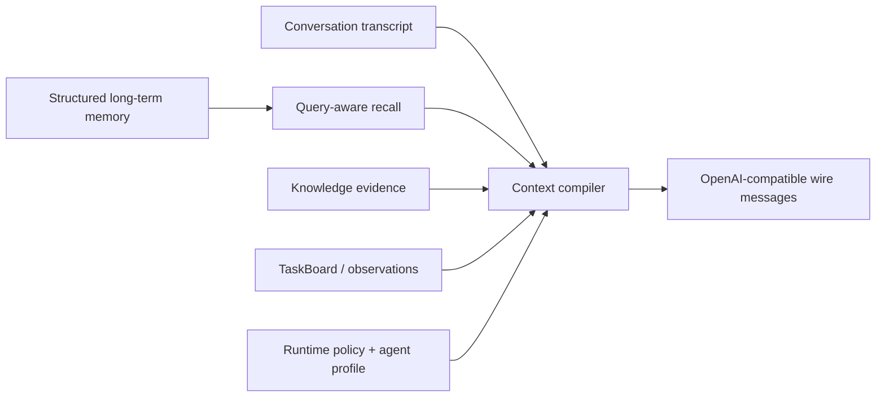

# Agent Context 与 Memory 数据契约

> 状态：研究记录，非实施依据
> 基线：Parrot `a612c876ec56ea979488a1856d77df3b7155fbc7`、Skyler 迁移快照、OpenClaw 与 Hermes 本地快照
> 日期：2026-07-19

> 实施时以 [Agent Runtime 统一 Loop 实施方案](agent-runtime-implementation-plan.md) 为准。当前知识入口已删除
> `KnowledgeIntentContext` 和自动二阶段 recall：最多 400 tokens 的 pinned memory 与近期 History 直接进入共享 Loop，
> query-aware Memory 只在模型按需调用受限 `memory` tool 时发生。本文件保留为长期数据契约研究。

## 1. 结论

Parrot 当前真正的问题不是“Memory 放在哪个 OpenAI role”，而是内部没有一份 Provider 无关、带来源和信任级别
的 Context 数据模型，导致所有内容过早拼成字符串后再交给 Prompt。

目标方案：

1. 引入版本化 `ContextEnvelope` 和 `ContextItem`，先表达语义、来源、权限、时效和 Token，再由
   `PromptCompiler` 序列化成 OpenAI-compatible messages。
2. 保持一条稳定、尽量唯一的 system prefix；Agent Profile、平台策略和工具安全规则在这里，动态数据不提升为
   system。
3. 将会话历史、长期结构化 Memory、知识 Evidence、TaskBoard 和 Runtime Facts 分成不同集合，不再混成一个
   “memory context”。
4. 知识型不再执行前置问题理解模型。近期完整会话和极少量 confirmed pinned memory 直接进入共享 Loop，
   query-aware Memory/Evidence 由同一 Loop 按需调用受限工具取得。
5. 近期会话尽量保留原始 `user/assistant/tool` 语义、完整配对和每条消息的发生时间；更老内容压缩成带来源的
   summary，避免把所有历史塞入一个 synthetic user 字符串。
6. 长期 Memory 是可错、可过期的参考数据，不是平台指令；不能使用 system/developer 优先级承载。
7. Subagent 默认不继承 Parent 全量 History 或 Memory，只接收 Task 合同和显式选择的引用。
8. 项目只要求 OpenAI-compatible Chat Completions 基线。`developer`、message `name`、Reasoning 字段等均是可选
   Provider 能力，不能作为安全边界。

Skyler 的“专门记忆位置”值得采纳的是逻辑分层和 `memory_context` 边界，不是照搬 `DeveloperMessage` 或
`UserMessage(name=...)` 的线格式。

## 2. 当前 Parrot 的实际消息结构

`agent_runtime/prompt_composer.py::initial_messages()` 当前顺序是：

```text
system: runtime policy
system: optional agent system prompt
system: optional knowledge policy
user:   memory reference block
user/assistant: recent conversation messages with historical metadata headers
user:   optional taskboard reference context
user:   current user text
assistant: optional resume assistant message
user:   latest steer message（恢复时）
```

知识与能力不再由 Runtime 预取；`assistant tool_call -> tool result` 只表示主 Loop 实际提出并执行的工具调用。
这套结构能运行，但仍存在以下长期问题。

### 2.1 内部语义过早丢失

`ChatMessage` 只保留宽松 `role: str`、`content`、`name`、`tool_calls` 等线协议字段。Memory Item 的类型、状态、
来源、时效、可信度、检索分数和敏感级别在拼字符串后丢失，后续无法基于 Budget 或安全策略裁剪。

### 2.2 Memory 被双重包装

`build_memory_context()` 已返回 `<memory-context>...</memory-context>`，`_reference_message()` 又将它 HTML escape
后包进 `<memory_context>...</memory_context>`。结果同时存在连字符/下划线两套标签，并让模型看到转义后的嵌套
协议。它不会可靠提升安全，反而浪费 Token、增加 Prompt 行为不确定性。

### 2.3 自动 Memory 不是 query-aware

`SqlMemoryRuntime.context_for()` 当前读取“最近更新的可见 active records”，按类型排序并限量。它没有接收当前
问题或 resolved query，因此可能注入最近但无关的记忆，同时漏掉更旧但真正相关的约定。

项目已经有 `MemoryRetrievalService` 和 `memory.search` 能做 query-aware 检索，但自动上下文路径没有使用它。

### 2.4 近期历史已恢复原生角色

跨已结束 Interaction 的近期历史不再经 `render_conversation_history()` 扁平化为一个 XML-like `user` message，
而是按持久化顺序编译成原生 `user/assistant` messages。每条历史消息使用服务端生成的短
`historical_message` header 标识其历史属性和绝对发生时间，当前用户请求不添加该标识。

当前实现仍以 `ConversationTurn` 作为过渡 DTO，因此只恢复 user/assistant 语义，尚不跨 Interaction 回放历史
Tool Call/Tool Result。等待中的同一 Interaction 则继续按 durable sequence 恢复完整 user/assistant transcript，
不需要新增一次问题归纳模型调用。

### 2.5 动态 TaskBoard 已降为 reference data

TaskBoard 结果属于运行态观察，不与平台安全规则拥有同等指令优先级。当前已经作为带来源的 reference/context item，
由 Completion Gate 验证后交给 Parent 合成。

### 2.6 预取 Evidence 伪装问题已移除

旧路径会把 Runtime 预取表示成 synthetic `assistant tool_call -> tool result`。统一 Loop 已删除该路径；现在只有模型
实际提出且经过 Runtime 执行的 Tool Call 才进入工具轨迹。活动 Skill 恢复是唯一的 checkpoint replay，并明确标记
`checkpoint=active_skill`，不能被解释为本轮重新召回。

### 2.7 数据库有时间，History 合同却丢失时间

`ConversationMessage` 已继承 `TimestampMixin`，数据库中的每一条 user/assistant 消息都保存 timezone-aware
`created_at` 和 `updated_at`，并以 Interaction 内单调 `sequence` 区分首问、waiting 问题、steer 补充和最终回答；
`SqlConversationHistory` 使用该 sequence 恢复同一 Interaction 内的多轮配对。因此不需要为了历史时间再新增一组
数据库列。

查询后的 `ConversationTurn` 已保留 user/assistant 的发生时间，并由 Prompt Compiler 在各自原生角色消息前使用
ISO 8601 header 序列化。后续完整 ContextEnvelope 仍应复用这一数据库事实源，而不是从当前服务器时间猜测
消息发生时间。

## 3. 必须保持分离的状态



四个数据库/运行概念不能合并：

| 概念 | 事实源 | 用途 | 是否自动等于长期 Memory |
| --- | --- | --- | ---: |
| Conversation transcript | `conversation_messages` | 当前线程真实 user/assistant 回合 | 否 |
| Structured memory | `memory_records` | 已确认摘要、偏好、项目约定等跨轮事实 | 是 |
| Knowledge evidence | Knowledge module | 对当前问题检索出的引用证据 | 否 |
| Runtime state | Interaction/Event/TaskBoard | Tool、审批、Child、恢复和完成条件 | 否 |

“消息已经持久化”只说明它是 transcript，不表示它已经成为可跨会话复用的 Memory。Memory 写入仍需类型、范围、
确认、保留策略和来源。

## 4. Provider 无关的 `ContextEnvelope`

```python
@dataclass(frozen=True)
class ContextEnvelope:
    version: Literal["v1"]
    runtime_policy: RuntimePolicyContext
    agent_profile: AgentProfileContext
    runtime_facts: tuple[ContextItem, ...]
    pinned_memory: tuple[ContextItem, ...]
    recalled_memory: tuple[ContextItem, ...]
    conversation: tuple[ConversationItem, ...]
    task: tuple[ContextItem, ...]
    evidence: tuple[ContextItem, ...]
    current_request: CurrentRequest
    budget: ContextBudget

@dataclass(frozen=True)
class ContextItem:
    item_id: str
    kind: Literal[
        "memory",
        "conversation_summary",
        "knowledge_evidence",
        "tool_observation",
        "subagent_result",
        "runtime_fact",
    ]
    scope: ContextScope
    content: str | dict[str, object]
    source: ContextSource
    trust: Literal["platform", "verified", "user_confirmed", "retrieved", "untrusted"]
    status: Literal["active", "pending", "stale", "superseded", "failed"]
    created_at: datetime
    updated_at: datetime
    expires_at: datetime | None
    relevance_score: float | None
    citation_id: str | None
    sensitivity: Literal["public", "tenant", "user", "secret"]
    estimated_tokens: int
```

这不是公开 API Schema，而是 Runtime 内部合同。具体 ORM Record、Knowledge Chunk、Task Result 先通过各模块
Adapter 归一化，Prompt 层不得直接查询 ORM。

### 4.1 Source

每个动态 Item 至少记录：

```text
source_type
source_id
tenant_id
actor/user ownership
conversation/thread id（如适用）
origin interaction id
retrieval method
retrieved_at
```

敏感标识不必全部发给模型，但 Runtime 必须保留它们用于授权、去重、审计和引用解析。

## 5. Context 分层与消息顺序

### 5.1 Layer 0：稳定平台策略

包含：

- Runtime 不变量；
- Tool 成功与完成证明规则；
- Prompt Injection 边界；
- 公开/内部内容边界；
- 当前 Agent 类型的稳定安全策略。

编译为一条规范化 system message。不要在每轮插入多个动态 system block。

### 5.2 Layer 1：Agent Profile

包含角色、业务范围、输出风格和术语。它不能改变平台权限和安全规则。

在 Provider 支持 `developer` 且通过兼容性探测时，可以单独映射为 developer；基线协议则与 Layer 0 合并为一条
system prefix，并对租户自定义内容加清晰边界。

### 5.3 Layer 2：小型 pinned memory

只自动注入满足全部条件的 Item：

- `status=active`；
- 用户确认或平台验证；
- 当前 Tenant、Agent、Actor/Conversation 范围可见；
- 未过期、未被 supersede；
- 类型在 allowlist，例如 `user_preference`、`project_convention`、当前 thread summary；
- 总 Token 极小且有稳定顺序。

它用于主 Loop 必须知道的长期偏好和约定，不包含最近任意 Memory。

### 5.4 Layer 3：Conversation

保留最近 N 个完整 turn：

```text
user
assistant
assistant tool_calls（如真实存在）
tool results（与 call id 配对）
```

只选完整、安全、已持久化的 turn。超过 Budget 的更老历史先压缩成 `conversation_summary`，不能同时注入原文和
同一段 summary。历史边界说明可作为 reference user message，安全规则仍由 system 控制。

### 5.5 Layer 4：query-aware Memory 与 Evidence

主 Loop 判断确有需要时，再通过受限工具按需加载：

- 相关 structured memory；
- 知识库 Evidence；
- instruction Skill；
- 可信只读 MCP 观察；
- 已完成 Subagent result。

这些都是 reference data，不是 system instruction。

### 5.6 Layer 5：当前任务与用户请求

当前 Task/Requirement/Observation 使用结构化 reference item；当前用户消息保持最后一个实际 user turn。Resume
和 Steer 必须按 durable sequence 还原真实时间顺序，不能简单把 assistant prompt 追加到最新 user 后面。

## 6. 推荐编译顺序

OpenAI-compatible 基线消息：

```text
system: stable runtime policy + normalized agent profile
user:   compact pinned-memory reference（存在时）
user/assistant/tool: recent complete conversation turns
user:   recalled-memory reference（存在时）
user:   evidence/task/subagent reference（存在时）
user:   current request
assistant/tool: only actual current-loop tool protocol messages
```

需要注意：

- “reference user”不是在模拟当前用户的新指令，内容里应带 item id、来源和只读声明；
- 如果目标 Provider 对多 user message 行为不稳定，Adapter 可以将多个 reference block 合并为当前请求前的一条
  context message，但不能改变内部 `ContextEnvelope`；
- `name` 字段可用于可观测性或支持良好的 Provider，不能承担信任边界；
- 静态内容放前、动态内容放后，以提高 Prompt Cache 命中。OpenAI 官方同样建议把静态/重复内容置于开头，
  用户特定动态内容放在末尾。

## 7. Memory 类型与生命周期

### 7.1 类型

项目应明确区分：

| 类型 | 示例 | 默认范围 | 默认自动注入 |
| --- | --- | --- | ---: |
| `user_preference` | “回答用中文” | user | 小量 pinned |
| `project_convention` | 项目固定术语、约定 | agent/project | 小量 pinned 或 recall |
| `conversation_summary` | 一段旧会话压缩 | conversation/thread | 当前线程按需 |
| `semantic_fact` | 用户确认的业务事实 | user/project | query-aware |
| `episodic_reference` | 过去任务/事件索引 | thread/project | query-aware，不直接当指令 |
| `procedure_reference` | 已审核操作方法引用 | agent/project | query-aware；真正权限仍看 Tool Policy |

Transcript 不自动转换成上述类型。Memory extraction 只能提出 candidate，推断写入维持 pending/confirmation 边界。

### 7.2 状态

```text
pending_confirmation
→ active
→ stale / superseded / expired / deleted
```

PromptCompiler 默认只消费 `active`。用户明确要求查看或确认 pending 时，可以通过管理/Memory Tool 返回，但不能
偷偷影响答案。

### 7.3 更新与冲突

- 同 scope/type/key 使用版本和 expected version；
- 新值不能静默覆盖旧值，应保留 provenance；
- 冲突时优先当前用户明确输入，其次 confirmed 新记录；
- Runtime 不让模型凭自然语言直接把冲突 Memory 标记为 resolved；
- 高风险事实可以设置 TTL 或要求重新确认。

## 8. Query-aware Memory Recall

### 8.1 Pre-loop pinned + on-demand recall

```text
Pre-loop:
  recent complete history + tiny pinned memory

On demand in the same Agent Loop:
  model calls memory.search with a non-empty query
  → hybrid memory retrieval
  → authorization
  → freshness/diversity rerank
  → Context Budget
```

这样让模型直接结合历史理解“它呢”“刚才那个”，同时避免在尚未确认需要 Memory 时自动产生额外召回。

### 8.2 检索

优先复用现有 `MemoryRetrievalService`，补充：

- resolved query 输入；
- lexical + semantic 并行；
- scope/tenant/actor 先过滤；
- 时间衰减，但不让新记录无条件压过高相关旧记录；
- MMR/类型多样性，避免十条同义 Memory；
- status、expiry、supersedes 过滤；
- 每类和总 Token 上限；
- retrieval degradation 明确传入 Trace。

如果向量能力不可用，降级为 lexical/metadata 不是“没有 Memory”；如果所有路径不可用，记录 unavailable，不能
返回空列表并假装检索成功。

### 8.3 On-demand Tool

保留 `memory.search/read` 作为补充：

- 自动 recall 只提供高置信、预算内的少量 Item；
- 模型发现缺少具体旧记录时可显式 search；
- Tool 结果仍经过 Tenant、Actor、Scope 与 source 授权；
- 功能完成不能以 Memory 文本代替真实外部 Tool Observation。

## 9. Conversation History

### 9.1 Recent turns

`SqlConversationHistory` 已经按 Tenant、Agent、Actor、Conversation 过滤并选择完整 turn，这是可复用基础。改造重点
是让它返回 Provider 无关的 `ConversationItem`，而非先渲染 XML 字符串。

```python
@dataclass(frozen=True)
class ConversationItem:
    message_id: str
    interaction_id: str
    role: Literal["user", "assistant", "tool"]
    content: str | None
    tool_calls: tuple[ToolCall, ...]
    tool_call_id: str | None
    status: Literal["complete", "incomplete"]
    sequence: int
    occurred_at: datetime
```

只注入 complete turn。未完成输出、cancelled candidate、Reasoning 和 Trace 不进入正常历史。

#### 时间合同

- `occurred_at` 来自持久化 `ConversationMessage.created_at`，必须是 timezone-aware；
- 内部和数据库统一保存 UTC，Prompt 编译时可按服务端确认的 Actor/Runtime 时区显示，并始终保留 UTC offset；
- user 与 assistant 是两条独立消息，各自保留时间，不能给整个 turn 只放一个模糊时间；
- `updated_at` 只用于记录行变更，不表示消息发生时间，不送给模型；
- 排序使用 durable `sequence`，历史数据没有 sequence 时才使用 `(occurred_at, message_id)` 稳定回退；
- 当前用户请求的接收时间属于受信任 `runtime_fact`，不得让前端或用户文本覆盖；
- 不向模型只发送“3 分钟前”一类易漂移相对时间；使用 ISO-8601 绝对时间，必要时附服务器计算的相对说明。

过渡期如继续使用 turn DTO，至少应改为：

```python
@dataclass(frozen=True)
class ConversationTurn:
    interaction_id: str
    user_content: str
    user_occurred_at: datetime
    assistant_content: str | None = None
    assistant_occurred_at: datetime | None = None
```

目标态仍是按消息保存的 `ConversationItem`，避免 turn DTO 再次丢失 Tool、Steer 和 Resume 的真实顺序。

#### OpenAI-compatible 序列化

OpenAI Chat Completions 的基线 message 没有标准时间字段，因此 `PromptCompiler` 先生成 Provider 无关元数据：

```python
CompiledMessage(
    role=item.role,
    content=item.content,
    metadata={"occurred_at": item.occurred_at.isoformat(), "historical": True},
)
```

Provider Adapter 再把服务端生成的时间作为紧邻历史内容的短 reference header 序列化，同时保留原始 role：

```text
[historical_message occurred_at="2026-07-19T09:42:13+08:00"]
消息正文
```

Header 与消息正文必须分字段构造和转义，不能让历史正文伪造 metadata。当前 user message 不添加这种 header；它的
接收时间放在 `runtime_facts`。所有时间 header 都计入 History Token Budget。

### 9.2 Summary

旧历史压缩应作为独立后台/低优先级任务，并记录：

- covered message range；
- source message ids；
- summary version/model/prompt；
- created_at；
- superseded status；
- token count。

Summary 是有损参考，不能替代审计 Transcript，也不能与覆盖的原消息重复注入。

## 10. Subagent Context

Child `ContextEnvelope` 使用专门的 `minimal_subagent` 模式：

```text
runtime_policy: minimal child policy
agent_profile: inherited and tool-filtered
pinned_memory: empty by default
recalled_memory: only explicitly selected items
conversation: no parent history
task: one DelegatedTask
evidence: explicit SourceRefs only
current_request: rendered task contract
```

Child 默认无长期 Memory 写权限。其结果进入 TaskBoard/Evidence，不成为 Memory。只有 Parent 完成后，独立的
Memory extraction 流程才可以基于用户确认和保留策略提出 candidate。

OpenAI Sandbox Agent Memory 也明确区分 conversation Session 与跨 run 的 Agent Memory，并建议 internal/subagent
可以只读或禁用生成；Parrot 采纳这种分离原则，但继续使用自身 PostgreSQL 与租户模型。

## 11. Skyler 做法与采纳判断

Skyler `_initial_messages()` 当前大致是：

```text
System runtime policy
Developer agent_profile
Developer runtime_context
Developer current_user_context
User(name=memory_context) structured memory block
history boundary
native history messages
subagent results
latest user messages
```

`AgentMemoryRuntime.context_for_run()` 读取可见 Memory，优先 thread summary、project convention、user preference，并
构造“REFERENCE ONLY”的 `memory-context`。

### 11.1 值得采纳

- 平台策略、Agent Profile、Runtime Context、Memory、History、Subagent Result 的逻辑分层；
- Memory 明确是 reference，而不是新用户指令；
- 只加载当前 thread history，跨 thread 内容通过 Memory Search；
- History boundary 后保留原始消息角色；
- Parent join 时将 Subagent 结果作为独立上下文；
- Child 使用 synthetic plan，避免重复 Root Planner。

### 11.2 不应照搬

- `DeveloperMessage` 不是所有 OpenAI-compatible Chat Completions 端点都支持；
- message `name=memory_context` 不是安全或兼容性保证；
- Skyler 自动 Memory 仍偏“最近可见项 + 类型排序”，并非 resolved-query recall；
- 不应把 Skyler 的 channel/user id 访问模型复制进 Parrot，Parrot 继续以 Tenant/RLS/Actor 为准；
- `skyler/` 只作为迁移参考，不能运行时导入。

结论：采纳它的内部 Context 分层和 History 处理思想，在 Parrot 中重新实现成 `ContextEnvelope`；不采纳其具体
Provider message class 作为核心合同。

## 12. OpenClaw 与 Hermes 的启示

### 12.1 OpenClaw

值得采纳：

- system prompt renderer 保持纯函数；
- stable prefix 与 dynamic suffix 分开；
- Subagent 使用 minimal prompt；
- curated long-term summary 小而稳定，详细 daily/session 内容按需搜索；
- memory retrieval 使用 hybrid、时间衰减和 MMR。

不采纳：

- 文件型 `MEMORY.md`/SQLite Session 作为 Parrot 事实源；
- Channel-specific context 混入 Runtime；
- 把本地工作区文件权限模型套到多租户平台。

### 12.2 Hermes

值得采纳：stable/context/volatile Prompt Tier 与前缀缓存意识。

不采纳：将外部 Memory 放进 volatile system prompt，或将 recalled memory 描述为“authoritative”。Parrot 的
Memory 可能是用户确认、推断、过期或召回降级结果，必须保持 provenance 和 fallible reference 边界。

## 13. Prompt Injection 与安全

### 13.1 信任不是 role 的同义词

- system 内容只能来自平台模板和经过约束的 Agent Profile；
- user/assistant/tool/history/memory/evidence 都可能包含不可信文本；
- XML/Markdown 标签只是模型提示，不是隔离机制；
- Runtime 权限、Schema、RLS、Completion Gate 和 Tool Policy 才是实际安全边界。

### 13.2 编译前处理

- Tenant/Actor/Scope 重新授权；
- secret/credential 检测和 redact；
- 控制标签规范化，避免嵌套协议；
- 内容长度与类型 Budget；
- 来源和引用 ID 与内容分离；
- `pending/stale/superseded` 默认过滤；
- Tool Result 只允许配对到当前可见 call id。

### 13.3 公开边界

ContextEnvelope、Memory、History、Evidence、Prompt 和 Child Result 都不直接进入公开事件。最终答案引用可公开的
Evidence ID；诊断界面读取 Trace 时仍需租户和管理员权限。

## 14. Token Budget 与裁剪

建议用比例和优先级，而不是把所有模块分别填满：

```text
reserved_output
reserved_tool_loop
stable_policy
current_request
recent_complete_history
pinned_memory
required_evidence
recalled_memory
optional_evidence
```

裁剪原则：

1. 永远保留平台策略、当前请求和必需 Evidence；
2. 按完整 Conversation Turn 裁剪，不切断 Tool 配对；
3. 先去重，再按 relevance/freshness/trust/类型多样性排序；
4. optional evidence 和低置信 Memory 最先移除；
5. 超长 Tool Result 写入 Evidence Store，只注入摘要和引用；
6. 记录每层原始 Token、选中 Token、丢弃原因。

具体 Token 数由模型 Context Window 与运行配置决定。不要在业务逻辑里假设某一特定模型窗口。

## 15. Prompt Cache 与性能

- 稳定 Runtime Policy 和 Agent Profile 置前；
- 版本化 template，避免同义随机改写；
- Tool Schema 顺序稳定；
- 动态时间、用户、TaskBoard、Memory 和 Evidence 放后；
- 不在 system prefix 中插入每轮 request id、当前时间或 Memory；
- `prompt_cache_key` 仅在管理员将 LLM 配置的 `prompt_cache_enabled` 打开时发送；不得按模型名猜测；
- 观测 `model.response.usage` 中的 prompt/completion/total/cached tokens（端点返回时）、context compile time、recall time 和 total input tokens。

Prompt Cache 是性能优化，不是正确性前提。端点不支持时保持 `prompt_cache_enabled=false`，消息语义必须保持不变。

## 16. 模块边界

建议新增：

```text
backend/app/modules/agent_runtime/context/
  contracts.py          # ContextEnvelope/ContextItem/ConversationItem
  collector.py          # 并行收集各模块数据，不拼 Prompt
  authorizer.py         # scope/tenant/status/sensitivity 校验
  budget.py             # 去重、排序、Token 分配
  compiler.py           # ContextEnvelope -> provider-neutral ChatTurn
  prompt_templates.py   # 稳定模板和版本

backend/app/modules/memory/
  pinned.py             # 小型 confirmed pinned selection
  recall.py             # resolved-query recall
  compaction.py         # transcript summary proposal/background task
```

Provider Adapter 只将 provider-neutral `ChatTurn` 转成线协议；Memory Module 不依赖 Provider，PromptCompiler 不查询
数据库，HTTP/IM Adapter 不构造 Context。

## 17. 迁移

### Phase A：内部合同，不改变线行为

- 引入 `ContextEnvelope` 与 typed items；
- 让现有 collector 生成 Envelope，再由兼容 compiler 输出当前消息；
- 记录各层 Token 和来源；
- 修复 double wrapping；
- 添加 snapshot/contract tests。

### Phase B：History 与 system prefix

- 只生成一条稳定 system prefix；
- TaskBoard 从 system 移为 reference item；
- 最近完整 History 恢复 native roles；
- `ConversationMessage.created_at` 贯穿 History DTO，并以 ISO-8601 时间元数据编译给模型；
- 保留 compatibility flag，按 Provider contract test 灰度。

### Phase C：pinned Memory 与按需召回

- 主 Loop 前只加载 pinned memory；
- 主 Loop 仅在需要时通过 `memory.search` 调用 query-aware recall；
- 增加 freshness/MMR/type diversity；
- 保留 `memory.search/read` 补充路径；
- 监测答案质量和错误召回。

### Phase D：Evidence 与 Subagent

- Runtime prefetch 使用内部 Evidence Item；
- Child 使用 minimal envelope；
- 大结果使用引用而非复制；
- Parent final synthesis 从统一 Evidence/Result 集合读取。

每阶段均需可回滚，不能一次改写所有 Prompt 与 Provider Adapter。

## 18. 测试

### 18.1 数据合同

- 每个 Context Item 有 tenant/source/status/sensitivity；
- Memory、History、Evidence、TaskBoard 不互相冒充；
- double wrapping 不再出现；
- PromptCompiler 输出顺序稳定；
- Tool Call/Result 配对完整。

### 18.2 Memory

- 最新但无关 Memory 不被 query recall 选中；
- 旧但相关 confirmed Memory 可以召回；
- pending/stale/superseded/expired 默认不注入；
- lexical/semantic 降级状态可区分；
- 当前用户明确内容覆盖冲突旧 Memory；
- 跨 Tenant/Actor/Scope 不可见。

### 18.3 History

- 最近 turn 保留 user/assistant 角色和顺序；
- user/assistant 各自的 `created_at` 映射为 timezone-aware `occurred_at`，不被 turn grouping 丢弃；
- Prompt 中使用绝对 ISO-8601 时间且保留 offset，`updated_at` 不冒充发生时间；
- DST、同毫秒消息和缺失 legacy sequence 时顺序稳定；
- incomplete/candidate/reasoning 不注入；
- Tool 对不被 Token 裁剪拆开；
- summary 与被覆盖原消息不重复；
- Steer/Resume 按 durable sequence 还原。

### 18.4 Provider

- 不支持 developer/name 时仍能使用 baseline system/user/assistant/tool；
- system prefix 唯一且稳定；
- strict/schema/tool/reasoning 差异不改变 Envelope；
- 同一 Envelope 在不同兼容端点的语义对照测试通过。

### 18.5 Subagent

- Child 默认看不到 Parent History 和全量 Memory；
- 显式 SourceRef 可以注入单个授权 Item；
- Child 不写长期 Memory；
- Parent 收到结构化 result，不收到 Child Reasoning。

## 19. 验收标准

1. Runtime 有 Provider 无关、版本化的 Context 数据模型；
2. Memory 不再靠标签字符串表达全部语义；
3. system prefix 稳定，动态 Memory/Task/Evidence 不提升为 system；
4. 知识问题仍先结合 History 做一次理解，再 query-aware recall；
5. Transcript、Summary、Structured Memory、Evidence 和 Runtime State 明确分离；
6. Skyler 的分层思想被重新实现，但未运行时依赖 `skyler/` 或特定 Provider Message；
7. Subagent Context 最小化且权限可测试；
8. Token、召回、裁剪、缓存和降级均可观测；
9. 当前用户请求、Runtime Policy 和 Tool 权限不会被 Memory 中的指令覆盖；
10. 历史消息时间从数据库贯穿到 Prompt，能支持相对时间问题且不会被用户伪造。

## 20. 参考

- [OpenAI Agents SDK Sessions](https://openai.github.io/openai-agents-python/sessions/)：会话历史是独立的 Session
  状态，并支持持久化和压缩。
- [OpenAI Sandbox Agent memory](https://openai.github.io/openai-agents-python/sandbox/memory/)：Agent Memory 与
  conversation Session 分离，Subagent 可只读或禁用生成。
- [OpenAI Prompt caching](https://developers.openai.com/api/docs/guides/prompt-caching)：稳定重复前缀置前，动态
  用户内容置后。
- [Anthropic Effective context engineering](https://www.anthropic.com/engineering/effective-context-engineering-for-ai-agents)：
  Context 是有限资源，长任务使用压缩、结构化笔记和按需检索。
- [LangGraph Memory overview](https://docs.langchain.com/oss/python/concepts/memory)：作为类型学参考，区分短期线程
  状态与长期 semantic/episodic/procedural memory；Parrot 不引入 LangGraph。
