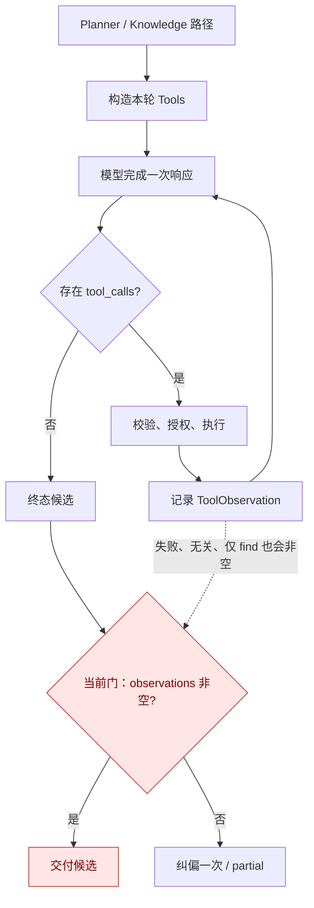
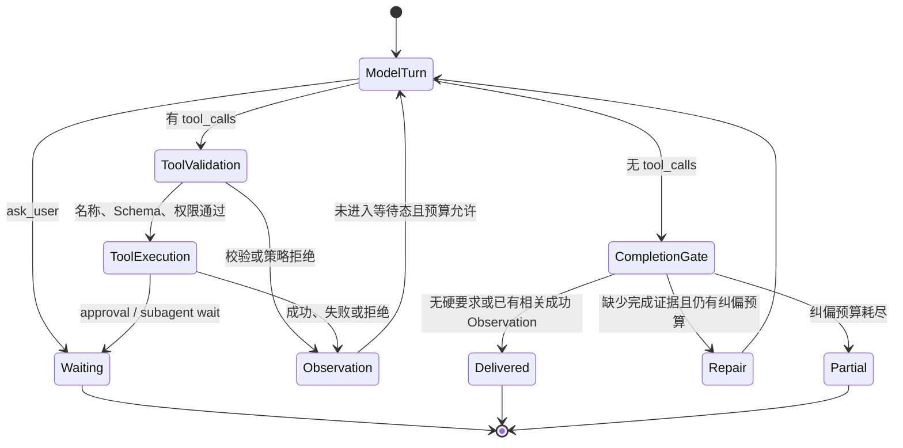

# Hermes 式 Tool Loop 与最小完成门实施方案

> 状态：历史研究记录，非当前实施依据。当前多能力边界、等待态与完成证据只以
> [Skill、MCP 与 Subagent 最终编排方案](multi-capability-orchestration-design.md) 为准。

> 实施差异（2026-07-21）：最终代码没有保留本文早期提出的
> `satisfies_capability: bool`。Runtime 使用 `control/instruction/read/action/subagent/failure`
> 枚举；find/load 中间态不能完成，`instruction_ready` 不等于动作回执，相关能力执行失败可以支持如实说明，
> 但不能被描述为外部动作成功。本文其余表格仅保留研究过程，不作为现行合同。

- 范围：Parrot in-process Agent Runtime
- 目标版本：下一次 Agent Runtime 小版本

## 1. 结论先行

Parrot 应采用 Hermes 的主循环语义：

```text
模型返回 tool_calls -> 执行工具 -> 写入 Observation -> 再次调用模型
模型不返回 tool_calls -> 作为终态候选 -> 通过完成门后返回
```

但“有工具就循环、没工具就返回”只解决循环控制，不能保证工具用得正确。正确性必须由运行时再加一层很小的确定性约束：

1. 模型只能看到本回合允许使用的工具。
2. 每个 Tool Call 在执行前统一校验名称和 JSON Schema。
3. 鉴权、租户隔离、MCP Policy、审批、预算和重复调用拦截仍由服务端执行。
4. 当 Planner 已判断必须使用能力时，普通文本只能是终态候选；只有获得**成功且相关的 Observation** 才允许交付。
5. 没有硬性工具要求的普通对话，模型不调用工具就直接返回，不增加无意义回合。

不依赖 `tool_choice=required`。这不是降低约束，而是把约束从兼容性不稳定的 Provider 参数，移到 Parrot 自己可测试、可观测的 Agent Runtime。

## 2. 用户需求与设计边界

### 2.1 本次要解决

- OpenAI-compatible 协议对接其他 LLM 时，尤其是 thinking/reasoning 模式下，不能可靠依赖 `tool_choice=required`。
- 希望保留 Hermes 式清晰循环：有 Tool Call 就继续，无 Tool Call 就准备结束。
- 防止模型只调用了一个无关、失败或中间态工具，随后输出文本并被系统误判为任务已经完成。
- 保持 `ask_user`、MCP 审批、TaskBoard、Subagent、Final Renderer 和断点恢复的现有边界。

### 2.2 本次明确不做

- 不修改 Provider 请求协议，不为不同模型维护 `required/auto` 兼容矩阵。
- 不新增数据库表、Migration、公开事件或前端协议。
- 不要求所有回答都调用 `final_response()`。
- 不从问号、措辞或 reasoning 文本推断“等待用户输入”。
- 不引入通用 Requirement DSL、字符串表达式 `success_predicate` 或可配置规则引擎。
- 不重写 Planner，不引入新的 LLM 判断器。

当前只有 `capability_lookup` 具有明确的硬性 Observation 要求。先把这一条做正确；出现第二类真实需求后，再抽象通用 Requirement 类型。

## 3. 基于当前代码的事实

| 事实 | 当前实现 | 判断 |
| --- | --- | --- |
| 主循环已经是 Tool Call 驱动 | `AgentCompletionLoop.run()`：有 `tool_calls` 执行并回环，无调用进入终态候选 | 主体正确，不需要重写 |
| Provider 未强制 Tool | `_stream_turn()` 调用 `stream_completion()` 时没有传 `tool_choice` | 符合跨 Provider 兼容目标 |
| 终止门已存在 | `terminal_candidate_decision()` 支持 `deliver / repair / partial` | 应增强，不应另建一套 Loop |
| 当前门过弱 | `capability_lookup` 只检查 `observations` 是否非空 | 失败、无关或中间态 Observation 都可能放行 |
| 已有相关性字段 | `ToolObservation.satisfies_capability` 已存在，但终止门未使用 | 直接复用，改动最小 |
| 工具名称已校验 | `_tool_result()` 拒绝不在本轮 `tools` 中的名称 | 保留 |
| 参数只完成了解析 | OpenAI adapter 只保证 arguments 是 JSON object | 应在统一执行入口按 `ToolDefinition.parameters` 校验 |
| MCP 有二次硬校验 | MCP Policy 校验实时 schema hash、JSON Schema、effect 和 approval | 必须保留，统一校验不能替代它 |
| 等待用户已有结构化工具 | `ask_user(question)` 产生 `waiting_user_input` | 继续作为唯一等待语义 |
| 副作用已有恢复边界 | Pending Action 持久化并在批准后重新校验；执行状态不确定时不自动重试 | 本次不改 |

直接证据位于：

- `backend/app/modules/agent_runtime/completion_loop.py`
- `backend/app/modules/agent_runtime/terminal_policy.py`
- `backend/app/modules/agent_runtime/tool_executor.py`
- `backend/app/modules/agent_runtime/plan_tools.py`
- `backend/app/modules/agent_runtime/capabilities.py`
- `backend/app/modules/mcp_servers/tool_policy.py`
- `backend/tests/test_agent_runtime_guards.py`
- `backend/tests/test_agent_runtime_finalization.py`
- `backend/tests/test_knowledge_unified_loop.py`

### 3.1 当前真实缺口

当前终止判断等价于：

```python
if plan.action == "capability_lookup" and not plan.capability_prefetched and not observations:
    block()
else:
    deliver()
```

因此以下行为都会让 `observations` 非空：

- `capability_search(find)` 只返回候选，还未 load/execute；
- 调用了 `time` 或 `todo`，与能力任务无关；
- 工具返回 `rejected` 或 `failed`；
- 重复执行被 Guard 拒绝。

现有测试 `test_capability_plan_can_conclude_after_a_tool_observation` 甚至固定了“只 find 一次即可完成”的弱语义。这正是需要替换的回归用例。



## 4. 目标语义

### 4.1 Agent Loop



该状态机保留用户期望的确定性：

- Tool Call 是否存在，由结构化响应决定，不解析文本。
- Tool 是否执行、是否等待、是否允许完成，由服务端状态决定。
- reasoning 内容仅供模型内部思考和诊断，不参与控制流。
- 同一响应同时含普通文本和非终态 Tool Call 时，Tool Call 分支优先；伴随文本保持私有，不能提前发布。
- `ask_user` 等终态 Tool 必须单独调用，不能与普通 Tool 混在同一响应中。

### 4.2 完成门

本阶段不新增通用类型，直接使用现有字段：

```python
@dataclass(frozen=True)
class ToolObservation:
    tool_name: str
    call_id: str
    succeeded: bool
    result_kind: str
    satisfies_capability: bool
```

终止规则改为：

```python
requires_capability = (
    plan.action == "capability_lookup"
    and not plan.capability_prefetched
)
has_capability_evidence = any(
    observation.satisfies_capability for observation in observations
)

if not content.strip():
    block("empty_response")
elif requires_capability and not has_capability_evidence:
    block("capability_observation_required")
else:
    deliver()
```

这里不能使用 `observation.succeeded` 代替 `satisfies_capability`。`time` 成功不代表 release-notes Skill 已经被正确使用，`capability_search(load)` 成功也只代表指令已加载，仍不是任务结果。

### 4.3 什么 Observation 可以满足能力要求

| Tool 结果 | `succeeded` | `satisfies_capability` | 原因 |
| --- | ---: | ---: | --- |
| `capability_search(find)` 返回一个或多个候选 | 是 | 否 | 只是路由中间态 |
| `capability_search(load)` 成功 | 是 | 否 | 只是上下文准备 |
| `capability_execute` 返回 `ok/succeeded/instruction_ready` | 是 | 是 | 已获得可用于回答的执行结果或正式指令 |
| `capability_search(find)` 成功且 `capabilities=[]` | 是 | 是 | 获得“无可用能力”的确定性负结果，可如实说明限制 |
| 任意 Tool 返回 `failed/rejected` | 否 | 否 | 失败不能伪装成完成证据 |
| `time/math/memory/knowledge_search/todo` 成功 | 是 | 否 | 不能满足 `capability_lookup` 的能力要求 |
| `waiting_approval/waiting_subagents` | 否 | 否 | 已进入独立等待终态，不进入完成门 |

`capability_search(find)` 的空结果必须同时满足：`status == "ok"`、`action == "find"` 且 `capabilities` 是空列表。异常、超时或 Policy 拒绝不属于确定性负结果。

### 4.4 工具使用“合理性”的保证边界

工具使用不存在一个能够对开放问题给出数学保证的通用规则。生产上应把保证拆成两层：

**运行时硬保证**

- 只能调用服务端按 Profile、Plan、入口和权限暴露的 Tool。
- 参数必须符合本轮 `ToolDefinition.parameters`。
- MCP 仍需通过实时发现、Schema Hash、Policy、租户和审批检查。
- 必须满足与 Plan 对应的完成证据，才能交付文本。
- 预算、重复调用、并发白名单、Control Plane Replan 和副作用不重试保持生效。

**模型质量软保证**

- Tool 名称、描述和 Schema 要单义，避免多个工具表达同一动作。
- Planner 只在需要外部能力时产生 `capability_lookup`。
- `capability_search` 继续限制候选数量并使用服务端 Ranker。
- 用场景化 Eval 检查“是否选对工具、查询是否合理、是否引用 Observation”，而不是增加另一个 LLM 当裁判。

运行时硬保证负责“不能乱执行、不能虚假完成”；Eval 负责持续提高“是否选得最好”。二者不能互相替代。

## 5. Provider 策略

### 5.1 统一策略

- Tool Loop 请求继续使用 Provider 默认选择，即不传 `tool_choice`。
- 不根据 `reasoning_content`、模型名或供应商动态切换 `required`。
- 不接受“thinking 模式关闭后再 required”作为默认路径；它会改变模型能力和响应质量。
- 若未来某个业务动作必须调用一个确定工具，应由服务端直接执行或进入结构化工作流，不把关键控制权交给 Provider 的 Tool Choice。

### 5.2 为什么这比 `required` 更稳定

OpenAI-compatible 只说明接口形状相似，不代表所有供应商都实现相同的 `tool_choice` 与 thinking 组合。部分实现会拒绝、忽略或降级该参数。

本次审阅的参考实现也印证了这一点：

- Hermes 的核心是响应中有 Tool Call 就执行并 `continue`，无 Tool Call 才进入最终响应分支。
- OpenClaw 对部分 thinking Provider 会把 `required` 降级为 `auto`，或在锁定具体工具时关闭 thinking；它并不能让所有 Provider 原生支持同一语义。

Parrot 应借鉴它们的循环边界，不复制 Provider 特例集合。

## 6. 最小代码改造

### 6.1 改动清单

| 文件 | 最小改动 | 不做什么 |
| --- | --- | --- |
| `terminal_policy.py` | 用 `any(item.satisfies_capability)` 替代“Observation 非空”；把 reason 改成更准确的 `capability_observation_required` | 不新增通用规则引擎 |
| `tool_executor.py` | 精确定义 `satisfies_capability`；执行前按本轮 ToolDefinition 校验参数 | 不改变具体 Tool handler 和 MCP 二次校验 |
| `completion_loop.py` | 仅适配更准确的 repair/partial reason；保持现有循环和一次纠偏 | 不改变 Provider 调用方式 |
| 对应测试 | 替换弱语义用例并补充负结果、失败和参数校验 | 不启动真实外部 MCP/LLM |
| 现有 AI 文档 | 对齐 `required`、普通文本终止和 `final_response` 的真实合同 | 不在同一变更重写全部架构文档 |

建议把统一参数校验写成 `tool_executor.py` 内的私有函数，复用项目已有 `jsonschema` 依赖：

```python
def _arguments_match_definition(
    call: ToolCall,
    definition: ToolDefinition,
) -> bool:
    try:
        Draft202012Validator.check_schema(definition.parameters)
        Draft202012Validator(definition.parameters).validate(call.arguments)
    except (SchemaError, ValidationError):
        return False
    return True
```

执行顺序必须是：

```text
本轮工具名称 -> 本轮 ToolDefinition Schema -> 重复/重试 Guard
-> Tool 专属权限与业务校验 -> MCP 实时 Schema/Policy/Approval -> 实际执行
```

统一校验失败返回稳定结果：

```json
{
  "status": "rejected",
  "code": "TOOL_ARGUMENTS_INVALID",
  "message": "Tool arguments do not match the declared schema."
}
```

该错误会作为私有 Tool Observation 返回模型，但不得把完整参数、Schema 或 ValidationError 暴露给用户。

### 6.2 不改动的边界

- `InProcessAgentRuntime._run()` 的 Planner、Knowledge、TaskBoard 分流不变。
- `FinalRenderer`、Candidate Checkpoint 和公开 delta 规则不变。
- `ask_user` 仍只向可恢复的 Root WebSocket Loop 暴露。
- Pending Action 仍按 tenant、actor、hash、version 和有效期恢复。
- Subagent 等待、Control Plane Replan 和运行预算不变。
- 已预取的 Active Skill 保持 `capability_prefetched=True`，不再强制额外 Tool Call。

## 7. Active Skill 与用户澄清

必须明确区分两件事：

- Active Skill 已被服务端预取并注入上下文，因此普通文本可以完成；不应为了形式再次强制 `capability_search`。
- 如果 Skill 需要在**同一个 interaction** 中暂停并等待用户补充，必须单独调用 `ask_user(question)`。

例如模型直接输出“请提供版本号。”，运行时只能把它当成已完成文本，不能安全地猜测这是等待态。只有结构化 `ask_user` 才会产生 `waiting_user_input`、持久化恢复点并在用户回复后继续绑定同一 Active Skill。

这是必要边界，不是缺陷。用文本问号推断等待会让普通反问句、建议句和多语言输出产生错误状态。

## 8. 兼容策略

### 8.1 `final_response`

当前文档声明 `final_response()` 仅为兼容 intent，但 `plan_tools.py` 仍在部分 Knowledge + Skill 场景暴露它，存在合同漂移。

处理分两步：

1. 本次完成门修复继续接受合法旧 `final_response()`，它也必须通过同一个完成门。
2. 回归稳定后停止在正常 Tool 列表中暴露 `final_response`，保留解析兼容至少一个小版本。

不要把移除 `final_response` 与第一步混在一个大改动里，以便单独回滚和观察。

### 8.2 Control Plane Replan

当能力不存在、被禁用或策略拒绝时，现有 Control Plane 可以产生新的 Plan 和 Tools。完成门每次都读取**当前 Plan**：

- 当前 Plan 仍是 `capability_lookup`：缺少有效证据，继续阻止交付。
- Runtime 已基于结构化错误明确 replan 为可直接说明限制的路径：新 Plan 不再要求能力证据，可以如实结束。

模型自己的失败文本不能解除要求；只有服务端 Replan 能改变要求。

## 9. 实施顺序

### 阶段 1：修正完成门和统一参数校验

预计改动 3 个生产文件和对应测试，无数据库/API 变更。

1. 先修改测试，固定 Observation 分类和终止行为。
2. 让 `terminal_policy` 使用 `satisfies_capability`。
3. 补全空能力列表的确定性负结果分类。
4. 在 Tool Executor 入口增加 JSON Schema 校验。
5. 运行 Agent Runtime、Knowledge Loop、Approval 和 Provider adapter 定向测试。

### 阶段 2：清理合同漂移

1. 停止在正常 Knowledge Tool 列表中暴露 `final_response`。
2. 保留旧调用兼容并补回归测试。
3. 同步以下文档中相互矛盾的 `required/auto/final_response` 描述：
   - `backend-harness.md`
   - `agent-runtime-implementation-plan.md`
   - `openai-compatible-provider-contract.md`
   - `runtime-operations-runbook.md`
   - `interaction-contract.md`

### 暂不实施

- 通用 `ToolRequirement` / Observation Ledger。
- 数据库存储 Requirement。
- Provider capability profile 和运行时自动降级矩阵。
- 使用另一个 LLM 判断 Tool 是否“合理”。

触发通用化的条件是：出现第二种不能由 `satisfies_capability` 表达、且确实需要硬终止约束的生产流程。

## 10. 测试与验收矩阵

| 场景 | 预期结果 |
| --- | --- |
| `agent_loop/direct_answer` 无硬要求，模型直接返回文本 | 一次终态候选，正常 completed |
| `capability_lookup` 未调用任何工具就返回文本 | 私下纠偏一次；仍无证据则 partial |
| 只调用 `capability_search(find)` 且有候选，随后返回文本 | 不允许 completed |
| `find_and_load`（或 `find -> load`）→ `capability_execute` 成功，随后返回文本 | completed |
| `find` 成功且 `capabilities=[]`，随后说明无可用能力 | completed |
| 调用无关的 `time/todo` 后返回文本 | 不满足能力完成门 |
| Tool 返回 failed/rejected/repeat-blocked | 不满足能力完成门 |
| Builtin Tool 参数不符合声明 Schema | 不进入 handler，返回 `TOOL_ARGUMENTS_INVALID` Observation |
| MCP 参数通过外层声明但实时 Schema Hash/Policy 已变化 | 继续 fail closed，不执行 |
| Root WebSocket 单独调用 `ask_user` | `waiting_user_input`，可恢复 |
| Active Skill 直接输出提问文本 | completed，不猜测等待态 |
| Active Skill 调用 `ask_user` 并恢复 | 继续绑定相同 Skill 版本 |
| 副作用 Tool 需要批准 | `waiting_user_action`；批准后重新校验并执行一次 |
| 副作用执行状态不确定 | partial，不自动重试 |
| thinking 模型调用工具 | 所有 Tool Loop 请求保持 Provider 默认 `tool_choice` |
| Candidate Checkpoint 恢复 | 不重新执行 Agent Loop 或 Tool |

至少需要修改或新增以下测试：

- 把 `test_capability_plan_can_conclude_after_a_tool_observation` 改为“仅 find 有候选不能完成”。
- 保留 `test_successful_capability_execution_satisfies_the_completion_gate`。
- 新增空能力列表作为确定性负结果的完成用例。
- 新增 failed、unrelated 和 invalid arguments 不满足/不执行的用例。
- 保留 reasoning 模型 `tool_choice is None` 的断言。
- 保留 Approval、Active Skill resume、Finalization checkpoint 回归。

## 11. 可观测性

不新增公开事件。可在现有 management-only diagnostic trace 中增加低敏元数据：

```json
{
  "decision": "deliver|repair|partial",
  "reason": "capability_observation_required|null",
  "observation_count": 2,
  "satisfying_observation_count": 0
}
```

不得记录 Tool 参数、结果正文、Prompt、Skill 指令或 reasoning 内容。建议监控：

- `repair / terminal_candidate` 比率；
- `partial_reason=capability_observation_required` 数量；
- `TOOL_ARGUMENTS_INVALID` 按模型和 Tool 名聚合；
- `capability_search(find)` 后未 load/execute 的比例。

这些指标能区分“模型不会用工具”“工具定义不清楚”“能力确实不存在”，也能判断是否需要进一步抽象。

## 12. 风险与回滚

### 风险 1：完成率短期下降

以前只 find 一次就可返回，现在会继续纠偏或 partial。它暴露的是原有虚假完成，不应通过放宽完成门解决。应优先检查 Tool 描述、Ranker 结果和模型兼容性。

### 风险 2：空候选误判

只有结构完整的成功空列表才能作为确定性负结果。请求失败、Policy 拒绝或解析异常不得归为空列表。

### 风险 3：Schema 校验暴露旧定义问题

个别 Builtin Tool 的实际 handler 可能接受声明外字段。上线前应通过定向测试对齐 schema；不能为兼容而允许 additional properties 漂移。

### 回滚方式

阶段 1 不改持久化和外部合同，可按代码提交整体回滚。不要增加“任意 Observation 都算成功”的运行时开关；该开关会恢复已知错误语义。

## 13. 完成定义

满足以下条件才视为方案落地：

- Hermes 式 Tool Call 循环保持不变，thinking 模型不依赖 `tool_choice=required`。
- `capability_lookup` 只有相关成功 Observation 或确定性负结果才能完成。
- 失败、无关和中间态 Tool Call 不能绕过完成门。
- 所有本轮 Tool Call 在 handler 前经过统一名称与 Schema 校验。
- MCP、审批、租户、恢复和公开输出边界无回归。
- 定向测试覆盖验收矩阵，相关 AI Interaction 文档不再互相矛盾。
