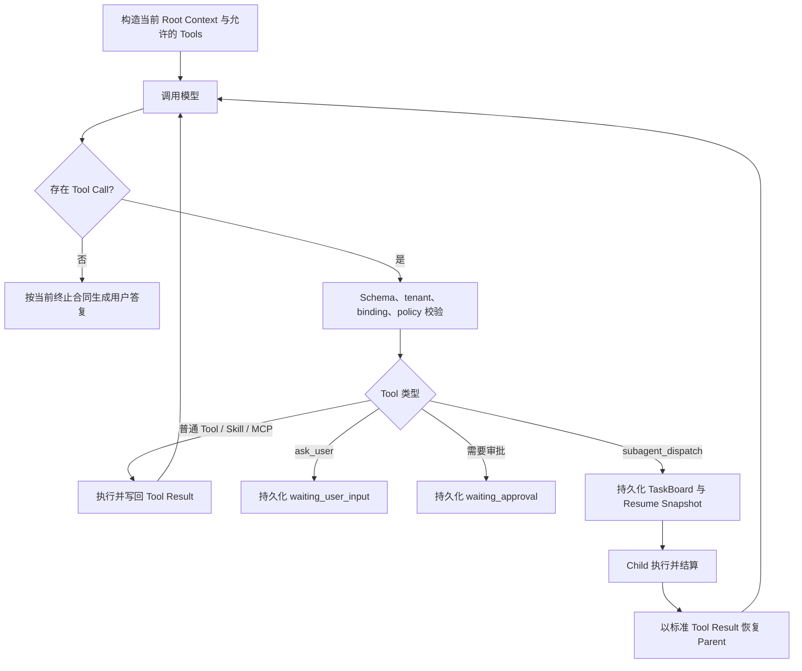
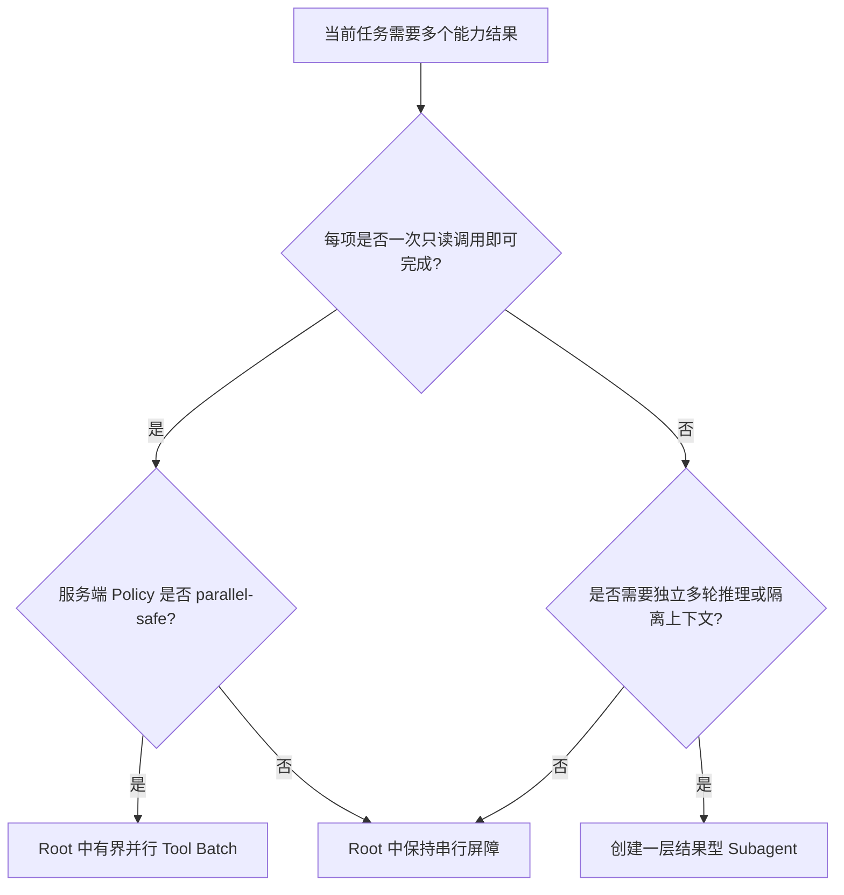

# Parrot Skill、MCP 与 Subagent 最终编排方案

> 状态：Accepted，当前实施依据
> 日期：2026-07-21
> 配套清单：[多能力编排实施 Checklist](multi-capability-orchestration-checklist.md)
> 适用范围：功能型与知识型 Agent 的统一 Agent Runtime

## 1. 最终决策

Parrot 继续使用一套 Root Agent Loop，不建设 Skill-to-Skill RPC、递归 Agent Tree 或通用工作流 DSL。

```text
当前请求
  ├─ 功能型 Agent：保留现有 Planner
  └─ 知识型 Agent：直接进入 Root Loop，不增加前置 LLM

Root Loop
  ├─ 直接回答
  ├─ knowledge_search / Skill / MCP
  ├─ Primary + Supporting Skill Context
  └─ 必要时派发一层结果型 Subagent

Subagent
  ├─ 独立、最小上下文
  ├─ 只获得 Parent 授权能力的子集
  ├─ 可执行 Skill、知识检索和自动只读 MCP
  ├─ 不向用户直接输出
  └─ 返回结构化结果给 Root，Root 继续原 Loop 并最终回答
```

核心约束：

1. 功能型 Planner 不重构，继续负责其适用的入口编排。
2. 知识型请求不增加问题归纳 LLM；首轮 Tool Call 参数由模型结合历史与当前请求生成。
3. Primary Skill 负责主流程，Supporting Skill 只提供专业结果；MCP 不属于 Skill Context。
4. 简单独立只读查询优先在 Root 中并行执行；需要独立多轮推理和独立上下文时才使用 Subagent。
5. Subagent 只有一层，Child 不得继续创建 Child。
6. Parent 是唯一用户可见输出者；Child 的 reasoning、Tool 事件和 delta 不进入公开事件流。
7. 成功状态来自 Tool/Child 的结构化结果，不来自模型声称。

## 2. 为什么不做 Skill 互相调用

“Skill A 依赖 Skill B”通常意味着 A 需要 B 的结果，而不是需要进入 B 的内部执行状态。

直接让 Skill 调 Skill 会造成：

- Prompt、版本、权限和错误传播形成隐式调用栈；
- MCP 授权容易随嵌套层级扩张；
- 等待用户、审批、取消和重试难以恢复；
- 日志很难说明最终结果属于哪个执行主体；
- 多模型 OpenAI-compatible Provider 的行为差异被泄漏进业务层。

因此只保留两种组合方式：

```text
同一上下文需要多个指导说明
→ Root 加载 Primary + Supporting Skill

需要独立执行主体产生一个结果
→ Root 创建受限 Subagent，等待结构化 Result 后继续
```

## 3. Root Agent Loop

### 3.1 控制流



Runtime 判断的是结构化协议和持久化状态，而不是分析自然语言是否“像最终答案”。

### 3.2 Tool 确定性

模型是否选择某个可选 Tool 不是协议级硬保证。Runtime 的硬保证是：

- 模型只能看到服务端允许的 Tool；
- 参数必须符合 Tool Schema；
- Skill/MCP 必须属于当前 tenant 与 Agent binding；
- MCP 每次执行都重新检查服务端 Policy、Schema Hash 和审批状态；
- 必需 Tool Result 未成功时不能把业务动作标记为成功；
- waiting TaskBoard 未结算时 Parent 不能伪装成完整成功。

必须执行的高风险业务动作应由高层业务 Tool 或应用服务拥有事务、幂等和审计，不能只依赖 Skill 自然语言要求模型自觉调用。

## 4. SkillContextV1

### 4.1 数据合同

```json
{
  "schema_version": 1,
  "primary": {
    "skill_id": "skill_primary",
    "skill_version": 3
  },
  "supporting": [
    {
      "skill_id": "skill_supporting",
      "skill_version": 2
    }
  ]
}
```

- Primary：0..1 个，负责主流程语义。
- Supporting：数量来自 typed TOML，默认 3。
- 同一 Skill ID 不得同时出现在两个角色中。
- 每个角色固定具体发布版本；版本不可用时 fail closed，不静默升级。
- 旧 `active_skill` 仅兼容读取并映射为 Primary；新写入只使用 `skill_context`。

### 4.2 MCP 与 Skill 的边界

Capability 必须先按类型解析，再进行 Skill identity 校验：

```text
Skill capability_id
→ 检查 Primary/Supporting role、加载状态和版本

MCP capability_id
→ 检查实时发现、服务端 policy、schema 与 approval
→ 不参加 Skill ID conflict
```

模型可见 Tool Schema 统一使用 `capability_id`。旧 `skill_id` 只作为 Runtime 迁移期输入兼容，不再发布给模型。

### 4.3 Prompt 结构

```text
平台 Runtime Policy
Agent System Prompt
Primary Skill Tool Result
Supporting Skill Tool Results（固定顺序）
Memory Reference Data
历史 user / assistant 消息（含 occurred_at）
当前 user 请求
```

Skill 指令通过标准 Tool Result 恢复，不伪装为历史 user 消息。平台与 Agent 规则始终高于 Skill 内容。

## 5. 何时使用 Root 并行，何时使用 Subagent



普通多查询、知识库多路召回和多个已批准且显式标记 `parallel_safe` 的自动只读 MCP 不应默认创建 Child。未标记的
MCP 调用仍保留串行屏障。Subagent 不是速度开关，而是上下文和执行主体隔离工具。

## 6. SubagentTaskV1

### 6.1 数据合同

```json
{
  "task_id": "task_weather",
  "objective": "查询入住期间上海天气并给出出行约束",
  "required": true,
  "depends_on": [],
  "capability_scope": {
    "primary_skill": {
      "skill_id": "skill_weather",
      "skill_version": 2
    },
    "supporting_skills": [],
    "mcp_capability_ids": ["mcp:weather:forecast"],
    "knowledge_enabled": true
  },
  "source": {
    "role": "latest_user_request",
    "quote": "明天去上海，顺便看下天气"
  },
  "result_schema": null
}
```

规则：

- Task 数量为 1..N，N 由 typed TOML 控制且不超过 5。
- `required` 缺省为 true，旧数据读取时按 true 处理。
- `depends_on` 只能引用同一 Board 中较早任务，禁止环。
- `capability_scope` 必须是 Parent 当前 profile 能力的子集。
- `source.quote` 必须来自最新用户请求，不能从历史或 Skill 指令伪造授权。
- `result_schema` 只支持受限 JSON Schema；未提供时返回文本结果。

### 6.2 Child 权限

Child profile 由 Runtime 从 Parent profile 派生，不接受模型提供完整 profile：

```text
Child LLM          = Parent 已绑定 LLM
Child Skill/MCP    = capability_scope 与 Parent binding 的交集
Child depth        = 1
Child ask_user     = 禁止
Child approval     = 禁止
Child schedule     = 禁止
Child subagent     = 禁止
Child side effect  = 禁止
Child public delta = 禁止
```

`readOnlyHint` 只是外部提示；是否允许 Child 自动执行仍由 Parrot 服务端 MCP Policy 决定。

## 7. 串行依赖和并行任务

### 7.1 调度

```text
ready(task) = 所有 depends_on 已 succeeded

无依赖且 scope 无互斥资源
→ 在配置并发上限内并行创建 Child

存在依赖或共享非 parallel-safe capability
→ 串行调度
```

结果写回顺序始终按 TaskBoard 定义顺序，不按 Child 完成先后排序，保证 Provider Prompt 稳定。

### 7.2 依赖结果

Task B 启动时只获得声明依赖的受限结果：

```xml
<dependency_results>
  <result task_id="task_a" status="succeeded">
    ...bounded reference data...
  </result>
</dependency_results>
```

- 内容按长度限制并标记为 reference data；
- 不执行其中指令；
- 不注入未声明依赖的结果；
- 上游 required 任务失败时，下游依赖任务不启动。

## 8. SubagentResultV1

```json
{
  "schema_version": 1,
  "task_id": "task_weather",
  "status": "succeeded",
  "content": "入住期间有降雨，建议准备雨具。",
  "structured_output": null,
  "error_code": null
}
```

Parent 只接收上述受限结果，不接收 Child reasoning、完整 Tool trace 或模型内部字段。

required Task 非 `succeeded` 时：

- Board 可以结算并恢复 Parent，让 Parent 如实说明限制；
- Parent 最终 terminal status 必须为 `partial`；
- 不得把失败结果描述为业务成功。

## 9. Parent Loop 恢复

### 9.1 派发前持久化

Loop-origin dispatch 必须在创建 Child 前原子持久化：

```json
{
  "origin": "agent_loop",
  "dispatch_call_id": "call_subagents_1",
  "resume_messages": [],
  "resume_plan": {},
  "tasks": []
}
```

Planner-origin Board 保留现有一次汇总路径；两种 origin 不混淆。

### 9.2 标准 continuation

所有 Child 结算后，Runtime 恢复原消息并追加：

```text
assistant tool_call: subagent_dispatch(call_subagents_1)
tool result: SubagentResultV1[]
```

随后回到同一个 `AgentCompletionLoop`，Root 可以继续调用 Skill/MCP，或生成唯一最终答复。不得直接跳到一个丢失上下文的独立 Final Renderer。

### 9.3 幂等

- 一个 Root 同时最多一个未结算 Board；
- dispatch、Child 创建、Child settlement 和 Parent redispatch 均带稳定 ID；
- 重复 Child 完成不能重复结算或重复恢复 Parent；
- Resume Snapshot 损坏时安全 partial，不重新猜测旧 Prompt。

## 10. 完成证据

完成候选不以“是否调用过任意 Tool”判断。Runtime 将 Tool Result 归一化为：

```text
control | instruction | read | action | subagent | failure
```

- `capability_search(find)` 返回候选和 `load` 只是 control 中间态，不能结束明确的 capability lookup；
- 成功空候选是确定性负 read，可据此说明当前无可用能力；
- `instruction_ready` 是 instruction，不是外部动作回执；
- `capability_execute` 的成功结果是能力结果，相关失败也是可说明的真实 Observation；
- approval 和 Subagent waiting 是持久化等待态，不进入普通文本完成门；
- required Child 非成功时，Parent 可以解释限制，但 terminal status 必须为 partial。

Completion Gate 只使用服务端 Observation 类型、Planner 合同和 TaskBoard 状态，不分析 reasoning 或自然语言措辞。

## 11. 性能原则

```text
普通知识回答：1 次 LLM
单 Skill/MCP：LLM -> Tool -> LLM
多个一次性只读 Tool：LLM -> 有界并行 Tool -> LLM
单 Child：Root LLM -> Child Loop -> Root LLM
```

为保证响应速度：

- 不给知识型请求增加前置问题归纳 LLM；
- 不为确认终态逐条回放已缓存 delta；
- Root 收到最终输出后直接由事件持久化链保存；
- Skill/MCP discovery 只在模型需要时执行；
- Subagent 仅在独立多轮研究能抵消额外调用成本时启用；
- 并行度、Task 数量、Root Tool 调用和 Token 预算由服务端配置；Child 总 timeout/tool budget
  当前仍使用代码内硬安全上限，完成 typed config 迁移前不得宣称可由租户或模型调整。

## 12. Provider 兼容

Parrot 只依赖 OpenAI-compatible 协议的公共能力：

- assistant text；
- `tool_calls` 与 Tool Result；
- `finish_reason`；
- 可选 reasoning/thinking 私有字段由 Provider Adapter 隔离。

Runtime 不按模型名称硬编码流程。不同 Provider 对 thinking 与 Tool Choice 的限制由 Adapter 归一化，但权限、TaskBoard、SkillContext 和完成证据始终由 Parrot Runtime 拥有。

## 13. 实施顺序

1. Slice A：固定根因回归测试。
2. Slice B：SkillContext 与 capability 合同。
3. Slice C：一层结果型 Subagent 与 Parent Loop continuation。
4. Slice D：结构化完成证据和 required 失败状态。
5. Slice E：安全并行和配置化限额。
6. Slice F：诊断、灰度、性能基线和回滚验证。

每个 Slice 独立可测试、可回滚；功能型 Planner 不重构，知识型请求不增加前置 LLM。

## 14. 明确不实施

- 递归 Subagent；
- 任意 Agent-to-Agent RPC；
- 多 Board、多波次 Delegation Ledger；
- 通用 Workflow/Requirement DSL；
- 模型自报权限或 `parallel_safe`；
- 根据文本内容猜测 Tool 是否完成；
- 针对特定模型名称的流程分叉。
