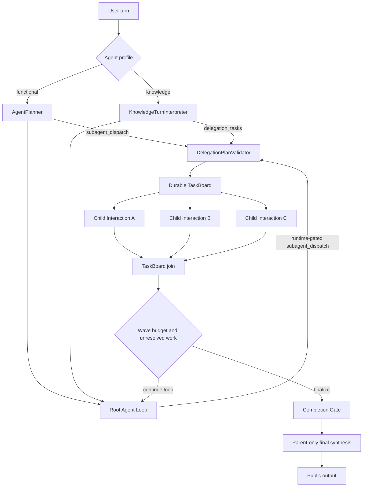

# 功能型与知识型 Agent 的 Subagent 编排契约

> 状态：研究记录，非实施依据。当前一层结果型 Subagent 与 Tool continuation 只按
> [Skill、MCP 与 Subagent 最终编排方案](multi-capability-orchestration-design.md) 的 Slice C 实施；本文讨论的递归、
> 多波次与 Delegation Ledger 仍不实施。
> 基线：Parrot `a612c876ec56ea979488a1856d77df3b7155fbc7`
> 日期：2026-07-19

> 实施时以 [Agent Runtime 可落地实施方案](agent-runtime-implementation-plan.md) 为准。本文件中的多波次、
> Delegation Ledger 和通用 EvidenceScheduler 仅保留为后续演进研究；首期复用现有 TaskBoard，并限制一个 Root
> Interaction 最多创建一块 TaskBoard。

## 1. 决策

Parrot 为功能型与知识型 Agent 同时提供 Subagent，但不新增第二套执行框架：

1. 复用现有 `TaskBoard`、Child `Interaction`、TaskIQ 调度、父行锁和恢复链路。
2. 功能型根回合继续由现有 `AgentPlanner` 决定 `subagent_dispatch`。
3. 知识型根回合由 `KnowledgeTurnInterpreter` 输出可选的 `delegation_tasks`，由 Runtime 编译成相同
   TaskBoard。
4. 功能型和知识型 Root 在 Agent Loop 中发现新的独立工作时，也可以调用同一个 `subagent_dispatch`；该 Tool
   只在 `DelegationGate` 通过时临时暴露，并受总波次、总 Child、去重、阶段和预算限制。
5. Parent 是 manager：始终拥有用户对话、审批、澄清和最终答案；Child 只返回内部结构化结果。
6. 默认整个 Root 最多 5 个 Child、同时运行 3 个、最多 2 个 delegation wave、深度 1；上限由服务端配置和
   代码共同限制，模型不能扩大。
7. Child 使用最小独立上下文与 synthetic plan，不再次执行根 Planner、不继续创建 Subagent。
8. 便宜且无需独立推理的知识库、Skill 和只读 MCP 查询使用 `EvidenceScheduler` 并发；只有确实需要
   独立多轮推理和独立上下文的任务才升级成 Subagent。

这采用的是“LLM 分解 + 代码编排”的混合模式。OpenAI Agents SDK 将 manager-style agents-as-tools
用于“父 Agent 保留最终答案并合并多个专家输出”，并建议用代码并发执行互不依赖的任务；Anthropic 的生产
Research 系统同样使用 orchestrator-worker，并明确指出广度型研究适合并行，而强依赖或共享上下文任务不适合。

## 2. 当前事实基线

当前项目并非从零开始，以下能力已经存在：

| 能力 | 当前实现 | 事实 |
| --- | --- | --- |
| 分解入口 | `agent_runtime/planner.py` | 功能型 Planner 已能返回 `subagent_dispatch` |
| Loop Tool 执行 | `execution_helpers.py`、`tool_executor.py` | Executor 已能处理该 Tool，并在结果为 `waiting_subagents` 时停止当前 Loop |
| 正常 Loop Tool 暴露 | `agent_runtime/plan_tools.py` | 当前 `tools_for_plan()` 不包含 `subagent_dispatch`，正常 Loop 不能主动调用 |
| 异常重规划 | `InProcessAgentRuntime._replan_after_control_plane_error()` | 功能型控制面异常重规划可以再次返回 `subagent_dispatch`，但这不是常规自适应入口 |
| Tool Schema | `agent_runtime/subagent_tools.py` | 接受 1 到 5 个任务，要求用户原文 provenance |
| TaskBoard | `agent_runtime/taskboard.py` | 校验 DAG、去重、总超时和总 Tool Budget |
| 并发 | `TaskBoard.ready_tasks()` | 最多 3 个 running task，依赖完成后再释放下一批 |
| 持久化分发 | `agent_runtime/subagent_dispatcher.py` | 在父 Interaction 行锁内创建 Child 并写回 TaskBoard |
| Child 运行 | `entry_type=subagent` | Child 是真实 Interaction，可由 TaskIQ 独立执行和恢复 |
| Child 规划 | `agent_runtime/subagent_plan.py` | 根据持久化 task 生成 synthetic plan，不重复根 Planner |
| Join | `settle_child()` | Child 终态后更新父 TaskBoard，全部终态时重新派发父 Interaction |
| 防递归 | `runtime_depth >= 1` | 当前深度固定为 1，Child 不能继续分解 |

当前服务端硬上限是：

```text
children <= 5
parallel <= 3
depth <= 1
sum(timeout_seconds) <= 180
sum(max_tool_calls) <= 20
```

这些边界符合第一阶段上线要求，应先保留。上线后再依据延迟、Token、失败率和 Provider 限流数据调整，不能
因为模型提出更多任务就动态扩容。

## 3. 当前问题

### 3.1 知识型和正常 Loop 没有完整分解入口

当前知识型可用工具集合不包含 `subagent_dispatch`。即使问题天然包含多个独立研究方向，也只能在同一个
上下文里串行推进，或仅进行单层知识检索。

功能型虽然能在根 Planner 入口分解，但正常 Agent Loop 的 `tools_for_plan()` 同样不暴露该 Tool。当前只有
控制面错误触发的受限 replan 可能再次派发；这不能覆盖“读取第一批证据后才发现新的两个独立方向”的常见场景。

此外，完成 TaskBoard 后 `_run()` 的 join guard 会直接以 `tools=()` 进入答案合成，无法带着 Child 结果回到
可继续分解的 Loop。要支持 Loop 内 Subagent，必须修改持久化恢复阶段，而不是仅把 Tool Definition 加进列表。

### 3.2 Tool Schema 与 Runtime 的 Agent 选择不一致

`subagent_dispatch` 的每个任务当前要求 `agent_id`，但 `TaskBoardTask` 不保存它，`_create_child()` 也始终继承
Parent 的 `agent_id` 和 runtime profile。这会让模型误以为自己能选择任意 Agent，而服务端实际忽略该字段。

第一阶段应采用明确合同：

```text
executor = inherit_parent_profile
```

删除模型输入中的必填 `agent_id`。未来如果需要专家 Profile，应新增服务端拥有的
`executor_profile_key`，只能从当前 Agent 已绑定且租户可见的候选集中选择，不能接受任意数据库 ID。

### 3.3 Task 结果还是松散字典

当前 `result: dict[str, object]` 可以承载输出，但缺少统一的：

- 完成状态与失败类型；
- 证据引用和来源信任；
- 任务声明的输出 Schema 校验结果；
- Token、Tool、耗时和截断信息；
- 可供父级判断“必需任务失败”的语义。

### 3.4 父子上下文边界需要收紧

Child 目前得到 task contract 和同一 Agent profile，这是正确方向；但后续接入 Memory、Knowledge Evidence 和
History 时，必须避免为了“上下文完整”把 Parent 整段会话、所有 Memory 和所有能力复制进去，否则会：

- 放大 Token、延迟和 Prompt Injection 面；
- 让多个 Child 重复研究同一内容；
- 让 Child 误把用户对 Parent 的控制当成自己的直接指令；
- 让 Child 写入相互冲突的长期 Memory。

## 4. 目标架构



Parent 不轮询 Child。Child 完成后通过持久化 settlement 推进 TaskBoard，并在全部终态时重新派发 Parent。
这比进程内 `asyncio.gather()` 更慢一些，但能承受 Worker 重启、长任务和数据库恢复。进程内并发只用于一个
Interaction 内部的短时只读 Evidence/Tool 调用。

## 5. 何时使用 Subagent

### 5.1 推荐使用

- 一个用户请求包含 2 到 5 个相互独立、各自需要多轮检索或工具判断的方向；
- 需要比较多个系统、方案、产品、区域或时间段，每个分支能形成独立结论；
- 需要研究、审查、验证等不同角色产生相互独立的结果，再由 Parent 综合；
- 单个上下文无法容纳所有原始证据，Child 可先压缩为结构化结论；
- 功能型任务中存在没有共享写状态的独立准备或读取步骤。

### 5.2 不应使用

- 一个知识库 Query、一次 Skill 加载或一次只读 MCP 调用；
- 任务严格串行，下一步参数依赖上一步结果；
- 多分支会写同一个外部对象、文件或资源；
- 需要用户澄清、审批或选择；
- Parent 已经拥有足够证据，只差一次答案合成；
- 任务价值不足以覆盖额外 Token 和 Provider 调用。

Anthropic 报告其多 Agent 研究大约消耗普通聊天约 15 倍 Token。因此“支持 Subagent”不能等于“默认分解”。
Parrot 应以复杂度、可并行性和收益门槛共同控制。

## 6. Evidence 并发与 Subagent 并发的分层

项目需要区分两种并行：

| 层级 | 适用 | 是否新开 LLM | 执行器 |
| --- | --- | ---: | --- |
| Evidence fan-out | 多 Query、多 Space、Skill 说明、可信只读 MCP | 否 | 同一 Interaction 内 `EvidenceScheduler` |
| Tool fan-out | 同一模型回合产生的独立安全 Tool Call | 否 | `ToolExecutionScheduler` |
| Subagent fan-out | 每个分支需要独立多轮推理、工具和上下文 | 是 | 持久化 TaskBoard + Child Interaction |

知识型 Agent 的默认优先级是：

```text
能批量检索解决
→ Evidence fan-out
→ 仍需独立多轮探索且问题可分解
→ Subagent fan-out
```

不能把每个知识来源包装成 Child；那会把便宜的并行 I/O 变成昂贵的多模型编排。

## 7. 统一 Delegation Plan

Planner/Interpreter 输出先归一化为 Provider 无关的内部结构：

```python
@dataclass(frozen=True)
class DelegationPlan:
    version: Literal["v1"]
    rationale_code: Literal[
        "breadth_research",
        "independent_comparison",
        "specialist_review",
        "parallel_preparation",
    ]
    tasks: tuple[DelegatedTask, ...]  # 2..5

@dataclass(frozen=True)
class DelegatedTask:
    task_id: str
    title: str
    objective: str
    kind: str
    depends_on: tuple[str, ...]
    required: bool
    expected_output: OutputContract
    allowed_capability_classes: tuple[str, ...]
    source_refs: tuple[SourceRef, ...]
    budget: TaskBudget
    dedupe_key: str
```

`SourceRef` 可以指向当前用户消息的精确 span，也可以指向已经重新授权的 Evidence ID。模型不得直接塞入任意
历史文本或跨租户资源标识。

### 7.1 功能型入口

保留 `AgentPlanner` 的四个动作。`subagent_dispatch` 参数升级为 `DelegationPlan v1`，但不改变 Planner 是否
执行以及它适用的根功能回合。

### 7.2 知识型入口

在 `KnowledgeTurnPlan` 中新增：

```python
delegation: DelegationPlan | None
```

只有满足以下条件才接受：

- 至少两个独立研究目标；
- 预计每个分支需要超过一次检索/工具调用或独立判断；
- 不需要 Child 写外部状态；
- 当前租户、Agent 和模型 Budget 允许；
- 任务目标覆盖当前用户问题且不重复。

否则 Runtime 将其降级编译为多个 `EvidenceRequest`，不创建 Child。

### 7.3 Agent Loop 内入口

入口分解无法覆盖所有情况。模型可能在收到知识证据、MCP 结果、Capability Observation 或第一波 Child 结果后，
才发现还存在两个互不依赖的工作方向。因此 Root Loop 也应支持同一个 `subagent_dispatch`，但不能永久、无条件
暴露。

```python
def loop_tools(state: RunState, profile: AgentRuntimeProfile) -> tuple[ToolDefinition, ...]:
    tools = normal_tools(state, profile)
    if delegation_gate.can_request(state, profile):
        tools += (subagent_dispatch_tool(),)
    return tools
```

`DelegationGate` 至少检查：

```text
runtime_depth == 0
stage in {RESEARCHING, EXECUTING}
no_active_task_board
delegation_waves < max_delegation_waves
total_children < max_children_per_root
total_tool/token/time budget remaining
no waiting approval / waiting user
not finalizing / cancelled / failed
```

模型调用该 Tool 后，现有 `RuntimeToolExecutor` 可以返回 `waiting_subagents` 并停止当前 Loop。真正需要改造的是
Parent 的恢复点：TaskBoard 完成后不能一律 `tools=()` 直接总结，而应根据持久化 `resume_stage`、剩余 Requirement
和 Wave Budget 决定恢复 Loop 还是进入 Finalizing。

### 7.4 Delegation Wave Ledger

单个 `input_payload.task_board` 只能表达当前/最后一块 Board，不足以支持入口分解后继续自适应分解。建议持久化：

```python
@dataclass(frozen=True)
class DelegationLedger:
    version: Literal["v1"]
    waves: tuple[DelegationWave, ...]
    active_board_id: str | None
    consumed_board_ids: tuple[str, ...]
    total_children: int
    total_tool_calls: int
    resume_stage: Literal["researching", "executing", "finalizing"]

@dataclass(frozen=True)
class DelegationWave:
    wave_index: int
    source: Literal["functional_planner", "knowledge_interpreter", "agent_loop"]
    board_id: str
    task_ids: tuple[str, ...]
    dedupe_keys: tuple[str, ...]
    status: Literal["waiting", "completed", "failed", "cancelled"]
```

第一阶段默认最多两波，但整个 Root 仍最多五个 Child，而不是“每波五个”。例如第一波三个任务后，第二波最多
两个。这样能处理 evidence-driven follow-up，同时防止 Loop 不断派生新 Agent。

父级恢复规则：

```text
completed board 尚未消费
→ 注入一次结构化 Child Result
→ 标记 consumed_board_id
→ 若 resume_stage 可继续且仍有未完成 Requirement
   → 恢复 Root Loop，按 DelegationGate 决定是否再次暴露 Tool
→ 否则 tools=() 进入 Finalizing
```

`dedupe_key` 必须跨 wave 唯一；第二波不能用不同措辞重复第一波任务。重复派发是 Runtime 拒绝，不靠提示词。

## 8. 服务端验证

`DelegationPlanValidator` 必须在持久化前完成：

1. Schema、版本、长度、任务数和 DAG 校验；
2. 每个 Task 的 provenance 与当前消息/Evidence 精确匹配；
3. 相同 `dedupe_key`、高度相似 objective 和重叠 source 范围去重；
4. 计算总超时、Tool、Token 和并发 Budget；
5. 根据 Agent profile 裁剪能力类别，拒绝越权 Tool Hint；
6. 禁止知识型 Child 使用写、审批或本地进程 MCP；
7. 检查当前 Interaction 没有活动 TaskBoard，且当前 Board 未重复消费；
8. 为每个 Task 生成服务端 `executor_profile`，不信任模型 Agent ID；
9. 固定稳定顺序，结果 join 不受完成先后影响；
10. 跨 Wave 校验 dedupe key、总 Child、总 Tool、总 Token、总墙钟和最大波次；
11. Loop 内派发只接受当前用户请求、已授权 Evidence 和已完成 Observation 的 SourceRef。

## 9. Child Context

每个 Child 只应看到：

```text
1. 稳定 Runtime Policy（minimal-subagent 版本）
2. 继承且经过裁剪的 Agent Profile
3. DelegatedTask 合同
4. 明确引用的 Evidence / SourceRef
5. 必需的工具定义与能力目录子集
6. Child 自己产生的消息和 Tool Observation
```

默认不包括：

```text
- Parent 全量 History
- Parent 全量长期 Memory
- 其他 Child 的中间进度
- Parent 的 Reasoning / Commentary
- 用户渠道和 IM 私有字段
- 未被 SourceRef 引用的知识片段
- Subagent dispatch、ask_user、approval、memory write 工具
```

如果某个已确认用户偏好或项目约定对 Task 必需，由 `ContextCompiler` 选择单个结构化 Memory Item 注入，不能
让 Child 自行加载所有 Memory。

## 10. Child 权限与工具

### 10.1 知识型 Child

- 允许绑定知识空间检索；
- 允许 instruction-only Skill；
- 允许服务端确认的只读远程 MCP；
- 禁止可执行 Skill、进程型 MCP、写工具、审批和用户澄清；
- 默认禁止长期 Memory 写入；
- 可以产生内部引用，但不产生公开输出。

### 10.2 功能型 Child

- 继承 Parent 已授权能力的子集；
- 默认只读；需要写操作的任务应留在 Parent 串行执行；
- 第一阶段禁止 Child 发起审批和外部副作用；
- 若未来开放写操作，必须有资源级互斥、父级预授权、幂等键和独立 ADR。

## 11. Child Result

统一结果合同：

```python
@dataclass(frozen=True)
class SubagentResult:
    version: Literal["v1"]
    task_id: str
    status: Literal["completed", "partial", "failed", "cancelled", "timed_out"]
    summary: str
    structured_output: dict[str, object] | None
    citations: tuple[EvidenceRef, ...]
    observations: tuple[ObservationRef, ...]
    limitations: tuple[str, ...]
    metrics: SubagentMetrics
```

Runtime 验证 `structured_output` 是否满足 Task 的 `expected_output`。校验失败是 `partial/failed`，不能仅因 Child
生成了自然语言就标记完成。

大结果应写入受租户隔离的 Artifact/Evidence Store，TaskBoard 只保存摘要、校验状态和引用，避免把大型报告
复制多次。第一阶段尚无通用 Artifact Store 时，必须设置结果大小上限并明确截断。

## 12. Join 与最终答案

父级合并规则：

1. 按 TaskBoard 定义顺序读取结果，而不是按完成时间；
2. 校验 Child Interaction、Task ID、Tenant 和 Board 所有权；
3. required Task 失败时，Completion Gate 选择补偿、partial 或 failed；
4. optional Task 失败时保留限制说明，但不伪造其证据；
5. Parent 消费当前 Board 后，如仍有独立未解决 Requirement，可在总上限内进入第二个且最后一个 Wave；
6. 没有未解决 Requirement、Wave 已耗尽或阶段不可分解时，进入 Finalizing；
7. 最终合成调用 `tools=()`，只有 Parent 的 `FINALIZING` 文本可公开。

Parent 不应逐字转述所有 Child 输出，而应依据引用合成；Child 的内部叙述、工具细节和 Reasoning 不进入用户
消息。

## 13. 取消、Steer、审批与恢复

### 13.1 Cancel

- 取消 Root 时，将未终态 Task 标记 `cancelled`，并请求取消对应 Child；
- 已提交的只读结果可以保留用于审计，但不再推进 Parent；
- 已完成外部动作不得因取消回滚，除非存在显式补偿合同。

### 13.2 Busy 输入与 Steer

- 新用户消息只进入 Root 的 durable steering 队列；
- 不能作为某个 Child 的 Tool Result 注入；
- 下一安全边界由 Parent 决定取消未开始任务、让运行中任务完成或重建 TaskBoard；
- 不在多个 Child 中广播同一用户输入，避免乱序和重复响应。

### 13.3 Approval

- 第一阶段 Child 不申请审批；
- Parent 负责所有审批和用户澄清；
- 如果 Child 发现必须执行写操作，只返回 `blocked_by_required_action`，由 Parent 重新进入正常功能流程。

### 13.4 Recovery

现有持久化路径继续作为事实源：

```text
Child terminal event
→ parent row lock
→ settle task
→ spawn dependency-ready tasks
→ all terminal 时 parent accepted
→ direct TaskIQ dispatch parent
→ DelegationLedger guard
→ 注入且只消费一次 completed board
→ resume_stage=researching/executing 时恢复 Root Loop
→ 否则 parent finalizing
```

任何重试都必须复用 `board_id + task_id + child_interaction_id`，不得创建重复 Child 或重放外部动作。

## 14. 并发、公平性和 Budget

需要三个相互独立的 Semaphore：

```text
global_subagents
tenant_subagents
provider_model_requests
```

TaskBoard 的 `max_parallel=3` 只是单 Root 上限，不代表全局资源充分。调度器还需：

- 租户公平队列，避免一个复杂请求占满 Worker；
- Provider/Model 限流和 429 退避；
- 每 Root 总 Token、总 Tool、总墙钟上限；
- Parent/Child 统一 Usage 聚合；
- 排队时间与执行时间分开观测；
- 简单任务不因复杂任务饥饿。

建议第一阶段默认：

```toml
[ai.subagents]
enabled = true
max_children_per_root = 5
max_parallel_per_root = 3
max_delegation_waves = 2
max_depth = 1
max_total_timeout_seconds = 180
max_total_tool_calls = 20
allow_knowledge = true
allow_functional = true
allow_child_writes = false
allow_child_memory_writes = false
```

具体全局和租户并发值必须由压测和 Provider 限额决定，不在设计文档中伪造固定生产数字。

## 15. 可观测性

Root Trace 至少记录：

- `delegation_source=planner|knowledge_interpreter`；
- `board_id`、task 数、DAG 层数、去重数；
- 每个 Task 的 queued/started/completed 时间；
- Child 模型调用、Token、Tool、失败、超时；
- Parent 等待时间、join 时间、最终合成时间；
- required/optional Task 完成情况；
- 被 Runtime 拒绝或降级为 Evidence fan-out 的原因；
- 全局、租户、Provider Semaphore 等待时间。

公开事件只需要“正在处理”与最终结果，不公开 Task 标题、Tool、内部错误或 Child 内容。管理端诊断必须继续受
Tenant 与权限控制。

## 16. 测试

### 16.1 合同

- 功能 Planner 的四种动作保持兼容；
- 知识 Interpreter 可生成/不生成 delegation；
- Root Loop 仅在 DelegationGate 通过时看到 `subagent_dispatch`；
- Child、Finalizing、Waiting User 和 Waiting Approval 阶段看不到该 Tool；
- 非法 `agent_id` 不再进入 Tool Schema；
- 2..5 Task、DAG、provenance、Budget 和 dedupe 校验；
- 服务端不接受模型扩大并发、深度和工具范围。

### 16.2 调度

- 三个独立 ready Task 确实并行；
- 依赖 Task 在前置完成前不启动；
- 完成乱序但 join 顺序稳定；
- Worker 重启后不重复创建 Child；
- Child settle 重复投递是幂等的；
- 入口 Planner、知识 Interpreter 和 Loop Tool 均写入同一 DelegationLedger；
- 第一波结果只注入一次，未完成 Requirement 可以触发第二波；
- 达到两波或五个总 Child 后 Tool 不再暴露；
- 跨 Wave 相同 dedupe key 被拒绝；
- Root cancel 能收敛 Child；
- 全局/租户/Provider 并发均受限。

### 16.3 安全

- Child 不继承未引用 History/Memory；
- 知识 Child 无法看到写工具、ask_user 和 subagent_dispatch；
- 跨租户 TaskBoard、Child、Evidence 不可见；
- 模型生成的任意 Agent ID、Tool Hint 和 Source ID 不能越权；
- Child 文本和 Reasoning 不进入公开事件。

### 16.4 完成性

- required Child 失败时不能正常成功；
- Output Schema 不满足时不能标记 completed；
- Parent 只引用真实 Child Evidence；
- Parent finalizing 没有 Tool；
- Child 全部完成后 Parent 只恢复一次。

### 16.5 性能

- 并行墙钟时间接近最慢 Child，而非所有 Child 之和；
- 简单任务不会创建 Child；
- Evidence fan-out 不误升级成多 LLM；
- 记录 Subagent 相比单 Agent 的质量、延迟、Token 和成本，而不是只测速度。

## 17. 实施顺序

### Phase A：修复现有合同

- 移除 Tool Schema 中未生效的模型 `agent_id`；
- 版本化 `DelegationPlan` 和 `SubagentResult`；
- 补齐 required/optional 与输出校验；
- 保持功能 Planner 和现有 TaskBoard 运行方式。

### Phase B：知识型接入

- `KnowledgeTurnPlan` 增加可选 delegation；
- 增加“降级为 Evidence fan-out”判定；
- 知识 Child 使用相同 profile、最小上下文和 synthetic plan；
- Parent-only finalizing。

### Phase C：Loop 内自适应分解

- `tools_for_plan()` 通过 `DelegationGate` 条件性加入 `subagent_dispatch_tool()`；
- 引入版本化 `DelegationLedger` 和 `resume_stage`；
- completed Board 从“一律 direct final”改为“消费结果后恢复 Loop 或 Finalizing”；
- 总 Wave、总 Child 和跨 Wave dedupe 由 Runtime 强制；
- 功能型和知识型 Root 共用，Child 继续禁止。

### Phase D：资源与恢复

- 增加全局、租户、Provider 并发控制；
- 聚合 Parent/Child Usage；
- 完善 Cancel、Steer、超时和恢复测试；
- 增加管理端 Trace，不增加用户可见中间 Loop。

### Phase E：评估后扩展

- 建立任务集，比较单 Agent、Evidence fan-out 和 Subagent；
- 只有质量收益覆盖成本后才调整默认门槛；
- 专家 Profile、Child 写操作或超过两波的递归式分解需要独立 ADR，不在第一阶段开放。

## 18. 参考实现与采纳边界

- [OpenAI Agents SDK Agent orchestration](https://openai.github.io/openai-agents-python/multi_agent/)：采纳
  manager 保留最终答案、代码并发独立任务；不引入 SDK 或 Responses API。
- [OpenAI Agents SDK Running agents](https://openai.github.io/openai-agents-python/running_agents/)：采纳 Agent Loop、
  `max_turns`、durable execution 的职责边界；Parrot 继续使用 PostgreSQL/TaskIQ。
- [Anthropic multi-agent research system](https://www.anthropic.com/engineering/multi-agent-research-system)：采纳
  orchestrator-worker、明确任务合同、3 到 5 个并发分支和成本门槛；不绑定 Claude 或 Extended Thinking。
- OpenClaw：采纳 minimal Subagent prompt、父级最终回复和 push completion；不复制文件型 Session/Memory。
- Hermes：采纳 fresh child context、稳定结果顺序、父取消传播和叶子工具裁剪；不复制进程内同步 ThreadPool。
- Skyler：采纳 root Planner + synthetic Child Plan 的已验证模式；Parrot 继续使用自身 Interaction、RLS 和
  TaskIQ，不运行时导入 `skyler/`。

## 19. 验收标准

满足以下条件才算完成：

1. 功能型 Planner 行为未被移除或降级为可选；
2. 功能型和知识型均可创建同一持久化 TaskBoard；
3. 两类 Root 都能在 DelegationGate 允许时从正常 Agent Loop 发起 Subagent；
4. Parent join 后可以恢复 Loop，最多两波且整个 Root 最多五个 Child；
5. 简单知识检索仍走 Evidence fan-out，不滥用 Child LLM；
6. Child 不重复根 Planner、不嵌套、不直接面向用户；
7. Parent/Child 权限、Memory、History 和 Tool 边界可测试；
8. required Task、Tool Observation 和最终成功状态可由 Runtime 验证；
9. Worker 重启、重复投递、取消和超时不会重复 Child 或外部动作；
10. 并发改善墙钟时间，同时 Token/成本和失败率可观测；
11. 不针对某个模型名称写业务分支，所有差异经 Provider Capability Profile 处理。
