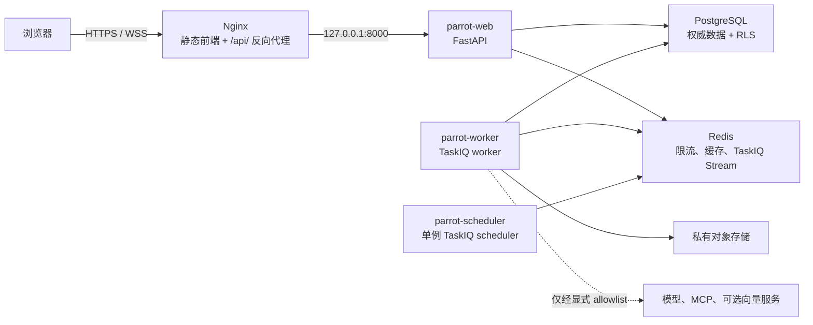

# Parrot 生产部署指南

## 1. 适用范围与边界

本文是当前 Parrot 的 Linux 主机部署参考，采用 **Nginx + systemd + 外部 PostgreSQL/Redis**
拓扑。它基于仓库现有的显式 TOML 配置、FastAPI Web 进程和 TaskIQ 进程入口；不引入第二套
应用配置或运行时。

- Parrot 是唯一可部署应用；`skyler/` 仅是迁移参考，不能作为运行时依赖或备用服务。
- 浏览器 API 根路径固定为 `/api/v1`；后端仅监听 loopback，公网流量只经 Nginx 和 TLS。
- 当前 MVP 的生产配置直接使用仓库中的 `backend/config/prod.toml`；应用不读取 `.env`、
  环境变量或第二个 secrets 文件作为配置来源。
- 根目录 `docker-compose.yml` 是本地/集成环境的便利设施，不是生产编排方案。生产不得用它
  启动应用容器，也不得因容器限制而放宽 Bubblewrap 沙箱。
- 本文只覆盖应用部署。PostgreSQL、Redis、TLS 证书、对象存储和可选向量服务应使用各自的
  受管服务或经过评审的基础设施方案。

运行时行为、Agent/Knowledge 验收项及故障恢复细节见
[运行操作手册](ai-interaction/runtime-operations-runbook.md)。

## 2. 目标拓扑



`parrot-web` 不启动任何持久后台循环。`parrot-worker` 处理 Agent 运行、记忆索引、文档摄取、
知识索引、Skill 构建和队列投递；`parrot-scheduler` 只运行一个实例。Worker 在有 Redis Stream
pending-message 监控和 PostgreSQL lease-loss 告警后才可以横向扩展。

## 3. 上线前条件

| 类别 | 要求 |
| --- | --- |
| 主机 | Linux、专用非登录系统用户 `parrot`、Python 3.13；前端构建使用 Node.js 20.9+，运行时也需提供配置中声明的 Node/npm 供受控 Skill 构建使用。 |
| 依赖 | 私有网络中的 PostgreSQL、Redis；应用主机能解析并访问它们。Redis 必须具备持久化、认证和备份策略。 |
| 网络 | 仅 Nginx 暴露 443；后端监听 `127.0.0.1:8000`。数据库、Redis 与 Skill 存储目录不得对公网开放。 |
| TLS | 为唯一的浏览器域名签发证书；`security.allowed_origins` 必须是完整 HTTPS origin，不能包含路径或尾随 `/`。 |
| Skill 沙箱 | 安装并验证 `/usr/bin/bwrap`，保留 `require_bubblewrap = true` 和 `allow_unsafe_local_execution = false`。不能因宿主机策略问题关闭沙箱。 |
| 对象存储 | 使用私有 Qiniu bucket、HTTPS 下载域名、仅前端实际域名的 CORS，以及 `staging/` 对象 24 小时生命周期规则。 |
| 可选向量服务 | 默认不启用 Memory 向量功能；任何 Memory/Knowledge 向量上线都需要单独的安全、留存、数据传输和租户隔离审批。 |

创建运行目录并限制权限：

```bash
sudo install -d -o parrot -g parrot -m 0700 \
  /var/lib/parrot/skill-packages \
  /var/lib/parrot/skill-artifacts \
  /var/lib/parrot/skill-sessions \
  /var/lib/parrot/skill-builds
sudo install -d -o root -g parrot -m 0750 /etc/parrot
```

应用版本建议以不可变目录部署，例如 `/opt/parrot/releases/<release-id>`，并由
`/opt/parrot/current` 指向已验证的版本。生产服务只读取 `current` 和 `/etc/parrot`；不要让
服务用户写入代码目录或密钥目录。

## 4. 配置与密钥

### 4.1 完整生产配置

将当前版本的 [prod.toml](../backend/config/prod.toml) 复制到仓库外，替换其中所有公开测试值、
占位符和示例地址，再以只读方式安装为 `/etc/parrot/config.toml`。跟踪的模板会主动拒绝生产启动。
应用只读取这个完整文件，不叠加第二个文件，也不从环境变量回退：

```toml
[app]
environment = "prod"
debug = false

[server]
host = "127.0.0.1"
port = 8000
reload = false

[logging]
# 生产建议使用 INFO；不得启用 ai.debug_log_prompts。
level = "INFO"
json = true

[security]
secure_cookies = true
allowed_origins = ["https://parrot.example.com"]

[ai]
allowed_model_hosts = ["models.example.com"]
debug_log_prompts = false

[object_storage]
bucket = "parrot-production"
key_prefix = "parrot"
download_domain = "https://parrot-oss.example.com"

[skills.sandbox]
enabled = true
bwrap_path = "/usr/bin/bwrap"
require_bubblewrap = true
allow_unsafe_local_execution = false
```

除以上字段外，保留模板中的限额、超时、TaskIQ、Memory、Knowledge 和 MCP 配置，除非有经过
评审的容量或产品决策。特别注意：

- 三个 `[database]` URL 必须不同：应用角色、平台角色和迁移角色不能复用。应用角色应保持
  RLS 约束；切勿以迁移角色运行 Web 或 Worker。
- `[redis]`、`[database]` 的连接串直接配置在 `prod.toml` 中。`[taskiq]` 的 queue、consumer
  group 和 schedule prefix 是部署身份的一部分，不能在同一 Redis 数据库中随意改名。
- `[security]` 的 `secure_cookies = true` 与 HTTPS origin 是生产校验的硬要求。Cookie 保持
  `HttpOnly` 和 `SameSite=Lax`，不得改为浏览器可读的 token。
- `[mcp].allowed_hosts`、`[ai].allowed_model_hosts`、Memory/Knowledge provider allowlist 均应
  只列实际主机名；`allow_stdio` 在生产保持 `false`，除非存在单独的安全设计。
- `memory.vector.enabled` 默认是 `false`。Knowledge 可服务纯词法空间；不要把“配置了向量端点”
  误当作已完成向量上线或已有可用索引。
- `skills` 的四个目录必须在仓库外，且 source package 与 artifact 目录必须不同。`
  skills.sandbox.session_directory` 和 `skills.build.session_directory` 也不得落入代码仓库。

### 4.2 凭据与历史边界

仓库中的三套 TOML 只保留公开测试值，不能连接真实外部账户。真实部署配置必须保存在仓库外；
不得复制进 Docker 镜像层。历史上进入 Git 的值需要在服务端撤销或轮换，文件替换并不撤销凭据。
同时清理旧镜像、构建缓存、日志、历史引用和其他克隆中的残留。历史改写需要独立协调，不应直接
向新公开远端推送旧历史。会话 pepper 轮换会使旧会话失效；加密根 key 需要先完成已有凭据的解密
重加密，不能直接替换导致密文不可读。

LLM、MCP、Embedding 与 reranker 的租户业务账号仍通过管理界面写入受认证加密存储。
发布前运行 `python3 scripts/quality/check_secrets.py`，扫描结果不得包含凭据原值。

权限示例：

```bash
sudo chown root:parrot /etc/parrot/config.toml
sudo chmod 0640 /etc/parrot/config.toml
```

先以服务账号在新版本目录中验证配置；该操作只加载并校验 TOML，不启动 Web 服务：

```bash
cd /opt/parrot/current/backend
sudo -u parrot .venv/bin/python -c \
  'from app.core.config import load_app_config; load_app_config("/etc/parrot/config.toml"); print("config valid")'
```

## 5. systemd 服务配置

以下服务均使用当前代码定义的 `/etc/parrot/config.toml` TaskIQ factory。不要将
`--config` 传给 `taskiq worker` 或 `taskiq scheduler`：TaskIQ 的原生 CLI 从
`app.modules.taskiq_entrypoints:container_broker` / `container_scheduler` 加载显式配置。

### 5.1 迁移服务

保存为 `/etc/systemd/system/parrot-migrate.service`。它是一次性服务，只在每次发布前手动运行，
不得 enable 成常驻服务。

```ini
[Unit]
Description=Parrot database migration and permission synchronization
Wants=network-online.target
After=network-online.target

[Service]
Type=oneshot
User=parrot
Group=parrot
WorkingDirectory=/opt/parrot/current/backend
UMask=0077
ExecStart=/bin/sh -ec '/opt/parrot/current/backend/.venv/bin/parrot db-upgrade --config /etc/parrot/config.toml && /opt/parrot/current/backend/.venv/bin/parrot sync-permissions --config /etc/parrot/config.toml'
NoNewPrivileges=true
PrivateTmp=true
ProtectHome=true
ProtectSystem=full
ReadWritePaths=/var/lib/parrot
```

### 5.2 Web 服务

保存为 `/etc/systemd/system/parrot-web.service`。它只提供 HTTP/WebSocket API，不承担 Worker
或 Scheduler 职责。

```ini
[Unit]
Description=Parrot FastAPI web service
Wants=network-online.target
After=network-online.target

[Service]
Type=simple
User=parrot
Group=parrot
WorkingDirectory=/opt/parrot/current/backend
UMask=0077
ExecStart=/opt/parrot/current/backend/.venv/bin/parrot serve --config /etc/parrot/config.toml
Restart=on-failure
RestartSec=5
TimeoutStopSec=45
NoNewPrivileges=true
PrivateTmp=true
ProtectHome=true
ProtectSystem=full
ReadWritePaths=/var/lib/parrot

[Install]
WantedBy=multi-user.target
```

### 5.3 Worker 服务

保存为 `/etc/systemd/system/parrot-worker.service`。初始部署仅启动一个 Worker；调大
`--workers` 或增加 systemd 实例前，先建立 Redis Stream pending-message 和 PostgreSQL
lease-loss 的告警。

```ini
[Unit]
Description=Parrot TaskIQ worker
Wants=network-online.target
After=network-online.target parrot-web.service

[Service]
Type=simple
User=parrot
Group=parrot
WorkingDirectory=/opt/parrot/current/backend
UMask=0077
ExecStartPre=/usr/bin/test -x /usr/bin/bwrap
ExecStart=/opt/parrot/current/backend/.venv/bin/taskiq worker --workers 1 --max-async-tasks 16 --ack-type when_executed app.modules.taskiq_entrypoints:container_broker
Restart=on-failure
RestartSec=5
TimeoutStopSec=90
NoNewPrivileges=true
PrivateTmp=true
ProtectHome=true
ProtectSystem=full
ReadWritePaths=/var/lib/parrot

[Install]
WantedBy=multi-user.target
```

Worker 必须在目标主机执行一次受控 Skill 沙箱验证。若宿主机禁用了非特权 user namespace，
不要通过关闭 `NoNewPrivileges`、`require_bubblewrap` 或 `allow_unsafe_local_execution` 来“修复”
问题；应使用支持非特权 Bubblewrap 的受控宿主机，或为该工作负载设计独立的加固执行环境。

### 5.4 Scheduler 服务

保存为 `/etc/systemd/system/parrot-scheduler.service`。此服务必须保持单例，运行多个实例会
破坏定时任务的单一调度边界。

```ini
[Unit]
Description=Parrot TaskIQ scheduler (singleton)
Wants=network-online.target
After=network-online.target parrot-web.service

[Service]
Type=simple
User=parrot
Group=parrot
WorkingDirectory=/opt/parrot/current/backend
UMask=0077
ExecStart=/opt/parrot/current/backend/.venv/bin/taskiq scheduler --update-interval 1 --loop-interval 1 app.modules.taskiq_entrypoints:container_scheduler
Restart=on-failure
RestartSec=5
TimeoutStopSec=45
NoNewPrivileges=true
PrivateTmp=true
ProtectHome=true
ProtectSystem=full
ReadWritePaths=/var/lib/parrot

[Install]
WantedBy=multi-user.target
```

## 6. Nginx 与 TLS

前端在构建时生成静态文件，Nginx 从发布目录提供文件，并把 `/api/` 原样代理到 loopback 后端。
API 代理必须支持 WebSocket upgrade，且读超时需要大于当前 `runtime.request_timeout_seconds`
（默认 360 秒）。在 Nginx 的 `http` 块中定义：

```nginx
map $http_upgrade $connection_upgrade {
    default upgrade;
    ''      close;
}
```

站点配置示例 `/etc/nginx/conf.d/parrot.conf`：

```nginx
server {
    listen 80;
    listen [::]:80;
    server_name parrot.example.com;
    return 301 https://$host$request_uri;
}

server {
    listen 443 ssl;
    listen [::]:443 ssl;
    http2 on;
    server_name parrot.example.com;

    ssl_certificate     /etc/ssl/parrot/fullchain.pem;
    ssl_certificate_key /etc/ssl/parrot/privkey.pem;

    root /opt/parrot/current/frontend/dist;
    index index.html;
    server_tokens off;
    client_max_body_size 51m;

    add_header Referrer-Policy "strict-origin-when-cross-origin" always;
    add_header X-Content-Type-Options "nosniff" always;
    add_header X-Frame-Options "SAMEORIGIN" always;
    add_header Strict-Transport-Security "max-age=31536000" always;

    location /api/ {
        proxy_pass http://127.0.0.1:8000;
        proxy_http_version 1.1;
        proxy_set_header Host $host;
        proxy_set_header X-Real-IP $remote_addr;
        proxy_set_header X-Forwarded-For $proxy_add_x_forwarded_for;
        proxy_set_header X-Forwarded-Host $host;
        proxy_set_header X-Forwarded-Proto $scheme;
        proxy_set_header Upgrade $http_upgrade;
        proxy_set_header Connection $connection_upgrade;
        proxy_read_timeout 370s;
        proxy_send_timeout 370s;
    }

    location = /index.html {
        add_header Cache-Control "no-store" always;
        try_files $uri =404;
    }

    location / {
        try_files $uri $uri/ /index.html;
    }
}
```

`client_max_body_size` 与当前 50 MiB 知识文件上限对齐。若变更
`knowledge.max_upload_bytes`，必须同步审查 Nginx 限制、对象存储限制和提取资源限制。将
HSTS 写入生产前确认该域名的所有子路径都已由 HTTPS 覆盖。

## 7. 发布顺序

1. 在受信任构建环境中检出锁定的发布版本，使用锁文件构建后端运行环境与前端静态产物；运行
   与改动相称的测试和 `make check`。不要在生产服务启动时下载依赖或编译前端。

   ```bash
   git checkout --detach <release-tag-or-commit>
   cd backend && uv sync --frozen --extra dev
   cd ../frontend && npm ci && npm run build
   cd .. && make check

   # 将通过验证的发布目录收敛为运行时依赖，不携带开发依赖。
   cd backend && uv sync --frozen --no-dev
   ```
2. 将不可变发布目录放入 `/opt/parrot/releases/<release-id>`，验证 `backend/.venv`、
   `frontend/dist` 和 `backend/app` 同属该发布版本；再原子更新 `/opt/parrot/current`。
3. 将已在仓库外填入部署值的完整生产 TOML 安装为 `/etc/parrot/config.toml`，以 `parrot`
   身份运行本文的只读配置校验。
4. `sudo systemctl daemon-reload` 后运行 `sudo systemctl start parrot-migrate.service`。
   迁移必须先于新服务启动；已执行的 Alembic revision 不可编辑，破坏性数据变更必须拆为
   独立、可回滚的发布计划。
5. 首次部署才执行 `parrot bootstrap-admin --config /etc/parrot/config.toml --password-file <仓库外临时文件>`，
   登录并更换临时凭据后安全销毁该文件。该命令只创建初始租户上下文、管理员身份、成员关系和
   必需角色授权，不创建 Agent、LLM 配置、Skill、MCP 或 Knowledge 业务数据。
6. 启动或重启 Web、Worker 和 Scheduler：

   ```bash
   # 首次发布
   sudo systemctl enable --now parrot-web parrot-worker parrot-scheduler

   # 后续发布（已运行的服务加载 /opt/parrot/current 新版本）
   sudo systemctl restart parrot-web parrot-worker parrot-scheduler
   sudo nginx -t && sudo systemctl reload nginx
   ```

7. 仅在从旧交付机制切换到 TaskIQ 且三个常驻服务均健康时，运行一次
   `parrot taskiq-backfill --config /etc/parrot/config.toml`。它是补投历史 pending 记录的
   一次性命令，不是 Worker 或 Scheduler 的替代品，也不应在每次发布中重复执行。
8. 完成第 8 节健康检查和运行操作手册中的业务 smoke checks 后，才将流量切至新版本。

## 8. 健康检查、监控与备份

Web 服务提供两个无需会话的本地健康接口：

```bash
curl --fail --silent http://127.0.0.1:8000/api/v1/health/live
curl --fail --silent http://127.0.0.1:8000/api/v1/health/ready
```

`live` 只说明进程可响应；`ready` 只验证 PostgreSQL 与 Redis 可连接。它们都不能证明
Worker、Scheduler、对象存储、模型服务、MCP 或向量服务健康。因此监控至少应覆盖：

- `systemctl is-active` 和重启次数：Web、Worker、Scheduler；Scheduler 的实例数必须恰好为 1。
- TaskIQ Redis Stream 的 backlog、pending、consumer idle 时间，以及 PostgreSQL runtime lease 的
  丢失/超时事件。
- Nginx 4xx/5xx、后端 5xx、请求耗时和 `X-Request-Id`。应用日志为 JSON 时仅含经 allowlist 的
  运行上下文字段；不得采集 prompt、cookie、token、密钥或完整模型输出。
- 对象存储上传失败、Skill sandbox 拒绝、知识摄取/索引失败和 provider allowlist 拒绝。
- PostgreSQL 备份可恢复性、Redis 持久化与恢复演练、部署根密钥的受控备份。凭据加密 key
  是数据库内密文可读性的恢复依赖，必须与数据库备份策略一起演练；轮换前需要完成
  重加密和恢复演练。

当前仓库没有独立的 Worker/Scheduler HTTP health endpoint 或 Prometheus 指标端点；在规模化前应
先把上述队列和 lease 信号接入现有监控平台，而不是把 `/health/ready` 当成全链路健康证明。

## 9. 回滚与安全边界

- 先停止或禁用受影响的 Agent 发布和计划任务，再处理运行时配置；保留 interaction、event、
  audit、index job 与对象版本用于诊断，不能通过删除数据掩盖发布失败。
- 应用回滚优先切回上一个 `/opt/parrot/releases/<release-id>` 并重启三个服务。不要把已经执行的
  Alembic revision 直接编辑或依赖未经验证的 downgrade；迁移应保持向前兼容直到旧版本退出。
- 模型、MCP、向量或对象存储故障必须按现有降级路径处理，不能借此扩大 host allowlist、关闭
  tenant/RLS 检查或将私有 bucket 改为公开。
- 不得恢复或新增 Skyler adapter、Skyler 数据库连接、身份 header 信任链或 Skyler worker。

### 上线检查清单

- [ ] `/etc/parrot/config.toml` 的 environment 为 `prod`、无 debug/reload、仅列 HTTPS origins。
- [ ] 所有部署凭据均在仓库外，历史已提交凭据已完成服务端撤销或轮换。
- [ ] `/etc/parrot/config.toml` 权限为 `root:parrot 0640`，日志和命令输出不包含配置值。
- [ ] 三个数据库 URL 不同；Redis、PostgreSQL 和对象存储均不对公网开放。
- [ ] Nginx 仅暴露 TLS，`/api/` 支持 WebSocket upgrade，后端只监听 loopback。
- [ ] Web、Worker、Scheduler 使用独立 systemd 服务，且 Scheduler 只有一个实例。
- [ ] Bubblewrap 可由 `parrot` 用户执行；生产未开启不安全 Skill 执行。
- [ ] 数据库迁移、权限同步、健康检查和业务 smoke check 已完成。
- [ ] 备份、告警、回滚版本及密钥恢复演练均有责任人和最近验证记录。
