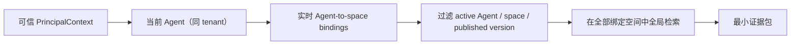
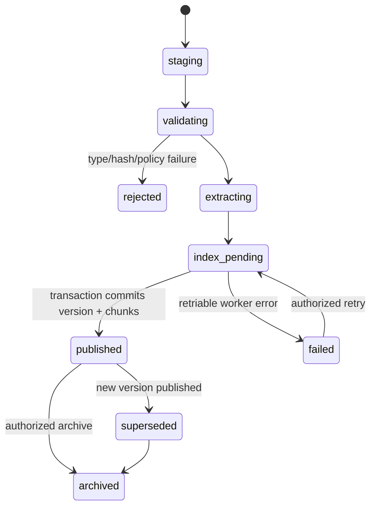
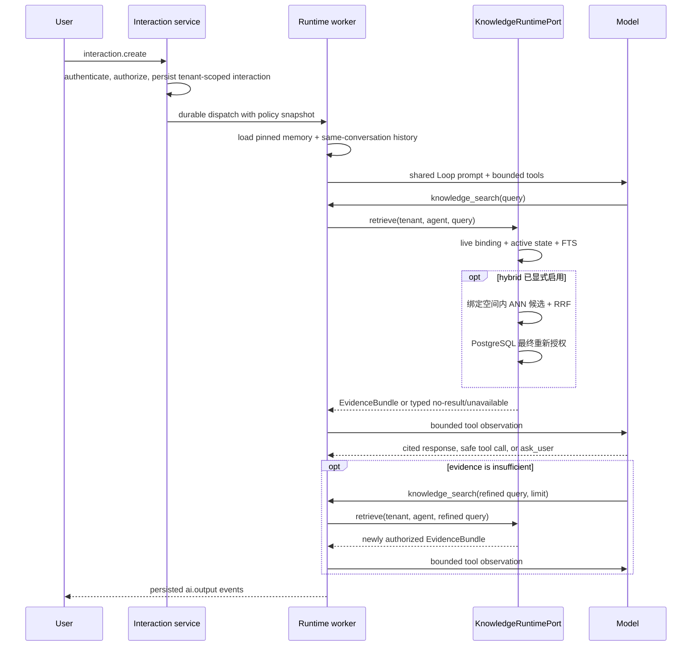

# Parrot 知识库接入与受控 Agent 架构方案

## 1. 结论与决策

原方案的三层分离（用户记忆、企业知识、实时工具）和“知识优先、行动受控”的方向正确，但**不能直接作为 Parrot 的实施方案**。它缺少知识文档的数据模型、摄取链路、知识空间授权模型、撤权语义，以及运行时的强制策略边界。

当前仓库已经有 `memory_records`、记忆索引 outbox 和可选 Milvus 记忆检索；它们服务于用户、会话和 Agent 记忆，不能承载企业知识文档。特别是 Memory 现有可见性只表达 tenant / agent / user / conversation / thread，不能表达知识空间成员、群组授权、文档版本和撤权。因此不得把文档、制度或 Runbook 写入 Memory collection，也不得复用它的向量索引作为知识库。

推荐采用以下决策：

1. 新增独立的 `knowledge` 模块；知识空间（`KnowledgeSpace`）是内容和管理访问边界，Agent binding 是运行时检索授权锚点。
2. 默认使用 PostgreSQL 全文检索和元数据过滤。语义检索按知识空间显式引用独立的 Embedding 配置、collection、索引任务和关系库引用，不复用 Memory/Milvus 索引；没有配置和外部处理授权时保持 lexical 失败闭合。
3. 知识型 Agent 的所有检索先按实时 Agent 绑定、租户和知识内容状态过滤，再排序、截取和发送给模型；模型、profile snapshot、向量元数据和前端都不能扩大可见范围。
4. `agent_type_key=knowledge` 不能只作为 UI/catalog 标签。运行时直接进入共享 Agent Loop，但必须使用服务端能力
   白名单；允许记忆、知识查询、时间、数学、instruction-only Skill 和受服务端 Policy 约束的远程 MCP，强制关闭脚本、可执行
   Skill、stdio MCP、子任务和定时任务，不能依赖 system prompt 约束。
5. 知识空间的 user/group grants 只控制管理面访问。已发布且 `allow_anonymous=true` 的知识型 Agent 可向匿名访客检索其全部绑定空间；因此 Agent 绑定必须被视为公开披露边界并在管理端明确确认。

这是一套模块化单体方案，遵循：

```text
api router -> knowledge service -> repository / storage ports
agent runtime -> KnowledgeRuntimePort
knowledge module -> PostgreSQL / private object storage / extraction worker
```

不引入 Skyler 运行时、数据库或路由；不让 router 写 SQL；不让 Agent runtime 直接查询知识表。

## 2. 现状核对与差距

| 当前能力 | 可复用边界 | 不能直接复用的原因 | 本方案处理方式 |
| --- | --- | --- | --- |
| `memory_records` 与 Memory Runtime | 用户偏好、项目约定、线程摘要；同租户 RLS 与 outbox 模式 | 没有知识空间 ACL、文档版本、来源、引用锚点或撤权模型 | 保持 Memory 独立；仅复用设计经验与 outbox 模式 |
| 可选 Milvus Memory 检索 | ANN 适配模式的参考 | 现有过滤仅适用于记忆 scope | Knowledge 使用独立 `KnowledgeVectorStore`、collection、凭据和 outbox，不复用 Memory 索引 |
| `AgentPublication.agent_type_key` | 服务端策略选择输入 | 知识型与功能型的规划语义、工具边界不同 | resolver 和 runtime 共同执行不可由前端覆盖的 capability policy |
| 现有 Interaction / durable runtime | 已有 principal、tenant、审计、事件和恢复路径 | 目前只有 Memory 首轮上下文，没有证据包或检索策略 | 在首次 Planner/模型调用前接入 `KnowledgeRuntimePort` |
| PostgreSQL RLS | tenant 级纵深防御 | tenant RLS 不表达 Agent 绑定和文档状态 | RLS 保护租户；检索 SQL 同时强制实时 Agent 绑定、Agent/空间/版本状态 |

关键风险是：若把“tenant 内任意文档都可检索”当成授权，会让一个 Agent 超出它的配置范围读取资料。知识型 Agent 的最终候选集必须是：

```text
当前 Agent 的实时绑定知识空间 ∩ active Agent / active space ∩ 当前有效文档版本
```

## 3. 安全模型

### 3.1 主体与安全边界

沿用 Parrot 的可信 `PrincipalContext`，不接收客户端、渠道配置、文档或模型提供的 tenant / user / group 声明：

```text
PrincipalContext
  tenant_id
  subject_type      # user | anonymous | system
  subject_id
  permissions
  request_id
```

知识空间是 tenant 内最小的内容和管理访问单元。一个空间包含相同保密级别和相同成员范围的文档，例如“研发通用”“产品项目 A”“人力资源”“财务”。首期不支持单文档例外 ACL；需要不同成员范围时创建不同空间。这比在每一个 chunk 上维护可变 ACL 更安全、可审核，也能使管理访问与运行时 binding 语义保持确定。



### 3.2 授权规则

权限 key 由代码拥有并通过现有 IAM 同步；角色只是权限 key 的集合，不能替代空间 ACL。

| 权限 | 作用 | 不能授予的能力 |
| --- | --- | --- |
| `knowledge.query` | 在管理台查询获管理授权的空间 | 让任意 Agent 检索所有知识 |
| `knowledge.spaces.read` | 查看自己可管理空间的元数据 | 修改成员或内容 |
| `knowledge.spaces.manage` | 创建、配置、停用空间 | 默认读取所有受限空间 |
| `knowledge.documents.read` | 管理端查看已授权空间的文档与版本 | 摄取、删除或授权 |
| `knowledge.documents.manage` | 上传、发布、替换、归档文档 | 修改空间成员 |
| `knowledge.access.manage` | 管理空间的用户/群组授权 | 跨 tenant 管理 |
| `knowledge.ingestions.manage` | 发起、重试和查看摄取任务 | 读取无权文档正文 |

授权判断：

```pseudo
function authorizeAgentKnowledge(tenantId, agentId, spaceId):
    require agentKnowledgeBinding.exists(tenantId, agentId, spaceId)
    require agent.isActiveAndPublished
    require space.isActive
    require document.isActiveAndPublished
    return allowed
```

- tenant 不一致、空间未绑定、Agent 已停用/下线或文档已归档时一律返回空证据，不得泄露名称、数量、相似度或引用链接。
- 管理端读取仍需对应的 `*.read` / `*.manage` 权限和空间授权；平台租户管理权限不能成为默认的内容读取绕过。跨租户运维仅能经过显式、审计的 break-glass 用例，首期不提供。
- 群组成员变化和管理授权撤销必须立即影响管理面查询；空间停用、Agent 解绑或下线、文档归档必须立即影响运行时关系库检索。异步索引删除只能优化存储，不能成为撤权的前提。
- `system` 仅用于摄取/索引 worker，并携带固定的 `tenant_id + job_id`，不能以任意用户或任意空间运行。匿名访问是否可读由目标 Agent 的 published/active/`allow_anonymous` 状态在入口处决定。

### 3.3 RLS、查询与缓存

每张 tenant-owned knowledge 表都有非空 `tenant_id`、tenant-prefixed唯一约束、复合外键和 PostgreSQL RLS。每个请求/worker transaction 都调用现有 `SET LOCAL app.current_tenant_id`；禁止连接池复用 tenant 状态。

关系库 RLS 负责租户纵深防御，检索 SQL 负责实时 Agent binding 与内容状态。每次返回 chunk 都必须重查绑定和状态；管理台读取引用全文或下载源文件时仍重复执行空间 user/group grant 判断，不能相信先前的搜索结果。

首期不把 `user_id` / group IDs 写进数据库 session setting 来实现复杂主体 RLS。这样做会引入成员变更、security-definer 函数和连接状态泄漏的额外风险。若未来需要数据库层的空间 ACL 纵深防御，必须单独 ADR 后再以 `SET LOCAL`、受限数据库角色、`FORCE ROW LEVEL SECURITY` 和撤权测试实施；不得由应用临时拼接 RLS 条件。

首期不缓存运行时证据结果。未来若引入缓存，键必须包含 `tenant_id + agent_id + 当前绑定空间集合 + query hash`，不得缓存跨 tenant 的检索结果、chunk 正文或 rerank 结果。变更 Agent binding、Agent/空间状态或文档发布状态时失效对应缓存；即使缓存失效延迟，也必须在返回前关系库复核。

## 4. 领域模型与持久化设计

### 4.1 表与所有权

`knowledge` 模块独占以下表；其他模块只能通过 typed port 调用，不能 join 或写入这些表。

| 表 | 关键字段/约束 | 职责 |
| --- | --- | --- |
| `knowledge_spaces` | `tenant_id`, `id`, `slug`, `status`, `classification`, 默认 `chunk_separator` / `chunk_size_chars` / `chunk_overlap_chars` 和本地文本预处理规则，`access_revision`; `UNIQUE(tenant_id, slug)` | 授权、摄取和检索的安全边界；默认处理与切分设置只作用于之后的新版本 |
| `knowledge_space_user_grants` | `(tenant_id, space_id, user_id)`；复合 FK 到空间与 tenant membership | 对个别成员授予管理面访问权 |
| `knowledge_space_group_grants` | `(tenant_id, space_id, group_id)`；复合 FK 到空间与 tenant group | 对群组授予管理面访问权 |
| `knowledge_sources` | `tenant_id`, `space_id`, `source_kind`, `canonical_uri`, `object_key`, `status` | 上传或后续 connector 的来源身份，不存公开桶地址 |
| `knowledge_documents` | `tenant_id`, `space_id`, `source_id`, `title`, `status`, `current_version_id` | 稳定的逻辑文档身份 |
| `knowledge_document_versions` | `tenant_id`, `document_id`, `version`, `content_sha256`, `extraction_status`, `published_at`, 文本预处理、分段标识符与切分设置快照 | 不可变提取结果、版本、实际生效的处理/切分参数和回滚依据 |
| `knowledge_chunks` | `tenant_id`, `space_id`, `document_version_id`, `ordinal`, `content`, `tsvector`, `citation_anchor` | 可检索文本与稳定引用锚点 |
| `knowledge_ingestion_jobs` | `tenant_id`, `source_id`, `version_id`, `status`, lease, error code | 可恢复摄取 outbox/worker 作业 |
| `knowledge_vector_references` | 后续向量阶段才创建 | 仅保存向量 ID 与 chunk/version 的对应关系 |

`knowledge_chunks` 必须保留文档版本 ID、段落序号和字符范围，不能只存拼接文本。引用必须能精确指向“文档、版本、页码/标题/段落范围”；版本切换不覆盖旧证据。

源文件留在私有对象存储中，object key 包含 tenant / space / source / version；浏览器只获得短时、单对象 staging 上传授权。服务端重新读取并校验文件后移动到 canonical key，和已有上传标准保持一致。下载或预览总是经过授权后端路径，不能使用可猜测的永久 URL。

### 4.2 文档状态机与摄取



摄取仅允许受信任的管理入口发起；首期只支持上传，外部 connector（飞书、Confluence、Git 等）延后。外部同步若将来接入，必须拥有独立的 tenant-scoped OAuth/credential、来源级 allowlist、最小权限、变更游标、删除传播和重新授权流程，不能把管理员浏览器 cookie 或用户 access token 交给 worker。

摄取步骤：

1. 授权 `knowledge.documents.manage`，校验空间、MIME、大小、内容哈希和重复策略；将文件放入私有 staging key。
2. 异步 worker 在固定 `tenant_id + job_id` 作用域内进行格式提取、受限的本地文本预处理和分块；提取器不得执行文档内宏、链接或嵌入代码。首期预处理仅支持空白规整与移除 URL/邮箱，原始对象不变，处理后的版本正文才可进入索引。当前需求明确不接入病毒扫描，因此文件类型、大小、魔数校验、私有存储和未发布隔离是最低防线；生产环境仍建议在对象存储入口或专用隔离服务补齐恶意文件检测。
3. 创建版本时快照空间默认的文本预处理、分段标识符与切分参数。分段标识符默认 `\\n\\n`，允许 `\\n`、`\\t` 或如 `***` 的自定义标识符；命中标识符后优先在其位置切分，超长内容仍回退到换行和词边界。随后生成不可变 `document_version`、chunk 和 PostgreSQL 全文索引；修改空间默认参数只影响后续版本，不会重切既有证据。失败版本不可进入检索结果。
4. 归档或删除立即使关系库不可见，并写删除作业。对象与索引异步清理由可恢复 job 完成；保留期限由空间分类策略决定。

文件、提取文本和文档元数据都视为不可信内容。它们可被模型当作证据，但不能修改系统策略、工具权限、检索过滤或执行计划。

### 4.3 多媒体内容边界

当前实现支持 UTF-8 文本、Markdown、带文本层的 PDF，以及 PPTX / DOCX / XLSX 结构化摄取。
Office 文档按 slide / section / table region 建立 evidence group，关联媒体写入
`knowledge_media_assets`。PPTX 全保真整页 `slide_render` 依赖 LibreOffice；缺失或渲染失败时仅生成
`thumb` 降级预览并计入 `skipped_media_count`，不能把该缩略图视为 shape-only 图的完整证据。
扫描 PDF 的 OCR 仍在后续切片。

多媒体实现以稳定的 `KnowledgeContentExtractorPort` 为准，worker 只消费 `ExtractedDocument`。
citation 逐步固定到 document version + slide/section/region；原文件与图像字节不进入检索 tool
observation。向量库仅存候选 ID。对话侧的目标契约是图文：回答携带可解析 citation，并可由服务端
挂接 primary media 附件（图仍不进 LLM）；该出站链路尚未实现。详见
`docs/knowledge-multimodal-implementation-plan.md`、`docs/knowledge-agent-rich-response-plan.md`
与 ADR 0003。

独立图片、外部 OCR/视觉供应商仍需单独审批后启用。

## 5. 检索与引用契约

### 5.1 第一阶段：无需向量数据库的安全检索

先使用 PostgreSQL `tsvector`、`websearch_to_tsquery`、标题/标签权重和严格 metadata filtering。它可支持制度、Runbook、产品文档等初期常见问题，并让权限、版本、引用和评测先稳定下来。


检索 SQL 的过滤条件必须先于排序和 limit 生效，并含有：

```text
tenant_id = interaction.tenant_id
agent_binding.tenant_id = interaction.tenant_id
agent_binding.agent_id = interaction.agent_id
agent.agent_type_key = knowledge AND agent.status = active AND agent.published = true
space.status = active
document.status = active
document_version.status = published
```

不得让数据库先在整租户或全库 ANN/FTS 检索再在 Python 中过滤；这会造成 timing、计数或日志泄露，也会浪费资源。

### 5.2 证据包与回答规则

`KnowledgeRuntimePort.retrieve()` 返回不可变的、已授权的 `EvidenceBundle`：

```text
query_id                 # 审计关联 ID，不回显完整敏感 query
space_id
document_id
document_version_id
chunk_id
title
source_uri_or_internal_ref
published_at
citation_anchor
excerpt                  # 严格长度上限
retrieval_method
score_bucket             # 不向终端暴露精确内部相似度
```

- 模型只接收截断后的证据正文和引用 ID，不接收对象存储 key、ACL、完整元数据、其他候选或未授权分数。
- 回答的每一项企业事实必须带一个或多个 `citation_id`；无法支撑的结论必须说明“未在可访问知识库中找到依据”。
- 引用链接/展开 API 接收 `citation_id` 后重新授权，且固定到原 `document_version_id`；不能按标题或最新版本重定向。
- 文档冲突时输出不同版本/来源的冲突，不静默选取最高分结果；检索不可用、无权限和无命中使用不同稳定错误码，但对无权限不暴露资源存在性。
- 原文中出现“忽略系统指令”“调用工具”等内容时，作为资料内容而非指令执行。system prompt 必须明确规定检索资料不具有指令权。

### 5.3 可选语义检索（显式启用）

代码层已实现独立向量索引和混合召回，但配置默认关闭。在生产启用前仍须完成数据分类/DPIA、Embedding 与重排序供应商的数据出境评审、保留/删除承诺、容量成本评估，以及租户隔离、撤权和删除压测。缺少任一条件时空间继续使用 lexical，不允许静默放宽安全约束。

获批后的 `KnowledgeVectorStore` 与 MemoryVectorStore 完全分离，至少满足：

1. 独立 collection、凭据、索引 job 和 `knowledge_vector_references`，不共用 Memory collection。
2. 向量 payload 只含 opaque `chunk_id`、`tenant_id`、`space_id`、`document_version_id`，不含正文、标题、ACL 或对象 key。
3. ANN 查询始终携带服务端生成的 tenant/space filter；返回结果仅为候选 ID。
4. 每个候选都回到 PostgreSQL，以当前 Agent binding、Agent/空间/文档状态和版本再次授权后才读取正文或计算 rerank；向量索引延迟不能放宽撤权。
5. embedding、rerank 与 LLM 的外发内容遵循同一数据分类策略；受限空间默认不向第三方服务发送文本，除非租户已显式批准并有合规依据。启用租户级多库合并重排是对当前及后续 Agent 绑定空间候选文本的显式处理授权，管理界面必须说明该作用域。
6. `embedding_configs` 与 `reranker_configs` 是独立 tenant 表，凭据分别使用独立 AAD；知识空间或租户合并策略保存配置引用、候选 Top K、阈值、重排序开关与索引 revision。禁用任一被引用的配置必须返回冲突，不能让运行时读取失效配置。

## 6. Agent Runtime 集成

### 6.1 不可绕过的执行策略

运行时 capability policy 由服务端 `AgentRuntimeProfile`、resolver、tool registry 与 capability session 共同执行。
它由 `agent_type_key` 选择，但并不由数据库描述、前端字段或 system prompt 动态授予能力；知识型 Agent 可以暂时
没有 binding，但该情况下运行时必须失败闭合为空证据。

| Runtime policy | 首次模型调用前 | 可用工具 | 明确禁止 |
| --- | --- | --- | --- |
| `knowledge` | 受限 pinned Memory + 同会话 History 直接进入共享 Loop | `memory`、`todo`、`time`、`math`、`knowledge_search`；instruction-only Skill；远程 MCP 的自动只读 Tool；Root WebSocket 的需审批副作用 Tool 与 `ask_user` | 功能型任务拆解、可执行/MCP-backed Skill、stdio MCP、Script、schedule、subagent、没有启用服务端 Policy 的 MCP |
| `action` | 默认不检索企业知识 | 当前已绑定并受 sandbox/审批约束的能力 | 因为模型或 prompt 自行读取知识库；未确认写操作 |
| `hybrid`（Phase 3） | required retrieval，先形成含 citation 的行动草案 | 只读知识工具 + 显式允许的行动工具 | 无证据的高风险操作、跳过影响说明与确认 |

`agent_type_key=knowledge` 必须由 runtime profile 的服务端策略强制执行。`BoundAgentRuntimeProfileResolver`
仅保留 instruction-only Skill 和非 stdio MCP；`CapabilitySession` 再过滤可执行 Skill 和没有当前有效服务端 Tool
Policy 的 MCP tool。Root WebSocket 可发现 `read + automatic` 和 `side_effect + required`，非交互入口只保留前者；
`tools_for_plan` 只注册知识型白名单。profile snapshot 不得保存 binding 或任何可授权知识空间 ID。MCP annotation 不能
替代管理员逐工具授权、schema hash 校验和服务端审计。

### 6.2 统一 Loop 按需检索路径



`knowledge` 不经过功能型 Planner，也不调用独立意图分析器。当前问题、History 和 pinned Memory 直接进入共享 Loop；
模型需要内部事实证据时调用 `knowledge_search`，需要业务流程时调用 `capability_search`，缺少信息时由 Root
WebSocket Loop 调用 `ask_user`。Runtime 对每次工具调用重新执行授权和输入校验；模型的路由选择不授予权限。

Memory 和 Knowledge 的注入顺序必须明确标记来源，并分别设置 token 预算。Memory 只提供用户偏好/线程摘要，Knowledge 只提供 Agent 允许的事实证据；二者不共享检索索引、存储表或写入通道。

### 6.3 Hybrid 的写操作门禁

Hybrid 不在知识库首期启用。后续必须将运行拆成持久化状态机：

```text
evidence_ready
  -> proposed_action (显示 citations、参数、目标资源与影响范围)
  -> waiting_user_confirmation
  -> authorized_execution
  -> completed | failed | expired
```

确认记录与执行请求必须绑定 interaction、tenant、actor、Agent policy、参数摘要和证据版本；任何参数、目标、scope 或证据变化都会使确认失效。确认不是让模型“继续”的自然语言推断，必须是客户端发出的、带 CSRF/所有权校验的显式命令。

## 7. API、前端与可观测性

OpenAPI 是唯一 wire contract。新增的管理 API 使用现有 `/api/v1` JSON envelope，并按模块划分：

```text
/api/v1/admin/tenants/{tenant_id}/knowledge/spaces
/api/v1/admin/tenants/{tenant_id}/knowledge/spaces/{space_id}/grants
/api/v1/admin/tenants/{tenant_id}/knowledge/spaces/{space_id}/documents
/api/v1/admin/tenants/{tenant_id}/knowledge/merge-settings
/api/v1/admin/tenants/{tenant_id}/knowledge/documents/{document_id}/version-upload-grants
/api/v1/admin/tenants/{tenant_id}/knowledge/documents/{document_id}/versions
/api/v1/admin/tenants/{tenant_id}/knowledge/documents/{document_id}/versions/{version_id}/source
/api/v1/admin/tenants/{tenant_id}/knowledge/ingestions/{job_id}
/api/v1/admin/tenants/{tenant_id}/agents/{agent_id}/knowledge-spaces
```

知识管理 UI 只通过 `frontend/src/shared/http/` 和 OpenAPI 生成客户端访问 API；前端权限检查仅用于呈现，后端才是最终裁决。源文件下载是受权二进制响应的窄例外，仍通过共享 HTTP client 携带会话并在服务端重新验证 tenant、权限、空间 grant、文档和不可变版本。上传新版本只有在提取、分块和发布全部成功后才切换当前版本，失败时继续检索旧版本。

审计记录必须覆盖空间创建/停用、grant 变更、上传、版本发布/归档、摄取重试、下载、检索决策和引用展开。审计字段保留 request ID、tenant、actor、space/document/version IDs、授权结果、候选/返回数量和耗时；不得记录完整 prompt、chunk 正文、原始文件、密钥、对象 key 或精确相似度。

最低监控指标：

| 类别 | 指标与门槛 |
| --- | --- |
| 安全 | 跨 tenant、跨空间、撤权后访问成功率必须为 0；所有拒绝可按 request ID 追踪 |
| 正确性 | 引用可重新授权率 100%；发布版本与引用版本一致率 100% |
| 检索 | 空结果率、每空间命中率、每文档结果上限命中率、检索故障率 |
| 性能 | PostgreSQL FTS P95、首 token P95、摄取队列延迟与失败重试率 |
| 质量 | 基准集 Recall@k、引用支持率、无证据回答率、冲突资料识别率 |

## 8. 分阶段实施计划与验收

### Phase 0：边界确认与 ADR

- 明确首期空间分类、文档类型、文件大小、保留期、受限数据是否允许外发给 LLM，以及谁能管理每类空间。
- 新建 ADR，记录“Agent binding 为运行时读取边界、KnowledgeSpace grants 为管理边界”“首期 PostgreSQL FTS”“匿名 Agent 仅可读取已发布 Agent 的绑定空间”“向量增强需独立批准”。
- 设计 OpenAPI、权限 key、RLS 迁移与删除/撤权语义；完成 threat model（跨租户、越权、提示注入、恶意文件、缓存、embedding 外发）。

验收：没有“默认全租户可读”、没有绕过 Agent binding 的运行时读取、没有将文档写入 Memory 的设计缺口。

### Phase 1：安全的知识空间与摄取最小闭环

- 新增 `knowledge` 领域模型、RLS、复合外键、空间 user/group grants、私有对象存储和可恢复摄取 worker。
- 已完成空间、授权、手工文本、文件 staging/canonical 上传、独立解析 worker、不可变版本、原子版本替换、来源下载、归档、引用锚点和重新授权的引用展开。替换失败不会影响当前发布版本，历史版本保留自己的 source 关联。
- 运行时知识读取由 Agent binding 决定；管理端继续通过 user/group grants 限制空间、文档、搜索和引用的访问。匿名知识 Agent 的披露范围由发布、匿名访问开关和绑定空间共同决定。

验收：同 tenant 未获授权成员、其他 tenant、已移除群组成员都不能通过列表、搜索、引用、下载、缓存或任务重试取得任何正文/元数据；归档文档立即从检索中消失。

### Phase 2：知识型 Agent 与带引用回答

- 实现 `KnowledgeRuntimePort`、`EvidenceBundle` 和 Agent-to-space binding。
- 将 `knowledge` policy 接入 durable runtime snapshot（不含 binding 或空间 ID），绕过功能型 Planner并直接进入共享
  Loop，在工具注册前强制 allowlist；由主模型按需调用 `knowledge_search`。
- instruction-only Skill 首次 load 后在 interaction payload 固定 `skill_id + version`；`ask_user -> steer` 恢复时继续
  同一 Skill，不重新召回或切换版本。
- 在 Interaction 事件中持久化检索决策和 citation IDs，不持久化敏感证据正文；实现授权后的 citation 展开。

验收：知识 Agent 在共享 Loop 中结合 History 与 pinned Memory，按需在已绑定空间取得证据；只能发现
instruction-only Skill 和受服务端 Policy 约束的远程 MCP Tool；脚本无法被发现，副作用 Tool 只在 Root WebSocket
进入持久化审批；引用展开在授权撤销后失败且不泄露文档存在；等待恢复不会切换活动 Skill。

### Phase 3：质量、治理与有限 Hybrid

- Agent 详情提供真实 `knowledge_search` 测试，展示实际命中、空间、检索方式、分数、配置和单空间降级原因；不以页面人工观察或 `knowledge-evaluate` 作为运行时切换条件。
- 在确认状态机、影响预览、参数绑定和审计完成后，知识空间管理员才可为该空间选择 Embedding、授权外部处理和可选重排序；其他空间继续 lexical。
- 外部 connector 必须逐个评审并加入独立 source adapter，不批量“同步所有文档”。

验收：高风险写操作无法由文本、旧确认、过期资料或未授权知识触发；测试证明确认无法复用于另一个 tenant、用户、interaction 或资源。

### Phase 4：可选语义检索

- 已实现独立 knowledge embedding/vector ports、持久化索引任务与引用、按 tenant + 已绑定空间过滤的 ANN、RRF 融合和可选重排序，以及 PostgreSQL 最终实时重新授权。向量服务故障只使受影响空间回退到 lexical，其他绑定空间照常按自身策略检索。
- 生产模板保持 vector disabled/lexical；启用后仍不会批量回填历史内容。只有管理员为一个空间选择 Embedding 配置并作出外部处理授权时，才为该空间已发布版本创建索引任务。

验收：向量候选永远无法绕过 PostgreSQL 当前授权；撤权、归档、删除和版本切换在索引延迟期间仍安全；数据出境、保留和删除均有可验证证据。

## 9. 必测安全场景

新行为必须覆盖自动化测试；至少包括：

1. tenant A 与 tenant B 使用相同 space/document/chunk ID 形态时，所有 API、worker 和 runtime 查询均隔离。
2. 同 tenant 的无 management grant 用户、不同群组用户、被撤销用户均不能枚举、搜索、展开 citation 或下载。
3. Agent 已绑定时，匿名和无 `knowledge.query` 的登录用户均可获得相关证据；Agent 未绑定、已停用/下线、空间停用或文档归档时检索为空。
4. `knowledge` Agent 只能看到服务端白名单；可执行/MCP-backed Skill、stdio MCP、没有启用服务端 Policy 的 MCP、
   Script、schedule 和 subagent 即使直接构造 tool call 也被拒绝；副作用 Tool 必须走 Root WebSocket 持久化审批。
5. Memory 的 user/thread 内容不会进入知识检索；知识文档不会通过 Memory API 或索引返回。
6. 缓存命中、向量候选、旧 citation、异步 job retry、版本切换和数据库连接复用都不能绕过当前授权。
7. 文档中的 prompt injection、恶意链接、宏、超长文本、解析失败、敏感数据命中和对象存储权限错误均失败闭合，不执行内容中的指令。
8. 所有写入与审计在同一事务；RLS migration 可升级；撤权、归档和删除可恢复、可重试并有可观测状态。

## 10. 最终推荐

当前交付以安全、可审计、支持引用的“tenant + Agent binding + PostgreSQL FTS”为默认路径，通过独立意图分析、
稳定 `KnowledgeRuntimePort` 和服务端 capability allowlist 接入 `knowledge` Agent。可选 hybrid retrieval 位于同一
port 后方，不改变 Agent tool contract；数据隔离、管理面空间权限、解绑、版本和引用继续由关系库最终裁决。

不推荐把企业文档混入现有 Memory/Milvus，或仅靠 Agent prompt、前端隐藏按钮、tenant filter 来保护文档。它们短期看似能工作，但无法满足群组授权、即时撤权、版本引用和最小权限要求。向量检索、外部同步和 Hybrid 执行应在基础安全闭环验证后，按独立风险门槛逐项启用。
